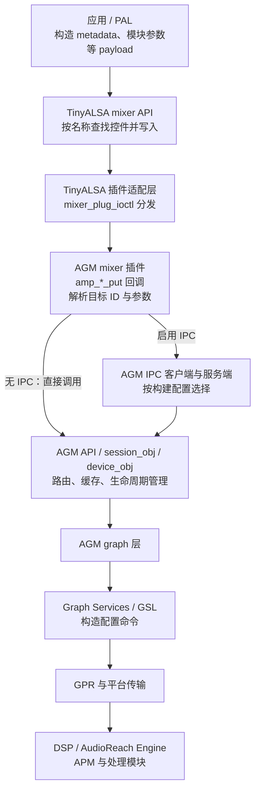
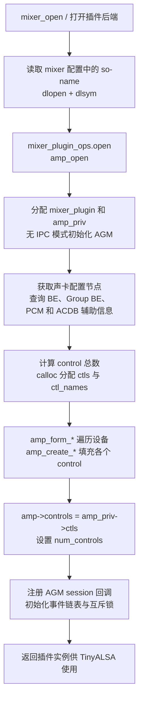
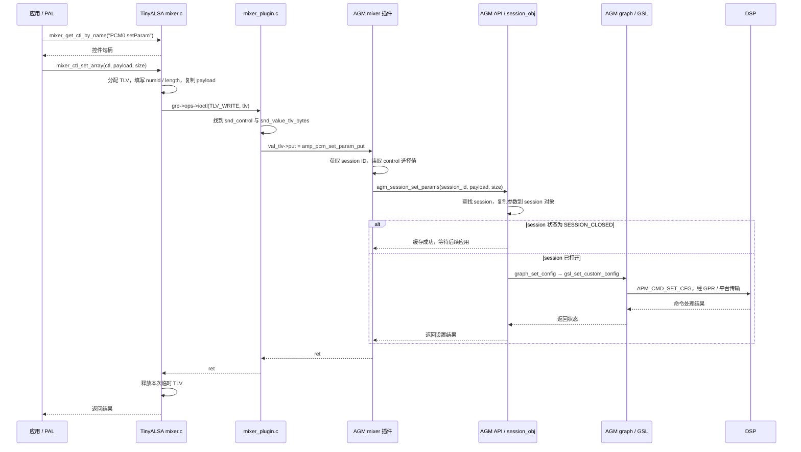
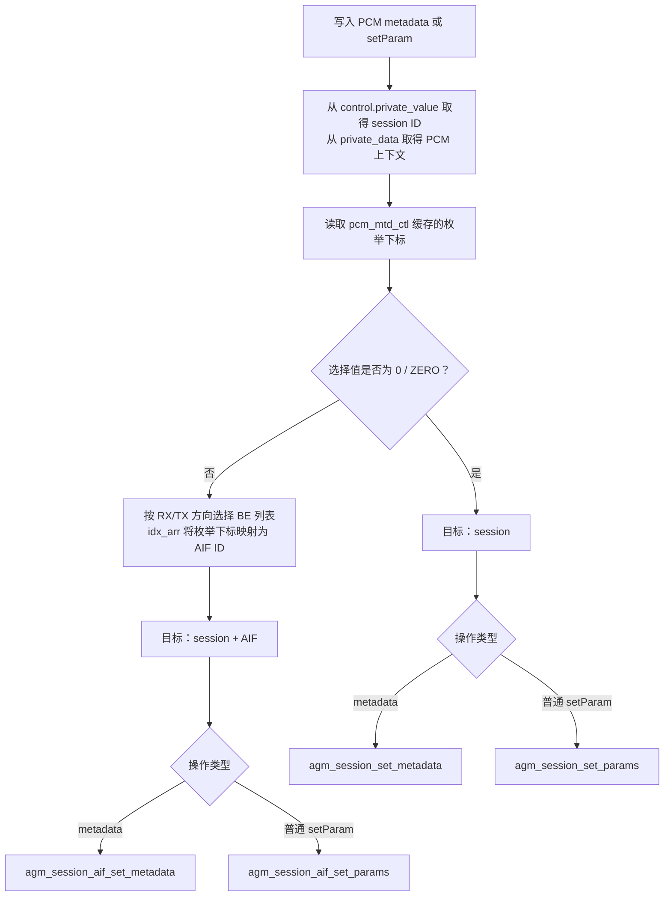
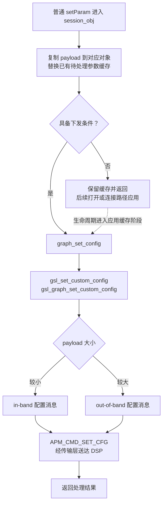
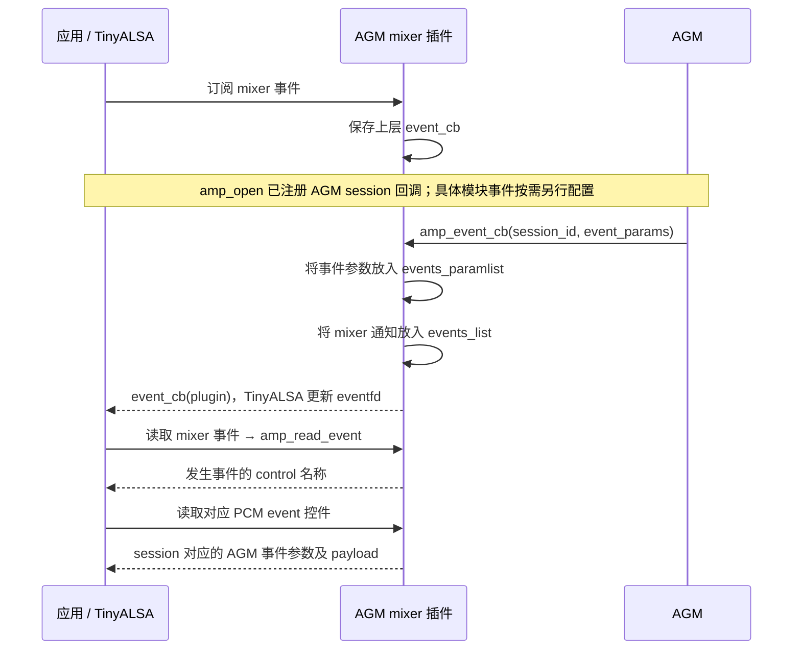

本文基于当前工作区源码，说明应用/PAL 如何通过 TinyALSA mixer API 设置 AGM 参数，以及参数如何进入 session、device 和 DSP。图中的路径对应启用了 AGM mixer 插件的配置；IPC 方式和底层传输依赖平台构建。本文为静态源码分析，未进行硬件运行验证。

核心关系是：**控件名称选择操作，control 私有数据确定目标，写入值提供参数，AGM 根据对象状态决定保存还是立即下发。**

## 1. 整体架构



TinyALSA 同时有硬件和插件后端。这里跟踪的是 AGM 插件控件：`grp->ops->ioctl()` 调用用户空间的 `mixer_plug_ioctl()`。使用 `SNDRV_CTL_IOCTL_*` 命令编号，并不意味着这一跳必然执行内核 `ioctl()` 系统调用。后续到 DSP 的通信由更下层处理。

PCM 音频数据的读写由 PCM 数据通路处理；本篇关注 mixer 控制通路。

## 2. 初始化：amp_open() 如何建立控件映射

TinyALSA 打开插件后端时，根据声卡配置加载插件动态库，取得导出的 `mixer_plugin_ops`，调用其 `.open = amp_open`。



图描述成功路径及职责；精确语句顺序和错误清理以 `amp_open()` 源码为准。

每个 `struct snd_control` 包含以下关键字段：

| 字段 | 作用 |
| --- | --- |
| `name` | 对外名称，例如 `PCM0 connect`、`PCM0 setParam` |
| `type` / `access` | INTEGER、ENUMERATED、BYTES，以及普通或 TLV 访问方式 |
| `get` / `put` | 普通控件读写回调 |
| `value` | 值类型描述；TLV 控件的读写回调保存在这里指向的 `snd_value_tlv_bytes` 中 |
| `private_value` | session ID、AIF ID 或内部数组下标，具体含义由控件决定 |
| `private_data` | 指向设备列表等上下文，提供方向、ID 映射和缓存 |

`amp_form_be_ctls()`、`amp_form_group_be_ctls()`、`amp_form_pcm_ctls()`、`amp_form_acdb_ctls()` 依次填充同一个数组。`amp_create_*()` 取得数组槽位，构造名称，再用 `INIT_SND_CONTROL_*` 宏绑定回调和私有数据。

BE 列表通过 AGM AIF 查询接口获得；PCM/Compress 节点来自声卡配置。不能把所有设备信息都理解成直接从 `card_node` 解析。

## 3. TinyALSA 如何包装和转发参数

上层先调用 `mixer_get_ctl_by_name()` 获取目标控件，再写入值。TinyALSA 主要检查类型、数量并包装数据；模块参数的二进制格式由调用者按接口约定构造。

| 参数类型 | 写入 API | 数据包装 | 插件分发 |
| --- | --- | --- | --- |
| BE 名称等枚举选项 | `mixer_ctl_set_enum_by_string()` | 字符串查找为枚举下标，放入 `snd_ctl_elem_value` | `ELEM_WRITE` → `ctl->put()` |
| 单个整数 | `mixer_ctl_set_value()` | 更新 `snd_ctl_elem_value` 中指定元素 | `ELEM_WRITE` → `ctl->put()` |
| 整数数组或普通字节数组 | `mixer_ctl_set_array()` | 按控件类型复制到 `snd_ctl_elem_value` | `ELEM_WRITE` → `ctl->put()` |
| metadata、setParam 等 TLV 字节数据 | `mixer_ctl_set_array()` | 分配 `snd_ctl_tlv`，填写 `numid`、`length` 并复制 payload | `TLV_WRITE` → `val_tlv->put()` |

对 TLV 控件，调用者传原始 payload 和字节长度，TinyALSA 自动添加外层 `snd_ctl_tlv`。`tlv->tlv` 指向业务 payload；它不代表调用者还要手动添加一份相同的外层头。

`set_array()` 的 `count` 对 INTEGER 是元素个数，对 BYTES 是字节数。整数数组还要匹配当前 TinyALSA 实现使用的整数元素宽度；不能把所有数组都当字节数组传。

`mixer_ctl_set_value()` 在当前实现中会先读出控件值再修改指定元素；枚举字符串写入则直接形成写请求。

## 4. 时序：一次 session setParam 的完整下发

以下示例假设 `<PCM> control` 已选择 `ZERO`，因此参数目标为 session。省略参数校验失败分支；AGM API 一栏表示服务端实际实现，IPC 代理按构建配置插入。



普通 `setParam` payload 通常携带模块实例 ID、参数 ID、参数长度及参数体，具体布局按对应模块协议构造。插件主要提取 payload 指针和长度，再交给 AGM；TinyALSA 不会替调用者计算模块实例 ID 或组装模块参数。

## 5. 参数路由：同一个 PCM 控件怎样选择不同目标

`<PCM> control` 是插件中的目标选择器。`amp_pcm_mtd_control_put()` 将枚举下标保存到 `pcm_mtd_ctl[]`；此时不会直接调用 AGM 设置参数。随后写入 metadata 或 setParam 时，再读取这个选择值。

这个选择器后缀在当前源码中是 **`control`**，例如 `PCM0 control`；结构体注释中的 metadata control 是它的用途描述。



“选择 BE”和“把 PCM 连接到 BE”是不同的操作：`<PCM> control` 选择参数作用范围；`<PCM> connect` 调用 `agm_session_aif_connect()` 配置连接关系。

其他控件映射如下：

| Control | AGM mixer 回调 | AGM API |
| --- | --- | --- |
| `<BE> rate ch fmt` | `amp_be_media_fmt_put` | `agm_aif_set_media_config` |
| `<BE> metadata` | `amp_be_metadata_put` | `agm_aif_set_metadata` |
| `<BE> setParam` | `amp_be_set_param_put` | `agm_aif_set_params` |
| `<Group BE> grp config` | `amp_group_be_media_fmt_put` | `agm_aif_group_set_media_config` |
| `<PCM> connect` / `disconnect` | `amp_pcm_aif_connect_put` | `agm_session_aif_connect`，传入连接或断开状态 |
| `<PCM> metadata` | `amp_pcm_metadata_put` | 按上图选择 session 或 session+AIF API |
| `<PCM> setParam` | `amp_pcm_set_param_put` | 按上图选择 session 或 session+AIF API |
| `<PCM> setParamTag` | `amp_pcm_set_param_put` | `agm_set_params_with_tag` |
| `<PCM> setParamTagACDB` | `amp_pcm_set_param_put` | `agm_set_params_with_tag_to_acdb` |
| `setACDBTunnel` | `amp_pcm_set_acdb_tunnel_put` | `agm_set_params_to_acdb_tunnel` |

`setParamTag` 和 `setParamTagACDB` 有独立分支，不能套用普通 `setParam` 的全部后续调用链。`setParamTag` 使用 tag 配置；`setParamTagACDB` 进入 ACDB 相关接口。选择 `ZERO` 时，插件在这些 tag 分支中使用 `be_idx = -1` 表示未选择具体 AIF。

## 6. 参数何时真正生效

AGM 接口返回成功，可能表示配置已保存，也可能表示已经完成本次下发，取决于接口和对象状态。

| 参数 | 当前源码的处理方式 |
| --- | --- |
| BE media config | `device_set_media_config()` 更新 `device_obj->media_config`，供后续设备及图配置使用 |
| session / BE metadata | 复制到相应对象，供后续图选择、构建及配置使用 |
| 普通 session setParam | `SESSION_CLOSED` 时缓存；否则调用 `graph_set_config()` |
| 普通 session+AIF setParam | session 非 CLOSED 且 AIF 状态至少为 `AIF_OPENED` 时下发，否则缓存 |



缓存路径不是无限队列：当前 session/session+AIF 实现会替换已有参数缓存。下发尝试后相应缓存会被清理，失败不意味着参数自动保留等待重试。

`gsl_graph_set_custom_config()` 还会选择消息目标：满足单个参数块条件时可直接发往模块实例端口，否则发往 APM 端口。两种情况都使用 `APM_CMD_SET_CFG`；图中 DSP 框包含 APM 和模块处理。

## 7. 示例：选择目标后发送参数

以下为调用顺序示意，假设 `mixer` 已成功打开，配置中确实存在 `PCM0`，且 `payload` 已按模块协议构造。实际代码应检查每一步的句柄和返回值，失败后停止后续操作。

```c
/* 设置作用于整个 session 的参数。 */
selector = mixer_get_ctl_by_name(mixer, "PCM0 control");
ret = mixer_ctl_set_enum_by_string(selector, "ZERO");

param_ctl = mixer_get_ctl_by_name(mixer, "PCM0 setParam");
ret = mixer_ctl_set_array(param_ctl, payload, payload_size);

/* 改为设置这个 session 与指定 BE 对应的参数。 */
ret = mixer_ctl_set_enum_by_string(selector, be_name);
ret = mixer_ctl_set_array(param_ctl, payload, payload_size);
```

两次写入的是同一个 `setParam` control；改变 `control` 的枚举值，就改变了插件选择的 AGM API。选择值会保留，后续操作需要明确设置所需目标。多个线程共用同一 selector 时，上层还需要协调“选择目标 + 写参数”的操作顺序。

连接操作则使用独立控件：

```c
connect_ctl = mixer_get_ctl_by_name(mixer, "PCM0 connect");
ret = mixer_ctl_set_enum_by_string(connect_ctl, be_name);
/* 枚举下标 → AIF ID → agm_session_aif_connect(session_id, aif_id, true) */
```

这些片段仅展示参数路由，不是完整的音频流启动程序；实际流还涉及 metadata、media config、PCM/session 打开及启动等步骤。

## 8. 异步事件通知是另一条通路

控件写入走前述 `put` 调用链并返回结果。AGM 异步事件通过 `amp_event_cb()` 上报，需要区分三个动作：初始化时注册 AGM session 回调、上层订阅 mixer 通知，以及按需通过 `<PCM> event` 控件注册具体模块事件。



`events_list` 保存“哪个控件发生了事件”的通知，`events_paramlist` 保存 session ID、module ID、event ID 和具体 payload。普通参数设置不会必然产生一条这种异步事件。

## 9. 源码阅读索引

以下使用固定源码版本的链接和函数名定位，避免新增注释后固定行号失效。

| 层次 | 文件 | 建议搜索的函数或符号 |
| --- | --- | --- |
| 上层参数调用示例 | [SessionAlsaUtils.cpp](https://github.com/AudioReach/audioreach-pal/blob/c7dc7c255106f3dd89db6c6727367fcddea75492/session/SessionAR/src/SessionAlsaUtils.cpp) | `mixer_get_ctl_by_name`、`mixer_ctl_set_array` |
| TinyALSA 公共入口 | [mixer.c](https://github.com/tinyalsa/tinyalsa/blob/f78ed25aced2dfea743867b8205a787bfb091340/src/mixer.c) | `mixer_open`、`mixer_ctl_set_enum_by_string`、`mixer_ctl_set_value`、`mixer_ctl_set_array` |
| TinyALSA 插件适配 | [mixer_plugin.c](https://github.com/tinyalsa/tinyalsa/blob/f78ed25aced2dfea743867b8205a787bfb091340/src/mixer_plugin.c) | `mixer_plugin_open`、`mixer_plug_ioctl`、`mixer_plug_elem_write`、`mixer_plug_tlv_write` |
| 控件结构与初始化宏 | [plugin.h](https://github.com/tinyalsa/tinyalsa/blob/f78ed25aced2dfea743867b8205a787bfb091340/include/tinyalsa/plugin.h) | `snd_control`、`snd_value_tlv_bytes`、`INIT_SND_CONTROL_*` |
| AGM mixer 插件 | [agm_mixer_plugin.c](https://github.com/AudioReach/audioreach-graphmgr/blob/39f4d320aaa4d72b814e7c52632bb37fa7ce02ce/plugins/tinyalsa/src/agm_mixer_plugin.c) | `amp_open`、`amp_create_connect_ctl`、`amp_pcm_mtd_control_put`、`amp_pcm_metadata_put`、`amp_pcm_set_param_put`、`amp_event_cb` |
| 插件链接方式 | [Makefile.am](https://github.com/AudioReach/audioreach-graphmgr/blob/39f4d320aaa4d72b814e7c52632bb37fa7ce02ce/plugins/tinyalsa/Makefile.am) | `AGM_NO_IPC`、`AGM_IPC_DBUS`、`AGM_IPC_SWBINDER` |
| AGM 服务入口 | [agm.c](https://github.com/AudioReach/audioreach-graphmgr/blob/39f4d320aaa4d72b814e7c52632bb37fa7ce02ce/service/src/agm.c) | `agm_session_set_params`、`agm_session_aif_set_params`、`agm_aif_set_media_config` |
| 会话配置与缓存 | [session_obj.c](https://github.com/AudioReach/audioreach-graphmgr/blob/39f4d320aaa4d72b814e7c52632bb37fa7ce02ce/service/src/session_obj.c) | `session_obj_set_sess_params`、`session_obj_set_sess_aif_params`、`session_obj_set_sess_metadata`、`graph_set_config` 调用点 |
| 设备配置 | [device.c](https://github.com/AudioReach/audioreach-graphmgr/blob/39f4d320aaa4d72b814e7c52632bb37fa7ce02ce/service/src/device.c) | `device_set_media_config`、`device_set_metadata` |
| AGM graph 层 | [graph.c](https://github.com/AudioReach/audioreach-graphmgr/blob/39f4d320aaa4d72b814e7c52632bb37fa7ce02ce/service/src/graph.c) | `graph_set_config`、`graph_set_config_with_tag` |
| GSL API | [gsl_main.c](https://github.com/AudioReach/audioreach-graphservices/blob/ad9168e474c8c101ba20d1fdeb6e656b66f2feb0/gsl/src/gsl_main.c) | `gsl_set_custom_config` |
| GSL 消息下发 | [gsl_graph.c](https://github.com/AudioReach/audioreach-graphservices/blob/ad9168e474c8c101ba20d1fdeb6e656b66f2feb0/gsl/src/gsl_graph.c) | `gsl_graph_set_custom_config`、`gsl_apm_config_inband`、`gsl_apm_config_oob` |
| mixer 使用示例 | [agmmixer.c](https://github.com/AudioReach/audioreach-graphmgr/blob/39f4d320aaa4d72b814e7c52632bb37fa7ce02ce/plugins/tinyalsa/test/agmmixer.c) | `mixer_ctl_set_array`、`rate ch fmt` |

可继续对照 音量下发详解（本地补充文档，暂未发布） 和 pal_stream_set_volume 调用链（本地补充文档，暂未发布），将这里的通用 `setParam` 通路代入具体音量参数。

若要沿工具的实际执行顺序阅读，可看 [agmplay 播放控制链](/myblog/post/agmplay-playback-control-chain/)：重点展开 XML 节点如何形成控件槽、各类索引如何转换，以及配置填入 AGM 对象后怎样触发建图。
