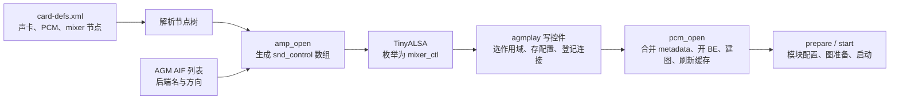
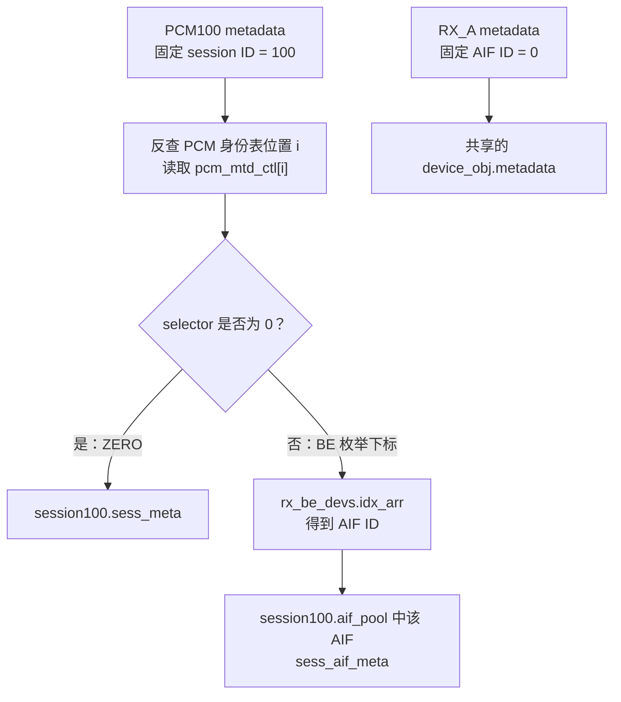
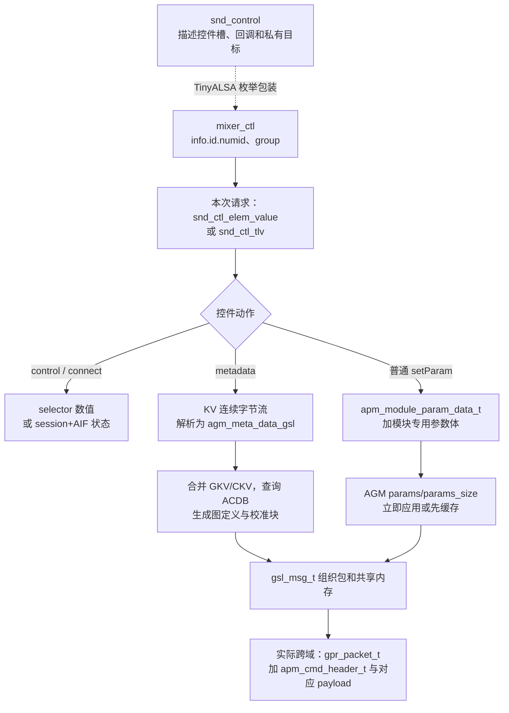
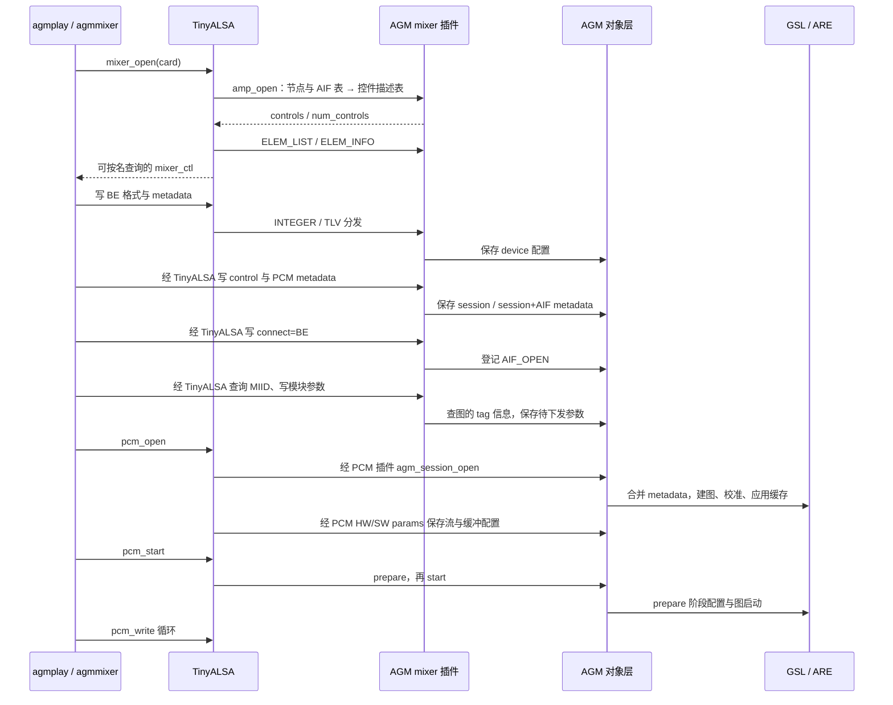

本文承接[AudioReach 主架构文档](/myblog/post/audioreach-architecture/)和[AGM 参数通过 TinyALSA 下发的架构与调用链](/myblog/post/agm-tinyalsa-parameter-flow/)，只追普通 PCM、默认 session 模式下的 `agmplay` 播放控制链。源码中的配置文件名是 **`card-defs.xml`**；下文用 XML 指代它。

主线是：**XML 提供节点，插件按节点与 AIF 列表构造控件描述表；agmplay 写控件，把配置存进对应 AGM 对象；首次 connect 登记待连接的 AIF；pcm_open 再消费这些配置，打开后端并建立 DSP 图。**

这里的“槽”有三种含义，分别对应不同内存：

| 所说的“槽” | 实际对象 | 填入什么 | 何时填入 |
| --- | --- | --- | --- |
| 控件描述槽 | `amp_priv->ctls[k]`、`ctl_names[k]` | 名称、类型、回调、目标标识与上下文 | `mixer_open()` 内的 `amp_open()` |
| 作用域选择槽 | `rx_pcm_devs.pcm_mtd_ctl[i]` | 后续 metadata/setParam 使用哪个 BE 枚举项 | 写 `PCM100 control` 时 |
| AGM 配置存储位置 | `sess_meta`、`sess_aif_meta`、`device.metadata`、`params` 等字段 | 图键、校准键、格式、模块参数与连接状态 | 控件回调调用 AGM API 时 |

**运行期“填参数”不会重新填写 `ctls[k]` 的回调或目标身份。** 控件描述符引导调用进入对应对象；数据保存在插件选择缓存或 AGM 对象中。



分析日期：2026-10-24。以下按当前工作区的可执行语句梳理，结构体与实例随相应阶段展开，源码基线与导航见 §9；未做板端运行验证。

下文标注“关键字段”的结构体摘录省略了无关成员，用于对照字段和实例；完整布局以所链头文件为准。

## 1. 播放前，各类输入分别提供什么

`agmplay` 直接使用 TinyALSA 和 `agmmixer.c` 辅助函数，这条路径不经过 PAL 的 `ResourceManager` 或 `usecaseKvManager.xml`。

| 输入 | 提供的信息 | 不应混淆的对象 |
| --- | --- | --- |
| `card-defs.xml` | card/device ID、PCM 名称、插件库、playback/capture/session_mode 等属性 | 不直接列举 `PCM100 metadata` 等每个控件，也不包含 DSP 图拓扑 |
| AGM 返回的 AIF 列表 | BE 名称、RX/TX 方向；列表位置用于 AIF ID 映射 | AIF ID 不是虚拟 FE device ID，也不是后端真实内核 PCM 编号 |
| `backend_conf.xml`、WAV、命令行参数 | BE 目标格式、FE 输入格式、stream/device/instance/device-PP 的键值 | BE 格式与 WAV 格式可以不同；逻辑 `INSTANCE` 与 FE device ID 分开 |
| ACDB | GKV 对应的图定义、tag 到模块的映射、校准数据 | XML 中有节点，不表示 ACDB 中一定有与键匹配的图 |

下面的例子统一使用 `card=100`、`device=100`、播放节点名 `PCM100`。这些取自样例命名，不代表所有平台编号；BE 名 `RX_A`、`RX_B`、`TX_C` 是为了演算映射而设置的假设名称。

## 2. 第一段：XML 先变成节点，还没有控件数组

### 2.1 XML 中哪些字段影响后续播放

精简后的单播放节点示例：

```xml
<defs>
  <card>
    <id>100</id>
    <name>virtualsndcard</name>
    <pcm-device>
      <id>100</id>
      <name>PCM100</name>
      <pcm_plugin>
        <so-name>libagm_pcm_plugin.so</so-name>
      </pcm_plugin>
      <props>
        <playback>1</playback>
        <capture>0</capture>
        <session_mode>0</session_mode>
      </props>
    </pcm-device>
    <mixer>
      <id>1</id>
      <name>agm_mixer</name>
      <mixer_plugin>
        <so-name>libagm_mixer_plugin.so</so-name>
      </mixer_plugin>
    </mixer>
  </card>
</defs>
```

各字段的使用点：

| XML 字段 | 后续用途 |
| --- | --- |
| card 的 `id` / `name` | 解析器选择并匹配声卡定义；有真实声卡时还会读取 `/proc/asound/cardN/id` 按名称匹配 |
| PCM 的 `id=100` | `pcm_open(card, device)` 查找节点；AGM PCM 插件把 device 用作 `session_id` |
| PCM 的 `name=PCM100` | mixer 插件生成控件名称的前缀 |
| PCM 的 `pcm_plugin/so-name` | 以后 `pcm_open()` 加载的 PCM 插件库 |
| `playback=1` | 将这个节点放进 `rx_pcm_devs`，为它生成播放侧控件 |
| `session_mode=0` | PCM 插件打开时选择默认会话模式；其他模式可能走无设备分支 |
| mixer 的 `id=1` | 当前 `snd_card_def_get_mixer()` 固定按节点 ID 1 查找；不是控件数组下标 |
| mixer 的 `mixer_plugin/so-name` | `mixer_open()` 加载的 AGM mixer 插件库 |

工具按 `PCM` 加 device 数字拼控件名，插件按 XML 的 `name` 拼控件名。因此本例的 `id=100` 和 `name=PCM100` 需要配合；只改名字可能使工具查找失败。

### 2.2 解析器产出的内存结构

入口在 [snd-card-parser.c](https://github.com/AudioReach/audioreach-graphmgr/blob/39f4d320aaa4d72b814e7c52632bb37fa7ce02ce/snd_parser/src/snd-card-parser.c) 的 `snd_card_def_get_card()`。先对照它会填写的三种结构体：

```c
struct snd_prop_val_pair {
    char *prop;                      /* 例如 "playback" */
    char *val;                       /* 例如 "1"，解析后仍是字符串 */
    struct listnode list_node;
};

struct snd_dev_def {
    enum snd_node_type node_type;    /* PCM / MIXER / COMPR */
    struct snd_dev_def_card *card;
    unsigned int device;            /* XML 的节点 id */
    int type;                       /* HW 或 PLUGIN */
    char *name;
    char *so_name;
    struct listnode list_node;      /* 挂入所属 card 的设备列表 */
    struct listnode prop_val_list;  /* 属性节点 snd_prop_val_pair 的链表头 */
};

struct snd_dev_def_card {
    unsigned int card;
    int type;
    char *name;
    int refcnt;
    struct listnode list_node;
    struct listnode pcm_devs_list;
    struct listnode mixer_devs_list;
    struct listnode compr_devs_list;
};
```

`node_type` 区分 PCM、mixer、compress 三种节点；`type` 区分节点走硬件还是插件。`listnode` 用来把对象挂入链表，设备对象和属性对象分别有自己的挂链成员。

缓存未命中时，Expat 的 `snd_start_tag()`、`snd_end_tag()`、`snd_data_handler()` 将本例 XML 填成下面的对象关系：

```text
snd_dev_def_card
  card / name / refcnt
  pcm_devs_list
    snd_dev_def { device=100, name="PCM100", type=PLUGIN,
                  so_name="libagm_pcm_plugin.so", prop_val_list=... }
  mixer_devs_list
    snd_dev_def { device=1, name="agm_mixer", type=PLUGIN,
                  so_name="libagm_mixer_plugin.so" }
  compr_devs_list
    ...
```

遇到 `pcm-device`、`mixer` 等节点时分配 `snd_dev_def` 并挂到相应列表；`id/name/so-name` 进入固定字段，`props` 下的属性进入 `prop_val_list`。遇到 plugin 标签时把节点类型置为 `SND_NODE_DEV_TYPE_PLUGIN`。

此时建立的是**节点定义**，还没有 `ctls[]`，也没有任何采样率或 GKV 被写入 AGM。

声卡定义按进程缓存并计引用。后续 mixer 插件、PCM 插件再次取同一声卡定义时，可能直接复用缓存；“调用了 get_card”不等于“又读了一遍 XML”。当前解析器还区分 `CARD_DEF_FILE` 和 `CARD_DEF_FILE_NATIVE`：虚拟卡 100 使用前者，其他情况使用后者；具体文件路径由构建配置定义。

### 2.3 从 mixer 节点加载到 amp_open

当前 TinyALSA 会先尝试硬件 mixer group，再尝试插件 group；**即使硬件 group 成功，也会尝试插件 group**。两者都失败，`mixer_open()` 才失败。

```text
agmplay: mixer_open(100)
  → TinyALSA mixer_grp_open(..., false)
  → mixer_plugin_open()
    → snd_utils_open_mixer(100)
      → dlopen("libsndcardparser.so")
      → dlsym("snd_card_ops")
      → open_card → snd_card_def_get_card(100)
      → get_mixer → 查 mixer 节点 id=1
    → 读取 mixer 节点的 so-name
    → dlopen("libagm_mixer_plugin.so")
    → dlsym("mixer_plugin_ops")
    → mixer_plugin_ops.open → amp_open()
```

这里先后加载的是**解析库**和**mixer 实现库**，`dlsym` 取得的是操作表。当前源码不通过推导 `agm_mixer_plugin_open` 函数名加载 mixer；之后 PCM 路径同样取得 `pcm_plugin_ops`，其 `.open` 是 `agm_pcm_open()`。

## 3. 第二段：amp_open 如何把节点展开成控件槽

### 3.1 先看身份表的结构，再收集 BE 与 PCM

这一步先建立名称到 ID 的映射。AGM 返回的单项后端信息是 `aif_info`；插件把它按 RX/TX 方向整理成 `amp_dev_info`。PCM/Compress 节点也整理成同一类型，只是 `idx_arr[]` 中放的是 session ID。相关定义见 [agm_api.h](https://github.com/AudioReach/audioreach-graphmgr/blob/39f4d320aaa4d72b814e7c52632bb37fa7ce02ce/service/inc/public/agm/agm_api.h)、[agm_mixer_plugin.c](https://github.com/AudioReach/audioreach-graphmgr/blob/39f4d320aaa4d72b814e7c52632bb37fa7ce02ce/plugins/tinyalsa/src/agm_mixer_plugin.c) 和 [plugin.h](https://github.com/tinyalsa/tinyalsa/blob/f78ed25aced2dfea743867b8205a787bfb091340/include/tinyalsa/plugin.h)。

```c
struct aif_info {
    char aif_name[AIF_NAME_MAX_LEN];
    enum direction dir;
};

struct snd_value_enum {
    unsigned int items;
    char **texts;
};

/* amp_dev_info 的关键字段 */
struct amp_dev_info {
    char **names;
    int *idx_arr;
    int count;
    struct snd_value_enum dev_enum;
    enum direction dir;
    int *pcm_mtd_ctl;
    struct amp_get_param_info *get_param_info;
};
```

其中 `names[i]` 和 `idx_arr[i]` 是成对数组，`dev_enum` 把名称数组提供给 ENUM 控件；`pcm_mtd_ctl[i]` 保存该 PCM 当前选择的 BE 枚举下标。后面示例中的 `rx_be_devs`、`rx_pcm_devs` 都是这个结构体的实例。

`amp_open()` 取得 `card_node` 后，依次收集 BE、Group BE、PCM/Compress 和 ACDB 辅助信息。核心是两个来源：

| 身份表 | 入口 | 来源与变换 |
| --- | --- | --- |
| `rx_be_devs` / `tx_be_devs` | `amp_get_be_info()` | 查询 `agm_get_aif_info_list()`，按方向筛选；`names[]` 存 BE 名，`idx_arr[]` 存原始 AIF 列表位置 |
| `rx_pcm_devs` / `tx_pcm_devs` | `amp_get_pcm_info()` | 从 XML 收集 PCM 和 Compress 节点，再按 playback/capture 筛选；`names[]` 存节点名，`idx_arr[]` 存 XML device ID |

两种表都在位置 0 加 `ZERO` 哨兵，真实对象从位置 1 开始。这里的 **`ZERO` 是大小写敏感的枚举文本**。

本例假设 AGM 的原始 AIF 列表为：

```text
原始 AIF 列表：  [0] RX_A/RX   [1] TX_C/TX   [2] RX_B/RX

rx_be_devs.names    = ["ZERO", "RX_A", "RX_B"]
rx_be_devs.idx_arr  = [     0,      0,      2 ]
tx_be_devs.names    = ["ZERO", "TX_C"]
tx_be_devs.idx_arr  = [     0,      1 ]

精简 XML 只有一个播放 PCM：
rx_pcm_devs.names   = ["ZERO", "PCM100"]
rx_pcm_devs.idx_arr = [     0,      100 ]
```

因此，选 `RX_A` 写入的是 **BE 枚举下标 1**，通过 `idx_arr[1]` 才映射到 **AIF ID 0**。AIF 0 可以有效；特殊含义属于枚举位置 0 的 `ZERO`，不能把所有数值 0 都视为无效 AIF。

普通 ALSA AIF 来自 AGM 的硬件后端枚举；AGM 也支持从 XML 解析 non-ALSA backend。mixer 插件使用的是 AGM 已整理好的 AIF 列表，不能把它等同于当前虚拟声卡的 PCM 节点列表。

### 3.2 先看数组容器，再算容量和分配空间

数组的拥有者是 `amp_priv`。先对照它的字段，再看后面的容量计算与 `calloc()`：

```c
/* amp_priv 的关键字段 */
struct amp_priv {
    unsigned int card;
    void *card_node;
    struct aif_info *aif_list;
    struct amp_dev_info rx_be_devs, tx_be_devs;
    struct amp_dev_info rx_pcm_devs, tx_pcm_devs;
    /* ... */
    struct snd_control *ctls;
    char (*ctl_names)[AIF_NAME_MAX_LEN + 16];
    int ctl_count;
    /* ... */
};
```

`ctls` 指向控件描述符数组；`ctl_names` 指向固定宽度的二维名称数组。前面的身份表也是该对象的成员，因此给控件设置 `private_data` 时，可以直接引用 `&amp_priv->rx_pcm_devs` 等上下文。单个 `snd_control` 的字段在 §3.3 随填槽代码展开。

当前后缀表决定每个对象生成哪些控件：

| 对象 | 控件数量 | 后缀 |
| --- | --- | --- |
| 每个 BE | 3 | `rate ch fmt`、`metadata`、`setParam` |
| 每个 Group BE | 1 | `grp config` |
| 每个 PCM/Compress 的通用部分 | 13 | `connect`、`disconnect`、`control`、`metadata`、`setParam`、`setParamTag`、`setParamTagACDB`、`getTaggedInfo`、`event`、`setCalibration`、`getParam`、`getBufInfo`、`sendMsg` |
| 每个播放节点额外部分 | 3 | `sidetone`、`datapathParams`、`flush` |
| 每个录音节点额外部分 | 3 | `loopback`、`echoReference`、`bufTimestamp` |
| 固定 ACDB 控件 | 2 | `setACDBTunnel`、`getACDBTunnel` |

令 `B` 为真实 BE 数，`G` 为 Group BE 数，`P_RX/P_TX` 为两方向的真实 PCM/Compress 节点数，均不含 `ZERO`：

```text
total_ctl_cnt = 3*B + G + 16*P_RX + 16*P_TX + 2
```

一个双向节点会分别参与两个方向的计数。控件数量是这个快照的实现规则，不应当作固定协议常数。

`amp_open()` 将总数用于分配上面两个指针指向的空间：

```c
amp_priv->ctls = calloc(total_ctl_cnt, sizeof(*amp_priv->ctls));
amp_priv->ctl_names = calloc(total_ctl_cnt, sizeof(*amp_priv->ctl_names));
```

随后按 `[BE][Group BE][PCM][ACDB]` 分区调用 `amp_form_*_ctls()`。PCM 区内部顺序为：RX 通用控件 → RX 附加控件 → TX 通用控件 → TX 附加控件。

本例 `B=3`、`G=0`、`P_RX=1`、`P_TX=0`，总计 **27 个控件槽**：

```text
ctls[ 0.. 2]  RX_A 的 3 个 BE 控件
ctls[ 3.. 5]  RX_B 的 3 个 BE 控件
ctls[ 6.. 8]  TX_C 的 3 个 BE 控件
ctls[ 9..21]  PCM100 的 13 个通用控件
ctls[22..24]  PCM100 的 3 个播放附加控件
ctls[25..26]  2 个 ACDB 控件
```

实际样例 XML 还包含其他 PCM/Compress 节点，会生成更多控件；27 只适用于本文精简配置。

### 3.3 对照 snd_control，逐项填写控件槽

真正占据 `ctls[k]` 的类型是 [plugin.h](https://github.com/tinyalsa/tinyalsa/blob/f78ed25aced2dfea743867b8205a787bfb091340/include/tinyalsa/plugin.h) 中的 `struct snd_control`：

```c
struct snd_control {
    snd_ctl_elem_iface_t iface;
    unsigned int access;
    const char *name;
    snd_ctl_elem_type_t type;
    void *value;
    int (*get)(struct mixer_plugin *plugin,
               struct snd_control *control,
               struct snd_ctl_elem_value *ev);
    int (*put)(struct mixer_plugin *plugin,
               struct snd_control *control,
               struct snd_ctl_elem_value *ev);
    uint32_t private_value;
    void *private_data;
};
```

| 字段 | 控件创建时填入什么 | 写入时怎样使用 |
| --- | --- | --- |
| `iface` | 通常是 `SNDRV_CTL_ELEM_IFACE_MIXER` | 向 TinyALSA 报告控件接口类别 |
| `access` | 普通 READWRITE，或 TLV_READWRITE | 区分普通值请求与 TLV 请求 |
| `name` | 指向 `ctl_names[k]` 中的完整名称 | 枚举时复制到 `snd_ctl_elem_info.id.name`，上层按名查找 |
| `type` | INTEGER、ENUMERATED、BYTES | 决定解释哪种类型描述及写入包装 |
| `value` | 指向 `snd_value_int`、`snd_value_enum` 或 `snd_value_tlv_bytes` | 查询元素数、枚举文本，或取 TLV get/put 回调 |
| `get/put` | 普通 INTEGER/ENUM 等控件的回调 | `ELEM_READ/WRITE` 路径调用 |
| `private_value` | AIF ID、session ID，或 PCM 身份表位置 | 回调按该控件约定解释，不是统一的“当前控件值” |
| `private_data` | 常指向 RX/TX 的 `amp_dev_info` | 回调找到方向、ID 映射及 selector 缓存 |

`value` 的类型随控件类型变化。ENUM 使用 §3.1 的 `snd_value_enum`；INTEGER 和 TLV 使用下面两个结构。TLV 回调在 `snd_value_tlv_bytes` 内，普通 ENUM/INTEGER 回调在上面的 `snd_control.get/put` 内。

```c
struct snd_value_int {
    unsigned int count;
    int min, max, step;
};

struct snd_value_tlv_bytes {
    unsigned int size;
    int (*get)(struct mixer_plugin *, struct snd_control *,
               struct snd_ctl_tlv *);
    int (*put)(struct mixer_plugin *, struct snd_control *,
               struct snd_ctl_tlv *);
};
```

`amp_create_*()` 取得 `ctls[k]` 和 `ctl_names[k]`，拼接名字，再通过 `INIT_SND_CONTROL_*` 绑定类型、回调和私有参数。

先看本例 `PCM100` 的展开过程。下面按 `amp_form_common_pcm_ctls()` 的实际调用顺序摘录，用局部 `next_ctl` 表示递增的槽号，其余控件暂时省略：

```c
struct amp_dev_info *pcm_adi = &amp_priv->rx_pcm_devs;
struct amp_dev_info *be_adi = &amp_priv->rx_be_devs;
int i = 1;                              /* PCM100 在身份表中的位置 */
char *name = pcm_adi->names[i];          /* "PCM100" */
int session_id = pcm_adi->idx_arr[i];    /* 100 */
int next_ctl = 9;                       /* 本例 PCM 通用控件区的起点 */

amp_create_connect_ctl(amp_priv, name, next_ctl++,
                      &be_adi->dev_enum, session_id, pcm_adi); /* 槽 9 */
amp_create_disconnect_ctl(amp_priv, name, next_ctl++,
                         &be_adi->dev_enum, session_id, pcm_adi); /* 槽 10 */
amp_create_mtd_control_ctl(amp_priv, name, next_ctl++,
                          &be_adi->dev_enum, i, pcm_adi);        /* 槽 11 */
amp_create_pcm_metadata_ctl(amp_priv, name, next_ctl++,
                           session_id, pcm_adi);                /* 槽 12 */
```

前两个调用把 `session_id=100` 放进描述符，第三个调用放的是身份表位置 `i=1`。每个 create 函数都按收到的 `ctl_idx` 取 `ctls[ctl_idx]` 和对应名称行，再执行初始化宏。例如完成后，槽 11 与槽 12 的字段状态等价于：

```c
/* 字段状态示意：名称字符串已由 create 函数写入 ctl_names 对应行。 */
amp_priv->ctls[11] = (struct snd_control) {
    .iface = SNDRV_CTL_ELEM_IFACE_MIXER,
    .access = SNDRV_CTL_ELEM_ACCESS_READWRITE,
    .name = amp_priv->ctl_names[11],      /* "PCM100 control" */
    .type = SNDRV_CTL_ELEM_TYPE_ENUMERATED,
    .value = &amp_priv->rx_be_devs.dev_enum,
    .get = amp_pcm_mtd_control_get,
    .put = amp_pcm_mtd_control_put,
    .private_value = 1,
    .private_data = &amp_priv->rx_pcm_devs,
};

amp_priv->ctls[12] = (struct snd_control) {
    .iface = SNDRV_CTL_ELEM_IFACE_MIXER,
    .access = SNDRV_CTL_ELEM_ACCESS_TLV_READWRITE,
    .name = amp_priv->ctl_names[12],      /* "PCM100 metadata" */
    .type = SNDRV_CTL_ELEM_TYPE_BYTES,
    .value = &pcm_metadata_bytes,
    .get = NULL,                        /* TLV 回调不放在这两个字段 */
    .put = NULL,
    .private_value = 100,
    .private_data = &amp_priv->rx_pcm_devs,
};

/* pcm_metadata_bytes 中的 size/get/put 才描述 TLV 请求的处理方式。 */
/* 其内容由 SND_VALUE_TLV_BYTES(...) 初始化： */
/* size=1024，get=amp_pcm_metadata_get，put=amp_pcm_metadata_put。 */
```

现在可把其它槽也按同一组字段对应起来：

| `ctls[k]` | 名称 | 类型/操作 | `private_value` | `private_data` |
| --- | --- | --- | --- | --- |
| 0 | `RX_A rate ch fmt` | INTEGER，4 元素，`amp_be_media_fmt_put` | 0，即 AIF ID | `rx_be_devs` |
| 1 | `RX_A metadata` | TLV BYTES，`amp_be_metadata_put` | 0，即 AIF ID | `rx_be_devs` |
| 9 | `PCM100 connect` | ENUM，`amp_pcm_aif_connect_put` | 100，即 session ID | `rx_pcm_devs` |
| 10 | `PCM100 disconnect` | ENUM，同上 | 100，即 session ID | `rx_pcm_devs` |
| 11 | `PCM100 control` | ENUM，`amp_pcm_mtd_control_put` | 1，即 PCM 在 RX 身份表中的位置 | `rx_pcm_devs` |
| 12 | `PCM100 metadata` | TLV BYTES，`amp_pcm_metadata_put` | 100，即 session ID | `rx_pcm_devs` |
| 13 | `PCM100 setParam` | TLV BYTES，`amp_pcm_set_param_put` | 100，即 session ID | `rx_pcm_devs` |
| 16 | `PCM100 getTaggedInfo` | TLV BYTES，`amp_pcm_tag_info_get` | 100，即 session ID | `rx_pcm_devs` |

**同一个 `private_value` 字段的含义由具体控件决定。** `control` 需要快速定位选择缓存，所以保存身份表位置 `i=1`；metadata/setParam/connect 需要操作 AGM session，所以保存 `idx_arr[i]=100`。

`amp_form_common_pcm_ctls()` 同时以 `calloc()` 分配 `pcm_mtd_ctl[]`，因此各 PCM 的初始 selector 都是 0，即 ZERO。每个 PCM 只有一个“当前选择值”，不是为它的每个 BE 保存一份 selector；各设备腿的 metadata/参数由 AGM 的 `aif_pool` 分别持有。

描述符的 `value` 也是类型描述，不一定存运行期值：

```text
PCM100 control.value → rx_be_devs.dev_enum → items/texts
PCM100 metadata.value → pcm_metadata_bytes → size/get/put
RX_A rate ch fmt.value → media_fmt_int → count/min/max/step
```

TLV 控件的回调在 `snd_value_tlv_bytes` 中；普通 ENUM/INTEGER 回调在 `snd_control.get/put` 中。`pcm_setparam_bytes` 声明的最大长度也不表示每个控件预先分配了同样大小的参数缓冲。

更细的数组分配与宏展开可对照现有Control 数组说明（本地补充文档，暂未发布）。

### 3.4 将这张描述表交给 TinyALSA

`amp_open()` 最后通过 `mixer_plugin` 返回结果。其关键字段在 [plugin.h](https://github.com/tinyalsa/tinyalsa/blob/f78ed25aced2dfea743867b8205a787bfb091340/include/tinyalsa/plugin.h) 中定义：

```c
/* mixer_plugin 的关键字段 */
struct mixer_plugin {
    unsigned int card;
    void *priv;                    /* 指向 amp_priv */
    /* ... */
    struct snd_control *controls;  /* 与 amp_priv->ctls 指向同一数组 */
    unsigned int num_controls;
};
```

构造完成后：

```c
amp->priv = amp_priv;
amp->controls = amp_priv->ctls;
amp->num_controls = amp_priv->ctl_count;
```

这里的 `controls` 与 `amp_priv->ctls` 指向同一张数组，未再复制一份描述符。下一段 TinyALSA 才会根据它建立上层 `mixer_ctl` 包装对象。

## 4. 第三段：TinyALSA 把描述表包装成可查找的 mixer_ctl

### 4.1 先看上层控件句柄与 group 结构

TinyALSA 查询控件时使用 ALSA UAPI 的身份和描述结构。先看本段会用到的字段，定义可对照 [asound.h](https://github.com/gregkh/linux/blob/v6.10.3/include/uapi/sound/asound.h)：

```c
struct snd_ctl_elem_id {
    unsigned int numid;
    snd_ctl_elem_iface_t iface;
    unsigned int device;
    unsigned int subdevice;
    unsigned char name[SNDRV_CTL_ELEM_ID_NAME_MAXLEN];
    unsigned int index;
};

/* snd_ctl_elem_info 的关键字段 */
struct snd_ctl_elem_info {
    struct snd_ctl_elem_id id;
    snd_ctl_elem_type_t type;
    unsigned int access;
    unsigned int count;
    /* ...还有 integer/enum 等值约束及保留字段 */
};
```

`id` 回答是哪一个控件，`type/access/count` 回答值如何读写。`mixer_get_ctl_by_name()` 返回的是 [mixer.c](https://github.com/tinyalsa/tinyalsa/blob/f78ed25aced2dfea743867b8205a787bfb091340/src/mixer.c) 中保存这份描述的 `mixer_ctl *`：

```c
struct mixer_ctl {
    struct mixer *mixer;
    struct snd_ctl_elem_info info;
    char **ename;
    struct mixer_ctl_group *grp;
};

/* mixer_ctl_group 的关键字段 */
struct mixer_ctl_group {
    struct mixer_ctl *ctl;
    unsigned int count;
    /* ... */
    const struct mixer_ops *ops;
    void *data;
};
```

`info` 保存已枚举到的 `id/type/access/count` 等信息；`ename` 是 TinyALSA 缓存的枚举文本数组；`grp` 决定本次请求走硬件还是插件后端。

在插件 group 中，`grp->data` 指向 [mixer_plugin.c](https://github.com/tinyalsa/tinyalsa/blob/f78ed25aced2dfea743867b8205a787bfb091340/src/mixer_plugin.c) 中的 `mixer_plug_data`，其中又保存插件实例及操作表。指针链为：

```text
mixer_ctl *ctl（上层句柄）
  ├─ info.id.numid = 12
  └─ grp → mixer_ctl_group
              ├─ ops->ioctl = mixer_plug_ioctl
              └─ data → mixer_plug_data
                           ├─ ops → mixer_plugin_ops
                           └─ plugin → mixer_plugin
                                         ├─ priv → amp_priv
                                         └─ controls[12] → snd_control
```

`snd_ctl_elem_info` 是描述“该控件是什么”的查询结果；本次写入数据使用的 `snd_ctl_elem_value` 和 `snd_ctl_tlv` 在 §4.3 中展开。

### 4.2 枚举描述表，建立包装对象和 numid 映射

插件返回后，TinyALSA 的 `add_controls()` 通过插件 ops 查询 `ELEM_LIST` 与 `ELEM_INFO`，分配自己的 `mixer_ctl_group.ctl[]`，保存每个控件的名字、类型、数量、group 和本地 numid。

这里存在两套数组：

```text
AGM 插件：amp_priv->ctls[k]        类型、回调、私有目标
                         ↑
                 numid=k 关联
                         ↓
TinyALSA：v_grp->ctl[k]            info、group、mixer 等包装信息
```

当前插件适配器的 `mixer_plug_get_elem_id()` 设置 `id.numid = offset`，所以虚拟 group 的 numid 是从 0 开始的插件数组位置。若还有硬件 group，外部遍历控件时看到的整体序号不应直接当作插件 numid。

此例中各编号的职责是：

| 编号 | 例值 | 表示什么 |
| --- | --- | --- |
| card ID | 100 | 打开哪张声卡定义 |
| XML mixer 节点 ID | 1 | 解析器查哪个 mixer 节点 |
| FE device / AGM session ID | 100 | 哪个播放会话 |
| PCM 身份表位置 `i` | 1 | `rx_pcm_devs` 中哪项，访问 selector 缓存 |
| BE 枚举下标 `e` | 1 | 选 `rx_be_devs.names[1]`，本例为 RX_A |
| AIF ID | 0 | `rx_be_devs.idx_arr[1]`，交给 AGM 的后端身份 |
| 控件槽/插件 numid `k` | 12 | 本例的 `PCM100 metadata` 描述符 |
| GKV 的 `INSTANCE` | 1 | ACDB 图设计中的逻辑流实例；不从 session ID 或槽号推导 |

### 4.3 先构造写入请求，再按 numid 分发到控件槽

这些是 ALSA UAPI 结构，字段可对照本地 [asound.h](https://github.com/gregkh/linux/blob/v6.10.3/include/uapi/sound/asound.h)；实际编译以目标 sysroot 的头文件为准。下面仅保留本篇使用的成员：

```c
struct snd_ctl_elem_value {
    struct snd_ctl_elem_id id;
    /* ... */
    union {
        union { long value[128]; /* ... */ } integer;
        union { unsigned int item[128]; /* ... */ } enumerated;
        union { unsigned char data[512]; /* ... */ } bytes;
        /* ... */
    } value;
    /* ... */
};

struct snd_ctl_tlv {
    unsigned int numid;
    unsigned int length;
    unsigned int tlv[0];
};
```

其中 `id` 的类型是 `snd_ctl_elem_id`，本篇主要使用 `id.numid` 定位插件槽、`id.name` 显示控件名。

| 写入动作 | 本次包装结构 | 本例中的关键值 | 插件如何找到目标 |
| --- | --- | --- | --- |
| `PCM100 control=RX_A` | `snd_ctl_elem_value` | `id.numid=11`；`value.enumerated.item[0]=1` | 找 `controls[11]`，普通 put 写 selector；`private_value=1` 指 PCM 位置 |
| `PCM100 connect=RX_A` | `snd_ctl_elem_value` | `id.numid=9`；`value.enumerated.item[0]=1` | 找 `controls[9]`；`private_value=100` 指 session，枚举 1 再映射为 AIF0 |
| `RX_A rate ch fmt` | `snd_ctl_elem_value` | `id.numid=0`；`value.integer.value[0..3]` 为 rate/ch/format/data_format | 找 `controls[0]`；`private_value=0` 指 AIF0 |
| `PCM100 metadata` | `snd_ctl_tlv` | `numid=12`；`length=40`；`tlv[]` 为 metadata 字节流 | 找 `controls[12]`，调用 `snd_value_tlv_bytes.put` |
| `PCM100 setParam` | `snd_ctl_tlv` | `numid=13`；`length=模块参数总字节数` | 找 `controls[13]`，由 selector 路由到相应 AGM 对象 |

INTEGER 数组的源元素应匹配 `long` 宽度，`count` 是元素个数；metadata/setParam 的 `count` 和 `tlv.length` 是字节数。本例 Stream metadata 为 40 字节，TinyALSA 临时分配的 TLV 包装是 8 字节头加 40 字节内容，共 48 字节。

`snd_ctl_tlv.numid` 用来找 **AP 侧控件槽**，不是 DSP 模块实例 ID。`tlv[]` 在这里承载 AGM 业务 payload，不是每个 KV 又套一层类型/长度头。回调消费或复制数据后，TinyALSA 会释放本次临时 TLV；服务端后续持有的是自己的副本。

以 `PCM100 metadata` 的 40 字节请求为例，完整分发链为：

```text
mixer_get_ctl_by_name("PCM100 metadata")
  → 在已枚举控件中按名称查找（先硬件 group，再插件 group）
  → 返回 TinyALSA mixer_ctl，info.id.numid=12，grp=v_grp

mixer_ctl_set_array(ctl, blob, bytes)
  → 分配本次 snd_ctl_tlv { numid=12, length=bytes, tlv=blob副本 }
  → grp->ops->ioctl(TLV_WRITE, ...)
  → mixer_plug_tlv_write()
  → plugin->controls[12]
  → ctl->value 中的 TLV put 回调
  → amp_pcm_metadata_put()
```

ENUM 写入则先把字符串转成枚举下标，使用 `ELEM_WRITE → snd_control.put()`。插件 group 的 `ops->ioctl()` 是用户态函数指针分发；使用 `SNDRV_CTL_IOCTL_*` 编号，不表示这一跳执行了内核 ioctl 系统调用。

## 5. 第四段：agmplay 按什么顺序向哪里填配置

### 5.1 以 play_sample 的实际顺序为准

以下表格跟踪单个普通 BE；多 BE 时前两步和设备腿部分会循环执行。这里只记录成功路径。

| 顺序 | `agmplay` / `agmmixer.c` 动作 | 控件 | 写入位置或结果 |
| --- | --- | --- | --- |
| 1 | `get_device_media_config()`、`set_agm_device_media_config()` | `RX_A rate ch fmt` | `device_obj->media_config` |
| 2 | `set_agm_audio_intf_metadata()` | `RX_A metadata` | `device_obj->metadata` |
| 3 | `set_agm_stream_metadata()` | 先 `PCM100 control=ZERO`，再 `PCM100 metadata` | `session_obj->sess_meta` |
| 4 | 非零 device-PP 时调用 `set_agm_streamdevice_metadata()` | 先 `PCM100 control=RX_A`，再同一个 `PCM100 metadata` | `aif_obj->sess_aif_meta` |
| 5 | `connect_agm_audio_intf_to_stream(..., true)` | `PCM100 connect=RX_A` | 默认首次会话中将该 session 的 AIF 状态置为 `AIF_OPEN` |
| 6 | 查询 PCM Converter 的 MIID，存在时 `configure_pcm_converter()` | `control=RX_A`、读 `getTaggedInfo`、写 `setParam` | 当前 session+AIF 的参数缓存 |
| 7 | 查询 PSPD MFC 的 MIID，存在时 `configure_mfc()` | 同上 | 当前 session+AIF 的参数缓存；可能替换第 6 步缓存，见 §7 |
| 8 | `pcm_open(card, device, PCM_OUT, &config)` | 改走 PCM 插件入口 | 建图、校准、应用缓存；随后 HW/SW params 更新流与缓冲配置 |
| 9 | 按条件调用 `set_agm_group_mux_config()` | 相关 selector / tag / setParam | 发生在 open 后；不是所有参数都在 open 前缓存 |
| 10 | `pcm_start()` | PCM prepare/start 操作 | 默认从 SETUP 状态先 prepare，再 start |
| 11 | `pcm_write()` 循环 | PCM 数据通路 | 写音频样本；不再通过 mixer metadata 搬样本 |

USB 在第 5 步前还有端点参数；VIRT 的 group config、DisplayPort 的附加配置也有条件分支，阅读时不能把这些分支插入所有普通 BE 路径。主线配置数据由工具参数及辅助函数构造，不会去 PAL XML 自动取键。

### 5.2 先看 metadata 的传输结构与内部结构

公开 API 中的基本单元位于 [agm_api.h](https://github.com/AudioReach/audioreach-graphmgr/blob/39f4d320aaa4d72b814e7c52632bb37fa7ce02ce/service/inc/public/agm/agm_api.h)：

```c
struct agm_key_value {
    uint32_t key;
    uint32_t value;
};

struct prop_data {
    uint32_t prop_id;
    uint32_t num_values;
    uint32_t values[];
};
```

辅助函数发给 TinyALSA 的连续字节流按这些字段排列：

```text
uint32 num_gkv
agm_key_value[num_gkv]        // 每项是 uint32 key + uint32 value
uint32 num_ckv
agm_key_value[num_ckv]
uint32 prop_id
uint32 num_values
uint32 values[num_values]
```

`agmplay` 的 metadata blob 是`num_gkv + KV数组 + num_ckv + KV数组 + prop_data`。`metadata_copy()` 将其拆开分配，保存成 [agm_priv.h](https://github.com/AudioReach/audioreach-graphmgr/blob/39f4d320aaa4d72b814e7c52632bb37fa7ce02ce/service/inc/private/agm/agm_priv.h) 中的内部结构：

```c
struct agm_key_vector_gsl {
    size_t num_kvs;
    struct agm_key_value *kv;
};

struct sg_prop {
    uint32_t prop_id;
    uint32_t num_values;
    uint32_t *values;
};

struct agm_meta_data_gsl {
    struct agm_key_vector_gsl gkv;
    struct agm_key_vector_gsl ckv;
    struct sg_prop sg_props;
};
```

**传输 blob 的计数是 `uint32_t`，内部 `num_kvs` 是 `size_t`，内部还带指针。** 两者需要解析和复制，不能按 `sizeof(agm_meta_data_gsl)` 直接发送或强制视为相同布局。

本例 Stream、Stream-Device、Device 三组 blob 的逻辑长度分别是 40、40、48 字节，均含属性头且 `num_values=0`；TinyALSA 另加的 `snd_ctl_tlv` 不计在这些长度内。

### 5.3 对照 AGM 对象，再看三组 metadata 的实例

metadata 由上一节的结构保存；媒体格式、缓冲配置则分别用下面两个 API 结构表示：

```c
struct agm_media_config {
    uint32_t rate;
    uint32_t channels;
    enum agm_media_format format;
    uint32_t data_format;
};

struct agm_buffer_config {
    uint32_t count;
    size_t size;
    size_t max_metadata_size;
};
```

这些内部结构挂在以下对象字段中，定义见 [session_obj.h](https://github.com/AudioReach/audioreach-graphmgr/blob/39f4d320aaa4d72b814e7c52632bb37fa7ce02ce/service/inc/private/agm/session_obj.h) 和 [device.h](https://github.com/AudioReach/audioreach-graphmgr/blob/39f4d320aaa4d72b814e7c52632bb37fa7ce02ce/service/inc/private/agm/device.h)：

```c
/* session_obj 的关键字段 */
struct session_obj {
    /* ... */
    uint32_t sess_id;
    enum session_state state;
    struct agm_meta_data_gsl sess_meta;
    struct listnode aif_pool;
    struct graph_obj *graph;
    struct agm_session_config stream_config;
    struct agm_media_config in_media_config, out_media_config;
    struct agm_buffer_config in_buffer_config, out_buffer_config;
    void *params;
    size_t params_size;
    /* ... */
};

/* 每个 session+AIF 关系对象的关键字段 */
struct aif {
    /* ... */
    uint32_t aif_id;
    struct device_obj *dev_obj;
    enum aif_state state;
    struct agm_meta_data_gsl sess_aif_meta;
    void *params;
    size_t params_size;
    struct agm_tag_config *tag_config;
};

/* 共享后端对象的关键字段 */
struct device_obj {
    /* ... */
    struct agm_media_config media_config;
    struct agm_meta_data_gsl metadata;
    struct refcount refcnt;
    int state;
    void *params;
    size_t params_size;
    /* ... */
};
```

假设播放输入为双声道 44.1 kHz PCM，BE 目标为双声道 48 kHz/16 bit，使用 `PCM_LL_PLAYBACK`、`INSTANCE_1` 和非零的设备 PP 键：

| 作用域 | GKV（逻辑表示） | CKV | AGM 中保存的位置 |
| --- | --- | --- | --- |
| Stream | `STREAMRX=PCM_LL_PLAYBACK`、`INSTANCE=1` | `VOLUME=LEVEL_0` | `session100.sess_meta` |
| Stream-Device | `STREAMRX=PCM_LL_PLAYBACK`、`DEVICEPP_RX=所选PP` | `GAIN=LEVEL_0` | `session100.aif_pool[AIF0].sess_aif_meta` |
| Device | `DEVICERX=SPEAKER` | `SAMPLINGRATE=48000`、`BITWIDTH=16`、`GAIN=0` | AIF0 指向的 `device_obj.metadata` |

三个作用域共享一部分键，但不是三个不同 mixer metadata 控件：后两种 FE 写法复用 `PCM100 metadata`，由 selector 分流；BE 自己另有 `RX_A metadata` 控件。

| 输入 | 保存位置 | 后续消费位置 |
| --- | --- | --- |
| BE 的 INTEGER 四元组 | `device_obj.media_config` | `device_open()` 与 HW EP 模块配置 |
| 三组 metadata blob | `sess_meta` / `sess_aif_meta` / `device.metadata` | 查询 tag 或建图时 `metadata_merge()`，再提供 GKV/CKV 给 GSL |
| 普通 setParam 字节流 | session/aif/device 的 `params + params_size` | 图可用时 `graph_set_config()` |
| PCM HW/SW params | session 的 media/buffer/stream config | `graph_prepare()` 的模块与缓冲配置 |

AGM 有 IPC 时，代理层按平台封装调用参数并在服务端重建这些对象；不能把表中带指针的宿主对象理解为跨进程、跨 DSP 直接传送的报文。

### 5.4 同一个 metadata 槽，怎样写入不同对象

写 Stream metadata 时：

```text
写 PCM100 control="ZERO"
  ctls[11].private_value = i = 1
  → rx_pcm_devs.pcm_mtd_ctl[1] = 0

写 PCM100 metadata=stream_blob
  ctls[12].private_value = session_id = 100
  → amp_pcm_get_control_value(100, rx_pcm_devs)
  → 搜索 idx_arr，找到 i=1
  → 读取 pcm_mtd_ctl[1]，得到 0
  → agm_session_set_metadata(100, ...)
  → session100.sess_meta = stream_blob 的内部副本
```

写 Stream-Device metadata 时：

```text
写 PCM100 control="RX_A"
  "RX_A" → 枚举下标 e=1
  → rx_pcm_devs.pcm_mtd_ctl[1] = 1

再次写同一个 PCM100 metadata=stream_device_blob
  仍从 ctls[12] 进入，session_id 仍为 100
  → 反查 i=1，读取 selector=1
  → rx_be_devs.idx_arr[1] = AIF ID 0
  → agm_session_aif_set_metadata(100, 0, ...)
  → session100.aif_pool[AIF0].sess_aif_meta = 内部副本
```

上面改变的是**后续调用的路由上下文**。已保存的 `session100.sess_meta` 不会因 selector 切到 RX_A 而移走或清空。

写 `RX_A metadata` 则直接使用该 BE 控件的 `private_value=AIF0`，调用 `agm_aif_set_metadata()`；不读取 `PCM100 control`。



### 5.5 对照模块参数结构，构造普通 setParam

metadata 的 GKV/CKV 选择图与校准；普通 `setParam` 则携带模块参数。`configure_mfc()` 在 [agmmixer.c](https://github.com/AudioReach/audioreach-graphmgr/blob/39f4d320aaa4d72b814e7c52632bb37fa7ce02ce/plugins/tinyalsa/test/agmmixer.c) 中构造两层内容：

```c
/* SPF 公共模块参数头；工具中也定义了相同字段 */
struct apm_module_param_data_t {
    uint32_t module_instance_id;
    uint32_t param_id;
    uint32_t param_size;
    uint32_t error_code;
};

/* MFC 参数体；工具中的 packed 定义 */
struct param_id_mfc_output_media_fmt_t {
    int32_t sampling_rate;
    int16_t bit_width;
    int16_t num_channels;
    uint16_t channel_type[0];
} __attribute__((packed));
```

`module_instance_id` 来自 tag 查询；`param_id` 由工具按模块协议填写，MFC 场景使用 `PARAM_ID_MFC_OUTPUT_MEDIA_FORMAT`。`param_size` 是参数体长度，不包含前面的公共参数头。

双声道例子的 payload 为：

```text
PCM100 setParam 的业务内容，共 32 字节
  [16B apm_module_param_data_t]
    module_instance_id = 查询所得的 MFC MIID
    param_id           = PARAM_ID_MFC_OUTPUT_MEDIA_FORMAT
    param_size         = 12
    error_code         = 0
  [ 8B MFC 固定参数：sampling_rate / bit_width / num_channels]
  [ 4B channel_type：两个 uint16_t]
  [ 4B 工具添加的 8 字节对齐 padding]
```

因此 TinyALSA 本次 TLV 的 `length=32`，临时 TLV 分配长度是 `8+32=40` 字节；参数头内的 `param_size` 仍为 12。`snd_ctl_tlv` 外壳和 `apm_module_param_data_t` 内头属于不同层，长度不能互换。

普通路径中，插件提取 `tlv->tlv` 后把整块业务内容交给 AGM。AGM 的 `params` 是 `void *` 字节缓存，不是以 `apm_module_param_data_t` 为键自动建立的多模块表；这就是 §7.2 中后写替换前写的结构基础。

PCM Converter 使用相同的公共参数头，但参数体不同：其后是 `media_format_t`、`payload_pcm_output_format_cfg_t` 和声道映射。不能按 MFC 参数体去解析 Converter 的 payload。

## 6. 第五段：connect 登记后，pcm_open 才把配置组合成图

### 6.1 connect 使用自己携带的 BE 枚举值

`PCM100 connect` 与 `PCM100 control` 虽然引用同一套 BE 枚举文本，但做不同的动作：

```text
PCM100 connect="RX_A"
  → ctls[9]：private_value=100，private_data=rx_pcm_devs
  → 本次枚举值 e=1
  → rx_be_devs.idx_arr[1]=0
  → agm_session_aif_connect(100, 0, true)
  → session_obj_sess_aif_connect()
  → SESSION_CLOSED 分支：aif_obj->state = AIF_OPEN
```

connect 不读取 `pcm_mtd_ctl[]` 来决定选哪个 BE，也不替 selector 改值。即使 selector 当前是 ZERO，只要向 connect 写 RX_A，登记的仍是 AIF0。

默认首次会话的这个分支没有执行 `device_open()` 或 `graph_open()`。`aif_obj` 可能早已在写组合 metadata 时按需创建；**对象存在、连接已登记、DSP 图已打开，是三个不同状态。** 对 connect/disconnect 写 ZERO 是 no-op，不等于断开全部设备；断开要向 `disconnect` 写明确 BE 名。

### 6.2 到 pcm_open 前，关键对象已经是什么样子

```text
agmplay 进程中的 mixer 插件
  ctls[]                   描述符已构造，运行期不随参数写入重建
  rx_pcm_devs.pcm_mtd_ctl[1] = 1       当前 selector 为 RX_A

AGM 状态（可在同进程，也可由 IPC 服务持有）
  session100
    state = SESSION_CLOSED
    sess_meta = Stream GKV/CKV
    graph = NULL
    aif_pool
      AIF0
        state = AIF_OPEN
        sess_aif_meta = Stream-Device GKV/CKV
        params = 最后一次待下发的普通参数 payload
        dev_obj ──────────────────────────┐
                                         ↓
  device_obj RX_A（多个 session 可以共享）
    media_config = BE 目标格式
    metadata = Device GKV/CKV
    后端资源尚未因本次默认首次 connect 而打开
```

“填槽”到这里主要发生在 AP 侧对象中。AGM 对象可能已经由配置调用或回调注册创建，不能把它们的创建时机都归到 `pcm_open()`。

### 6.3 pcm_open 消费这些对象

当前 PCM 路径为：

```text
pcm_open(100, 100, PCM_OUT, &config)
  → 按 XML 的 PCM 节点类型选择插件后端
  → 加载 libagm_pcm_plugin.so，取得 pcm_plugin_ops
  → pcm_plugin_ops.open = agm_pcm_open()
  → session_id = device = 100；读取 session_mode
  → agm_session_open(100, AGM_SESSION_DEFAULT, &handle)
  → session_obj_open()
  → session_open_with_first_device()
  → 从 aif_pool 找 state=AIF_OPEN 的对象
  → session_connect_aif(sess_obj, AIF0, opened_count=0)
```

`session_connect_aif()` 随后按以下顺序工作：

1. 合并 `sess_meta → sess_aif_meta → device.metadata`。相同 GKV/CKV 的 key 保留先出现者，后出现的重复 key 被移除；不是“最后写入的对象覆盖前面的对象”。本例合并后 GKV 为 StreamRx、Instance、DevicePP_Rx、DeviceRx 四个键。
2. `device_open()` 打开或引用后端资源。ALSA 后端用的是 BE 格式以及真实声卡/PCM 编号；虚拟 FE 的 `100/100` 不会直接变成硬件后端编号。
3. `graph_open()` 调 GSL，按合并 GKV 查 ACDB、下发图定义；新子图 OPEN 成功后按需应用三类校准。
4. 图可用后，应用 session、session+AIF、device 的缓存参数，以及缓存的 tagged config。普通参数经 `graph_set_config() → gsl_set_custom_config()` 下发。
5. 成功后 AIF 进入 `AIF_OPENED`；其余登记的 BE 经 `session_connect_reminder_devices()` 逐个增量加入，最后 session 进入 `SESSION_OPENED`。

三类校准使用 `SET_CFG`、`REGISTER_CFG`、`REGISTER_SHARED_CFG` 等不同命令，内存语义见主架构 §7.4。只有一条 FE、多个 BE 时仍有每条设备腿各自的 metadata 和参数，不是把所有 BE 拼成一个 device 对象。

默认模式下若找不到任何 `AIF_OPEN`，打开失败并返回 `-EPIPE`；已有 metadata 不足以代替 connect 登记。`NON_TUNNEL`、`NO_CONFIG` 等模式有其他 open 分支，不套用这个约束。

### 6.4 open 返回前后，还有哪些配置

`agm_session_open()` 返回的是会话句柄，PCM 插件保存到 `priv->handle`；它与外部 session ID 的用途不同。TinyALSA 在 `pcm_open()` 中继续提交 HW/SW params，进入 `agm_pcm_hw_params()`、`agm_pcm_sw_params()`，再调用 `agm_session_set_config()` 保存 FE 媒体格式、period/buffer 配置、阈值等。它们来自 `pcm_config`，不通过 mixer metadata 控件传入。

`agmplay` 随后按条件设置 group mux，再调用 `pcm_start()`。在当前 TinyALSA 中，SETUP 状态下的 start 会先触发 prepare：

```text
pcm_prepare
  → agm_pcm_prepare → agm_session_prepare
  → session_prepare → graph_prepare
  → 遍历带配置回调的 tagged module
  → 下发媒体格式、HW EP 等模块配置，配置数据缓冲
  → GSL_CMD_PREPARE → GRAPH_PREPARE

pcm_start
  → agm_pcm_start → agm_session_start
  → 图及后端启动，进入运行状态
```

因此完整控制阶段是 **建图 → 校准 → 缓存参数刷新 → prepare 配置/格式传播 → start**。prepare 可能再次配置某个模块，所以判断最终生效值时需要看完整顺序。

### 6.5 对照 GSL/GPR 结构，将参数封装成跨域消息

普通参数走 `graph_set_config() → gsl_set_custom_config() → gsl_graph_set_custom_config()`。GSL 用 [gsl_msg_builder.h](https://github.com/AudioReach/audioreach-graphservices/blob/ad9168e474c8c101ba20d1fdeb6e656b66f2feb0/gsl/inc/gsl_msg_builder.h) 中的构造对象组织内存：

```c
typedef struct gsl_msg {
    gpr_packet_t *gpr_packet;
    struct gsl_shmem_alloc_data shmem;
    uint8_t *payload;
    uint32_t proc_id;
} gsl_msg_t;
```

`gsl_msg_t` 本身不作为报文发送；`gpr_packet` 指向将发送的包，`payload` 指向本次要填入的数据内存，`shmem` 记录需要的共享内存信息。其中关键字段见 [gsl_shmem_mgr.h](https://github.com/AudioReach/audioreach-graphservices/blob/ad9168e474c8c101ba20d1fdeb6e656b66f2feb0/gsl/inc/gsl_shmem_mgr.h)：

| `gsl_shmem_alloc_data` 字段 | 用途 |
| --- | --- |
| `v_addr` | AP 进程访问共享缓冲的虚拟地址 |
| `spf_addr` | SPF 可使用的映射地址，拆成低/高 32 位写入命令头 |
| `spf_mmap_handle` | 与 SPF 共享内存映射对应的句柄 |
| `handle`、`metadata` | GSL/OSAL 内部管理信息 |

消息外层是 [gpr_packet_t](https://github.com/AudioReach/audioreach-graphservices/blob/ad9168e474c8c101ba20d1fdeb6e656b66f2feb0/gpr/api/gpr_packet.h)：

```c
struct gpr_packet_t {
    uint32_t header;           /* version / header_size / packet_size */
    uint8_t dst_domain_id;
    uint8_t src_domain_id;
    uint8_t client_data;
    uint8_t reserved;
    uint32_t src_port;
    uint32_t dst_port;
    uint32_t token;
    uint32_t opcode;           /* 普通 setParam 使用 APM_CMD_SET_CFG */
};
```

GPR 头后跟 [apm_api.h](https://github.com/AudioReach/audioreach-graphservices/blob/ad9168e474c8c101ba20d1fdeb6e656b66f2feb0/spf/api/apm/apm_api.h) 中的命令头：

```c
struct apm_cmd_header_t {
    uint32_t payload_address_lsw;
    uint32_t payload_address_msw;
    uint32_t mem_map_handle;
    uint32_t payload_size;
};
```

两种布局分别是：

```text
in-band：
  GPR 包内：[gpr_packet_t][apm_cmd_header_t][模块参数头+参数体+padding]
  命令头：mem_map_handle=0；payload_size 描述后面的参数块字节数

out-of-band：
  GPR 包内：[gpr_packet_t][apm_cmd_header_t]
  共享内存：[模块参数头+参数体+padding]
  命令头：mem_map_handle 与 payload_address 指向该共享内存映射
```

对于 §5.5 中的 32 字节 MFC 参数，小包走 in-band 时，当前固定 GPR 头为 24 字节、APM 命令头为 16 字节，包内合计为 `24+16+32=72` 字节。此时没有 TinyALSA 的 numid、selector 或 TLV 外壳；取代它们的是 GPR 域/端口、opcode 和参数头中的 MIID/PID。

当前 GSL 按参数块是否满足“一个公共参数头加对齐后的参数体”选择目标端口：满足时可直接发向模块 MIID，否则发向 APM。之后按大小选择 in-band/OOB 构造路径；最终能否使用独立共享内存还取决于平台支持，不支持时消息构造器可回退为 in-band。无论外层 `dst_port` 是模块还是 APM，模块参数块仍保留 `module_instance_id` 和 `param_id`。

metadata 走另一条转换：AGM 将合并后的内部 GKV/CKV 作为 GSL 调用入参，GSL 的声明见 [gsl_intf.h](https://github.com/AudioReach/audioreach-graphservices/blob/ad9168e474c8c101ba20d1fdeb6e656b66f2feb0/gsl/api/gsl_intf.h)：

```c
struct gsl_key_value_pair {
    uint32_t key;
    uint32_t value;
};

struct gsl_key_vector {
    uint32_t num_kvps;
    struct gsl_key_value_pair *kvp;
};
```

注意 GSL 的计数类型是 `uint32_t`，AGM 内部 `agm_key_vector_gsl.num_kvs` 是 `size_t`；两者都是 AP 侧调用结构，不能拿结构体大小代替原始 metadata blob 的长度。GSL 再查询 ACDB 生成图定义和校准块，**原始 mixer metadata blob 不会原样成为 GRAPH_OPEN 的 payload**。图定义与普通 setParam 可以使用相同的 GPR/APM 外壳，但命令及内部数据内容不同。

## 7. 填槽时两个容易漏掉的状态行为

### 7.1 get_miid 是读取操作，但辅助函数会先改 selector

`agm_mixer_get_miid(mixer, 100, "RX_A", ...)` 一开始调用 `set_agm_stream_metadata_type(..., "RX_A", ...)`，也就是写 `PCM100 control=RX_A`；之后才读取 `PCM100 getTaggedInfo`。

该查询合并现有 metadata，通过 GSL 查 ACDB 中的 tag → MID/MIID 映射，不要求图已在 DSP 上打开。随后 `configure_pcm_converter()`、`configure_mfc()` 调用的 `agm_mixer_set_param()` **不再重新设置 selector**，因此其参数进入的是刚被查询函数选中的 session+AIF 作用域。

这也解释了为什么“查询的是流侧 PCM Converter”仍可能使用 session+AIF 参数缓存：**tag/MIID 指明图中的模块，selector 决定这次参数先存在哪个对象，两者是不同维度。**

selector 属于本次 mixer 插件实例，会一直保留到下次改写。调用者共享同一个 mixer 时，需要协调“选择作用域 → 写参数/读 tag”的成对操作。

### 7.2 普通参数缓存是单个 payload，后写会替换前写

当前 `session_obj_set_sess_aif_params()` 的核心行为可概括为：

```c
/* 逻辑摘录，省略校验、加锁与错误清理。 */
free(aif_obj->params);
aif_obj->params = copy_of(new_payload);
aif_obj->params_size = size;
if (session_is_open && aif_is_opened)
    graph_set_config(graph, aif_obj->params, size);
```

它没有在对象中按 MIID 建缓存表，也没有自动追加命令队列。对同一作用域反复写 metadata 同样是替换该对象的整组 metadata，不是逐次追加键值。

在本文追踪的 `agmplay` 路径中，若 PCM Converter 和 MFC 都查询成功、两个配置写入都成功，且中间没有其他状态变化：

```text
open 前，session100 / AIF0 的同一个 params 字段：
  configure_pcm_converter 成功 → 保存 Converter payload
  configure_mfc 成功           → 释放旧 payload，改存 MFC payload
  pcm_open 应用缓存            → 该字段只提供最后保存的 MFC payload
```

这是这组工作区代码的静态行为，不能把两次控件写入都画成 open 时自动重放。它也不直接证明 Converter 最终没有配置：ACDB 和后续 prepare 仍可能为其提供配置。分析问题时应分别检查缓存覆盖与后续模块配置。

## 8. 从初始化到清理，怎样按阶段定位

### 8.1 回看各阶段使用的结构体



| 需要回答的问题 | 看哪个结构/字段 |
| --- | --- |
| 写的是哪个 AP 控件槽？ | `mixer_ctl.info.id.numid`、`snd_ctl_tlv.numid`、`snd_control.name` |
| 回调应操作哪个 session/AIF？ | `snd_control.private_value/private_data` 与 `amp_dev_info.pcm_mtd_ctl/idx_arr` |
| 这次要写哪些值、多少字节？ | `snd_ctl_elem_value.value`，或 `snd_ctl_tlv.length/tlv[]` |
| 图与校准选择条件保存在哪里？ | `agm_meta_data_gsl.gkv/ckv`，以及 session/aif/device 对象中的对应字段 |
| 具体修改 DSP 中哪个模块参数？ | `apm_module_param_data_t.module_instance_id/param_id` |
| 命令发给哪个域/端口，数据放哪里？ | `gpr_packet_t` 的路由字段，以及 `apm_cmd_header_t` 的地址、映射句柄和长度 |

### 8.2 实际执行时序与定位点



可以围绕下面几个位置观察数据，不必把控件槽、枚举和 session ID 混着看：

| 阶段 | 源码观察点 | 需要核对的值 |
| --- | --- | --- |
| XML 是否找到 | `snd_card_def_get_card()`、`snd_card_def_get_mixer()` | 实际文件路径、匹配到的 card、mixer ID 1、PCM ID/name |
| 控件是否生成 | `amp_get_pcm_info()`、`amp_form_common_pcm_ctls()` | `names[i]`、`idx_arr[i]`、`ctl_idx`、各类数量与总容量 |
| 写到了哪个控件 | `add_controls()`、`mixer_plug_elem_write()` / `mixer_plug_tlv_write()` | name、虚拟 group numid、`private_value` 的具体含义 |
| 写到了哪个作用域 | `amp_pcm_mtd_control_put()`、`amp_pcm_get_control_value()` | PCM 位置 `i`、selector `e`、`be_adi->idx_arr[e]` |
| 配置是否齐备 | `session_obj_set_sess_metadata()`、`session_obj_set_sess_aif_metadata()`、`device_set_metadata()` | 三组 metadata、BE 格式、AIF 状态及最后保留的 params |
| 是否已开始建图 | `session_open_with_first_device()`、`session_connect_aif()`、`graph_open()` | AIF_OPEN、合并后的键、device_open 结果、GSL 返回值 |
| 是否已配置并启动 | `graph_prepare()`、`session_start()` | 逐模块配置结果、buffer 配置、图/设备状态 |

`Invalid mixer control` 首先指向控件名称、插件初始化或枚举；`No Audio interface(Backend) set on session(Frontend)` 指向默认会话缺少连接登记；`acdb get graph failed` 则应检查合并后的 GKV 与 ACDB。三者分别处在不同阶段。

当前 `agmplay` 的正常清理顺序是 **`pcm_stop → 逐 BE disconnect → pcm_close → mixer_close`**。这是工具的实际顺序；图与设备资源按状态、引用计数释放。文件读完后直接 stop，源码中没有显式的 drain/EOS 等待流程，不能把数据写入返回自动解释为尾音已渲染完成。

## 9. 源码基线与阅读导航

本地 AudioReach 各仓库是独立快照；已有文件还包含本地修改。下列 commit 标识基线，正文分析以当前工作区文件为准，不表示这些快照经过联合构建或板端验证。

| 组件 | 基线 |
| --- | --- |
| AGM / snd parser / agmplay | `39f4d320aaa4d72b814e7c52632bb37fa7ce02ce` |
| TinyALSA | `f78ed25aced2dfea743867b8205a787bfb091340`，配方补丁见 TinyALSA 集成说明（本地补充文档，暂未发布） |
| GSL | `ad9168e474c8c101ba20d1fdeb6e656b66f2feb0` |

源码链接指向上述基线的公开仓库；在文件内搜索函数名，避免注释变化使行号失效。

| 阅读目标 | 文件 | 搜索入口 |
| --- | --- | --- |
| 工具成功路径及清理顺序 | [agmplay.c](https://github.com/AudioReach/audioreach-graphmgr/blob/39f4d320aaa4d72b814e7c52632bb37fa7ce02ce/plugins/tinyalsa/test/agmplay.c) | `play_sample` |
| 控件名称、payload 和隐藏 selector 更新 | [agmmixer.c](https://github.com/AudioReach/audioreach-graphmgr/blob/39f4d320aaa4d72b814e7c52632bb37fa7ce02ce/plugins/tinyalsa/test/agmmixer.c) | `set_agm_stream_metadata_type`、`set_agm_stream_metadata`、`set_agm_streamdevice_metadata`、`agm_mixer_get_miid`、`agm_mixer_set_param` |
| 样例 XML | [card-defs.xml](https://github.com/AudioReach/audioreach-graphmgr/blob/39f4d320aaa4d72b814e7c52632bb37fa7ce02ce/snd_parser/samples/card-defs.xml) | card、pcm-device、mixer |
| 节点解析与缓存 | [snd-card-parser.c](https://github.com/AudioReach/audioreach-graphmgr/blob/39f4d320aaa4d72b814e7c52632bb37fa7ce02ce/snd_parser/src/snd-card-parser.c) | `snd_card_def_get_card`、`snd_dev_def_init`、`snd_card_def_get_mixer` |
| 解析库动态加载 | [snd_card_plugin.c](https://github.com/tinyalsa/tinyalsa/blob/f78ed25aced2dfea743867b8205a787bfb091340/src/snd_card_plugin.c) | `snd_utils_open_dev_node`、`snd_utils_open_mixer` |
| TinyALSA 控件包装与写入 | [mixer.c](https://github.com/tinyalsa/tinyalsa/blob/f78ed25aced2dfea743867b8205a787bfb091340/src/mixer.c) | `mixer_open`、`add_controls`、`mixer_get_ctl_by_name_and_index`、`mixer_ctl_set_array` |
| mixer 插件加载与分发 | [mixer_plugin.c](https://github.com/tinyalsa/tinyalsa/blob/f78ed25aced2dfea743867b8205a787bfb091340/src/mixer_plugin.c) | `mixer_plugin_open`、`mixer_plug_get_elem_id`、`mixer_plug_elem_write`、`mixer_plug_tlv_write` |
| 描述符字段与初始化宏 | [plugin.h](https://github.com/tinyalsa/tinyalsa/blob/f78ed25aced2dfea743867b8205a787bfb091340/include/tinyalsa/plugin.h) | `snd_control`、`INIT_SND_CONTROL_*`、`snd_value_tlv_bytes` |
| 控件查询与写入请求的 UAPI 结构 | [asound.h](https://github.com/gregkh/linux/blob/v6.10.3/include/uapi/sound/asound.h) | `snd_ctl_elem_id`、`snd_ctl_elem_info`、`snd_ctl_elem_value`、`snd_ctl_tlv` |
| 控件槽生成与路由 | [agm_mixer_plugin.c](https://github.com/AudioReach/audioreach-graphmgr/blob/39f4d320aaa4d72b814e7c52632bb37fa7ce02ce/plugins/tinyalsa/src/agm_mixer_plugin.c) | `amp_open`、`amp_get_be_info`、`amp_get_pcm_info`、`amp_form_common_pcm_ctls`、`amp_pcm_metadata_put` |
| PCM 打开与 HW/SW params | [agm_pcm_plugin.c](https://github.com/AudioReach/audioreach-graphmgr/blob/39f4d320aaa4d72b814e7c52632bb37fa7ce02ce/plugins/tinyalsa/src/agm_pcm_plugin.c) | `pcm_plugin_ops`、`agm_pcm_open`、`agm_pcm_hw_params`、`agm_pcm_prepare` |
| 三种配置存储位置 | [session_obj.h](https://github.com/AudioReach/audioreach-graphmgr/blob/39f4d320aaa4d72b814e7c52632bb37fa7ce02ce/service/inc/private/agm/session_obj.h)、[device.h](https://github.com/AudioReach/audioreach-graphmgr/blob/39f4d320aaa4d72b814e7c52632bb37fa7ce02ce/service/inc/private/agm/device.h) | `session_obj`、`aif`、`device_obj` |
| metadata、格式与缓冲结构 | [agm_api.h](https://github.com/AudioReach/audioreach-graphmgr/blob/39f4d320aaa4d72b814e7c52632bb37fa7ce02ce/service/inc/public/agm/agm_api.h)、[agm_priv.h](https://github.com/AudioReach/audioreach-graphmgr/blob/39f4d320aaa4d72b814e7c52632bb37fa7ce02ce/service/inc/private/agm/agm_priv.h) | `agm_key_value`、`prop_data`、`agm_meta_data_gsl`、`agm_media_config`、`agm_buffer_config` |
| 保存、缓存、连接与建图时机 | [session_obj.c](https://github.com/AudioReach/audioreach-graphmgr/blob/39f4d320aaa4d72b814e7c52632bb37fa7ce02ce/service/src/session_obj.c) | `session_obj_set_sess_aif_params`、`session_obj_sess_aif_connect`、`session_connect_aif`、`session_open_with_first_device` |
| metadata 内外结构与去重 | [metadata.c](https://github.com/AudioReach/audioreach-graphmgr/blob/39f4d320aaa4d72b814e7c52632bb37fa7ce02ce/service/src/metadata.c) | `metadata_copy`、`metadata_merge`、`metadata_remove_dup` |
| BE 枚举与 AIF ID 查找 | [device.c](https://github.com/AudioReach/audioreach-graphmgr/blob/39f4d320aaa4d72b814e7c52632bb37fa7ce02ce/service/src/device.c) | `device_get_aif_info_list`、`device_get_obj`、`device_open` |
| 模块表、建图和 prepare 配置 | [graph.c](https://github.com/AudioReach/audioreach-graphmgr/blob/39f4d320aaa4d72b814e7c52632bb37fa7ce02ce/service/src/graph.c) | `graph_open`、`graph_prepare`、`graph_set_config` |
| OPEN 后校准与图操作 | [gsl_graph.c](https://github.com/AudioReach/audioreach-graphservices/blob/ad9168e474c8c101ba20d1fdeb6e656b66f2feb0/gsl/src/gsl_graph.c) | `gsl_graph_open_sgids_and_connections`、`gsl_graph_set_sg_cal` |
| 参数消息构造及共享内存 | [gsl_msg_builder.h](https://github.com/AudioReach/audioreach-graphservices/blob/ad9168e474c8c101ba20d1fdeb6e656b66f2feb0/gsl/inc/gsl_msg_builder.h)、[gsl_msg_builder.c](https://github.com/AudioReach/audioreach-graphservices/blob/ad9168e474c8c101ba20d1fdeb6e656b66f2feb0/gsl/src/gsl_msg_builder.c)、[gsl_shmem_mgr.h](https://github.com/AudioReach/audioreach-graphservices/blob/ad9168e474c8c101ba20d1fdeb6e656b66f2feb0/gsl/inc/gsl_shmem_mgr.h) | `gsl_msg_t`、`gsl_msg_alloc_ext`、`gsl_shmem_alloc_data` |
| 跨域包头与模块参数头 | [gpr_packet.h](https://github.com/AudioReach/audioreach-graphservices/blob/ad9168e474c8c101ba20d1fdeb6e656b66f2feb0/gpr/api/gpr_packet.h)、[apm_api.h](https://github.com/AudioReach/audioreach-graphservices/blob/ad9168e474c8c101ba20d1fdeb6e656b66f2feb0/spf/api/apm/apm_api.h) | `gpr_packet_t`、`apm_cmd_header_t`、`apm_module_param_data_t` |

概念层面可对照[官方 Linux 插件架构](https://audioreach.github.io/design/linux_plug-in_arch.html)。其中的分层和 metadata 分组用于理解设计，工具的具体顺序、字段和符号仍以本篇所列源码为准。
