> 版本：v1.0（2025-02 整理）
> 范围：AudioReach 全景软件架构、关键机制与典型端到端流程
> 资料基础：AudioReach 公网设计文档与开源仓库（[audioreach.github.io](https://audioreach.github.io/)、[github.com/AudioReach](https://github.com/AudioReach)），并对照两份官方培训材料做章节结构校核：
>
> 说明：本文是**公开资料的二次整理**（综述 + 架构分析），不是任何厂商文档的翻译或替代，也不复制任何受控材料的内容。以公网文档为主干组织；不包含寄存器、私有参数 ID、二进制布局、日志原文等受控细节。文中术语以公网文档为准，官方材料里同名不同称谓的地方统一在第 3.2 节对照。

---

## 0. 一页速览

AudioReach 是 Qualcomm 的新一代端到端音频软件架构，覆盖三块东西：

1. **AP 侧平台软件**：Platform Adaptation Layer（PAL）+ TinyALSA/TinyCompress 插件 + Audio Graph Manager（AGM）+ AudioReach Graph Services（ARGS：GSL、AML、GPR、ATS）。
2. **DSP 侧处理引擎**：AudioReach Engine（ARE），核心是 Signal Processing Framework（SPF）：容器、模块、图/子图、APM、AMDB、IRM、POSAL。
3. **PC 侧设计/调优工具**：AudioReach Creator（ARC，即新一代 QACT）+ ACDB 数据库 + H2XML 数据驱动工作流。

一句话主线：**用“键向量（Key Vector）”把一个用例声明出来，ACDB 把它翻译成“图定义 + 校准数据”，GSL 打包后经 GPR 下发，ARE 在 DSP 上把模块图跑起来，PAL/ALSA 插件把上层音频框架的读写字节流无缝接到这张图上。**

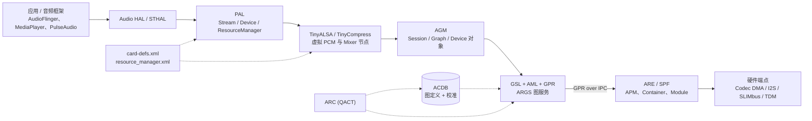

---

## 目录

1. [定位与设计原则](#1-定位与设计原则)
2. [总体分层架构](#2-总体分层架构)
3. [组件全景与称谓对照](#3-组件全景与称谓对照)
4. [平台适配层 PAL](#4-平台适配层-pal)
5. [ALSA 插件机制与虚拟声卡](#5-alsa-插件机制与虚拟声卡)
6. [Audio Graph Manager](#6-audio-graph-manager)
7. [AudioReach Graph Services](#7-audioreach-graph-services)
8. [键向量体系：GKV / CKV / TKV](#8-键向量体系gkv--ckv--tkv)
9. [GPR：跨域消息路由](#9-gpr跨域消息路由)
10. [AudioReach Engine 与 SPF](#10-audioreach-engine-与-spf)
11. [音频图模型](#11-音频图模型)
12. [端到端流程](#12-端到端流程)
13. [数据通路与实时行为](#13-数据通路与实时行为)
14. [控制语义与状态机](#14-控制语义与状态机)
15. [并发、混音与设备切换](#15-并发混音与设备切换)
16. [跨平台适配](#16-跨平台适配)
17. [调优与开发工作流](#17-调优与开发工作流)
18. [演进与版本脉络](#18-演进与版本脉络)
19. [附录](#19-附录)

---

## 1. 定位与设计原则

### 1.1 AudioReach 是什么

AudioReach 不是“一个库”，而是一套**跨处理域、跨 OS 的音频软件栈规范 + 参考实现**。它把“音频用例”从硬编码的驱动逻辑，变成可数据化描述、可离线设计、可在线调优的“图（Graph）”。

它同时替换了上一代架构中的三样东西：

| 维度 | 上一代（Elite / CASA 早期形态） | AudioReach |
| --- | --- | --- |
| DSP 框架 | Elite（固定拓扑、按用例编译的模块链） | SPF：非线性图、多端口模块、运行期图管理 |
| 模块接口 | APPI / CAPI 早期版本 | CAPI v2 / v3（统一模块接口 + h2xml 元数据） |
| 用例定义 | 代码 + 头文件宏 + ACDB 条目强耦合 | GKV/CKV/TKV 键向量 + ACDB + ARC 图形化设计 |
| AP 侧接入 | 直接调内核 ALSA/ASoC 节点 | 插件化虚拟声卡 + AGM 图服务（控制面与数据面分离） |
| 调优工具 | QACT（仅本地、批量盲拷贝校准） | ARC/QACT 8.x：在线校准、远程调优、资源监控、图在线编辑 |

### 1.2 五条设计原则

公网文档把 AudioReach 的设计原则归纳为五条，理解这五条，后面所有模块都能对上号：

1. **统一接口、跨平台复用**：同一套 SPF/ARGS 代码跑在 AP（ARM/Linux）与 DSP（Hexagon/RTOS）上，靠 POSAL/OSAL 隔离平台差异。
2. **数据驱动配置**：能用数据描述的（图拓扑、模块参数、校准值、键值映射）就不写代码；`h2xml` 把模块头文件变成 XML，导入 ACDB 后即可被 ARC 画图使用。
3. **可扩展**：模块、容器、子图、键、工具插件都可以由 OEM/第三方扩展，扩展点明确（CAPI、custom container、custom module、ARC plugin）。
4. **模块化可伸缩**：同一套软件从单 DSP 低端穿戴，到多核多 DSP 的座舱/手机都能裁剪；容器数量、模块数量、内存档位都是设计变量。
5. **分布式处理**：Master/Satellite 多实例、多核 offload，让用例设计者决定“哪段处理放在哪个核”，上层无感。

### 1.3 关键概念一览

| 概念 | 一句话解释 | 详见 |
| --- | --- | --- |
| Graph 图 | 一组子图按顺序连起来完成一个用例 | §11.1 |
| Subgraph 子图 | 可独立启停/替换的模块集合（Stream、Stream-PP、PSPD、Device-PP、Device） | §11.2 |
| Module 模块 | SPF 内最小的可寻址功能单元，有 MID 与 MIID | §10.4 |
| Container 容器 | 一个软件线程里执行一组模块的框架实体 | §10.3 |
| GKV | 声明“是什么用例”的键向量 | §8.1 |
| CKV | 声明“取哪套校准”的键向量 | §8.2 |
| TKV | 声明“运行时改哪个模块的哪个参数”的标签键向量 | §8.3 |
| ACDB | 存放图定义与校准数据的数据库（含 delta 文件） | §7.4 |
| APM | ARE 内接收图管理命令、聚合容器响应的控制模块 | §10.2 |
| AIF / Back-end | 硬件端点抽象，AGM 里以 AIF ID 标识 | §6.3 |

---

## 2. 总体分层架构

### 2.1 软件栈全景

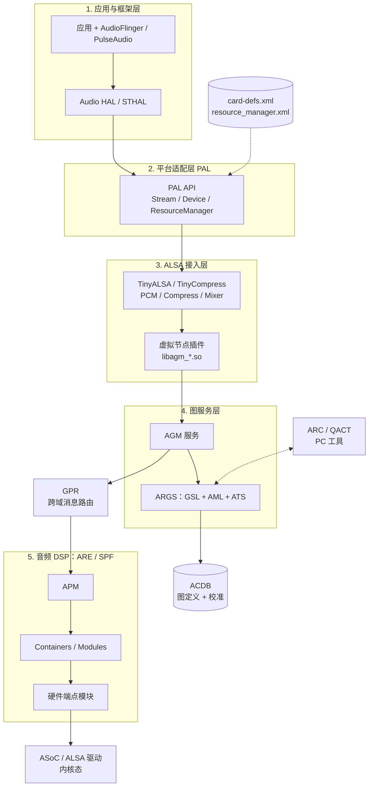

> 阅读提示：`GPR` 横跨用户态与内核态（用户态库 + IPC 驱动），`ARC` 通过 ATS 通道间接访问设备。这张图刻意保持线性，便于看清“一条命令从应用到 DSP”的主干；分支细节见后续各章。

### 2.2 两条贯穿全局的“分离”

整套架构做对了三件事，其中最关键的两件是“分法”：

**① 控制面与数据面分离**

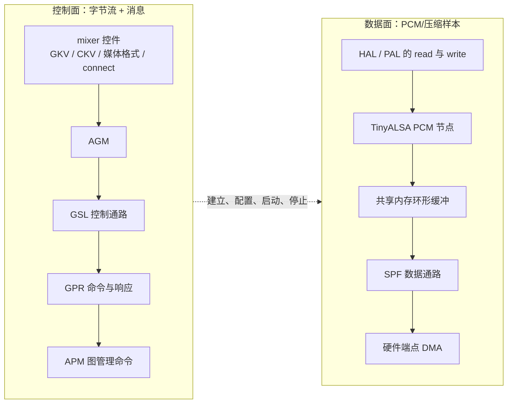

- 控制面的职责：**把图“装配”出来**（选子图、选设备、下发校准、连 FE-BE）。
- 数据面的职责：**把样本搬过去**（这里是真正吃带宽和延迟的地方）。
- 两者在“图已经 open/start 之后”基本解耦：控制面可以继续做 setParam、getTaggedInfo、RTC 实时校准，而不影响数据面搬运。

**② 前端（Front-End）与后端（Back-End）分离**

来自 ALSA DPCM 的思路：FE 是“流”（PCM/compress 设备 + Stream/Stream-PP 子图），BE 是“物理链路”（PSPD/Device-PP/Device 子图 + AIF）。这样：

- 换设备（耳机拔插）只重建 BE，不动 FE → 播放不中断；
- 多流共享一个设备时，FE 各自独立、BE 共享并做引用计数；
- 多设备分流时，一个 FE 经 Splitter/SPR 分到多个 BE。

---

## 3. 组件全景与称谓对照

### 3.0 为什么需要对照表

同一个东西在不同年代、不同资料里有 2~3 个名字（PAL 早期叫 QAL、GSL 所在组件集合叫 ARGS、ARE 早期直接叫 SPF、QACT 新版叫 ARC、GPR 在早期文档里被误写成 “Graph Packet Router”）。读资料时先在这张表里对齐，能省掉大量困惑。

### 3.1 组件职责总表

| 组件 | 所在域 | 职责 | 关键接口/入口 | 典型文件 |
| --- | --- | --- | --- | --- |
| ARC（QACT） | PC | 图设计、校准编辑、在线调优、资源监控、远程连接 | 与 ATS 之间 TCP/IP、QPST/DIAG、USB | ACDB 工程文件、模块 XML |
| Audio HAL / STHAL | AP 用户态 | Android/PulseAudio 与 PAL 之间的桥；设备枚举、patch、路由 | `pal_stream_open`、`pal_device_*` | `AudioStream.cpp`、`AudioDevice.cpp` |
| PAL | AP 用户态 | 面向音频框架的高层 API；会话/设备抽象；并发策略 | `pal_*` API | `Pal.cpp`、`StreamPCM.cpp`、`ResourceManager.cpp` |
| ResourceManager | AP 用户态 | 单例；会话与设备登记；XML 解析；声卡与 mixer 初始化 | 内部 + `resource_manager.xml` | `ResourceManager.cpp` |
| snd-card-def parser | AP 用户态 | 解析 `card-defs.xml`，给 tinyalsa 提供虚拟节点描述 | `snd_card_def_*` | `libsndcardparser.so` |
| TinyALSA / TinyCompress | AP 用户态 | ALSA 用户态封装；按节点类型分流到 HW ops 或 plugin ops | `pcm_open`、`mixer_*`、`compress_*` | `pcm.c`、`mixer.c` |
| PCM / Compress / Mixer 插件 | AP 用户态 | 把 ALSA 语义翻译成 AGM API（虚拟控件、虚拟 PCM） | `agm_pcm_plugin_open`、`agm_mixer_plugin_open` | `libagm_pcm_plugin.so`、`libagm_mixer_plugin.so` |
| AGM | AP 用户态服务 | 用例编排：Session/Graph/Device 对象；FE-BE 连接；调 GSL | AGM client API | `agm/` 服务 |
| GSL | AP 用户态库 | 图服务客户端：图/子图管理、数据缓冲、校准、事件 | `gsl_*` API | `gsl/` |
| AML | AP 用户态库 | ACDB 访问（基线 + delta），按 GKV/CKV/TKV 取二进制块 | `aml_*` API | `acdb/`、`acdb_delta_data` |
| GPR | AP 与 DSP 双侧 | 异步消息路由，屏蔽 IPC 差异（GLink、SMD 等） | `gpr_*` API | `gpr/` |
| ATS | AP 用户态服务 | ARC 连接网关：OCS、RTC、MCS、FTS 四个子服务 | TCP/IP、DIAG | `ats/` |
| ARE / SPF | DSP（也可跑 AP） | 图执行引擎：APM、Container、Module、AMDB、IRM | GPR opcode | `spf/`、`capi/` |
| QACT/QTS | AP 侧 | 设备端调优服务，向 ARC 暴露 ACDB 与 RTC 能力 | ATS 通道 | `qts/` |

### 3.2 称谓对照

| 本文用法 | 官方 80-VN500-101 | 官方 80-VN500-26 | 公网文档 |
| --- | --- | --- | --- |
| PAL | AudioReach Platform Adaptations（如 PAL for Linux） | Platform audio layer (PAL) | Platform Adaptation Layer |
| ARC / QACT | QACT™（IDE） | QACT | AudioReach Creator（ARC），即 QACT |
| ARGS | GSL / AML（分列） | GSL / AML | AudioReach Graph Services：GSL+AML+GPR+ATS |
| ARE / SPF | SPF（Signal Processing Framework） | SPF（Audio Signal Processing Framework & Drivers） | AudioReach Engine（ARE），内核为 SPF |
| AGM | 未单列 | Audio graph manager（AGM） | Audio Graph Manager |
| ACDB | ACDB（Graphs & Calibration） | Usecase Graphs and Calibration Data（ACDB） | Audio Calibration Database，含 delta 文件 |
| 硬件端点 | Device / HW EP | Device / HW EP（I2S、SLIMbus、codec DMA、TDM） | Hardware End Point（HW EP） |

> 注意：`80-VN500-26` 的缩写表把 GPR 写成 “Graph Packet Router”，公网文档统一为 **Generic Packet Router**。以公网为准。

---

## 4. 平台适配层 PAL

### 4.1 定位

PAL 是**音频框架与 AudioReach 之间的最后一层“懂音频”的软件**。它向上接 Audio HAL/STHAL（或 PulseAudio 适配层），向下用 TinyALSA API 操作“虚拟声卡”，横向依赖 ResourceManager 做策略。

它要解决四件事：

1. **用例映射**：把 HAL 的 stream type（`PAL_STREAM_LOW_LATENCY`、`PAL_STREAM_DEEP_BUFFER`、`PAL_STREAM_COMPRESSED`、`PAL_STREAM_PCM_OFFLOAD`、`PAL_STREAM_ULTRA_LOW_LATENCY` …）和设备类型（`PAL_DEVICE_OUT_SPEAKER`、`WIRED_HEADPHONE`、`BLUETOOTH_A2DP` …）翻译成 GKV 的键值。
2. **前端分配**：从 `card-defs.xml` 声明的 FE 里选一个空闲的 PCM/compress 设备（例如 `PCM100`、`PCM101`、compress FE 105），并保证同类型用例不冲突。
3. **后端配置**：按 `resource_manager.xml` 把逻辑设备映射到 BE/AIF（例如 `CODEC_DMA-LPAIF_WSA-RX-0`、`SLIM_0_RX`），并设定 BE 的 rate/channel/format。
4. **并发裁决**：多流、多设备、录音与播放同时存在时，决定是共享 BE、拆分 FE，还是拒绝。

### 4.2 内部结构

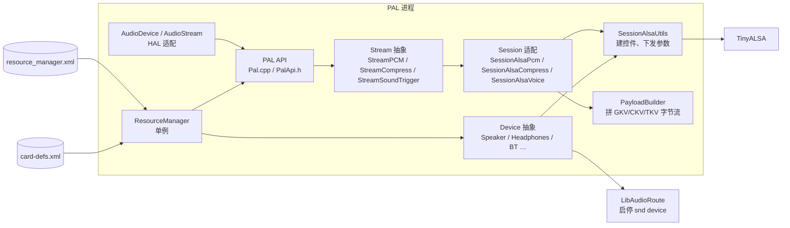

要点：

- **Stream 是播放/录音的入口**，它持有“会话 + 设备”的组合；
- **SessionAlsaPcm / SessionAlsaCompress** 负责真正的“配控件 + 开 PCM”；
- **PayloadBuilder** 负责把 KV 序列化成 AGM 能吃的 metadata 字节流（这是最容易出错的一层，见 §8.5）；
- **ResourceManager 是单例**，在 `pal_init()` 时加载一次，全进程共享。

### 4.3 关键配置文件

| 文件 | 作用 | 谁读 | 改动影响 |
| --- | --- | --- | --- |
| `card-defs.xml` | 声明虚拟声卡：card ID、PCM/compress 设备 ID 与名字、`so-name`（插件 .so）、playback/capture/hostless 属性、mixer 定义 | snd-card-def parser、TinyALSA、PAL | 改错会导致 `pcm_open` 找不到节点或加载错插件 |
| `resource_manager.xml` | 逻辑设备 → 后端/AIF 的映射、BE 默认格式、每流每设备的 PP 选择、并发策略 | PAL ResourceManager | 决定“扬声器/耳机/蓝牙分别走哪条 BE、挂哪些 PP” |
| `backend_conf.xml` | 测试工具（agmplay 等）用的 BE 目标格式 | 测试工具 | 只影响工具，不影响正常 HAL 路径 |
| `audio_dynamic_log.xml` | 动态日志开关（按模块/文件） | AGM/PAL 日志系统 | 调日志级别，需推回 `/vendor/etc/` |
| `kvh2xml.h` | 所有键与值的定义（GKV/CKV/TKV 的“字典”） | PAL、AGM、ACDB、测试工具 | 键值必须与 ACDB、图设计三方一致，否则查不到图 |
| ACDB 数据文件 | 图定义 + 校准，二进制 | AML | 由 ARC 生成/修改 |

### 4.4 用例到 GKV 的映射

官方材料给出了一组 HAL flag 到 PAL stream type 的映射，公网文档则给出 stream type 到 `StreamRx` 键值的映射。合起来看：

| HAL flag（示例） | PAL stream type | GKV 中的 `StreamRx` 值（示例） | 目标形态 |
| --- | --- | --- | --- |
| `AUDIO_OUTPUT_FLAG_COMPRESS_OFFLOAD` | `PAL_STREAM_COMPRESSED` | `COMPRESSED_OFFLOAD_PLAYBACK` | 压缩数据直通 DSP，DSP 内解码 |
| `AUDIO_OUTPUT_FLAG_DIRECT` | `PAL_STREAM_PCM_OFFLOAD` | `PCM_OFFLOAD_PLAYBACK` | 长缓冲、低功耗 |
| `AUDIO_OUTPUT_FLAG_DEEP_BUFFER` | `PAL_STREAM_DEEP_BUFFER` | `DEEP_BUFFER_PLAYBACK` | 大缓冲、抗抖动 |
| `AUDIO_OUTPUT_FLAG_FAST` / `PRIMARY` | `PAL_STREAM_LOW_LATENCY` | `PCM_LL_PLAYBACK` | 低延迟 |
| `AUDIO_OUTPUT_FLAG_RAW` / `MMAP_NOIRQ` | `PAL_STREAM_ULTRA_LOW_LATENCY` | `PCM_ULL_PLAYBACK` | 超低延迟、pull 模式 |
| 录音 | `PAL_STREAM_PCM_RECORD` / `COMPRESSED_RECORD` | `PCM_RECORD` / `COMPRESSED_RECORD` | 反向图 |

> 这张表是“示例映射”，实际取值由 `kvh2xml.h` 与 ACDB 决定；改键值必须同步改图设计，否则会“查得到键、找不到图”。

---

## 5. ALSA 插件机制与虚拟声卡

### 5.1 为什么要有插件

AudioReach 的图配置**不走内核 ALSA/ASoC**（那套框架表达不了 DSP 图），但 Linux/Android 生态又只认 ALSA。于是采用“**虚拟声卡 + 用户态插件**”：

- 内核里仍然有一张物理声卡（codec、DMA、DAI link），负责真正的时钟、GPIO、codec 寄存器；
- 用户态额外“挂”一批**虚拟节点**（PCM、compress、mixer control），这些节点不在 `/dev/snd` 里，而是由 TinyALSA 通过 `card-defs.xml` 认识，并 `dlopen` 对应 `.so` 来接管；
- 应用看到的是一张“完整的声卡”，实际读写被插件翻译成 AGM API。

### 5.2 打开链

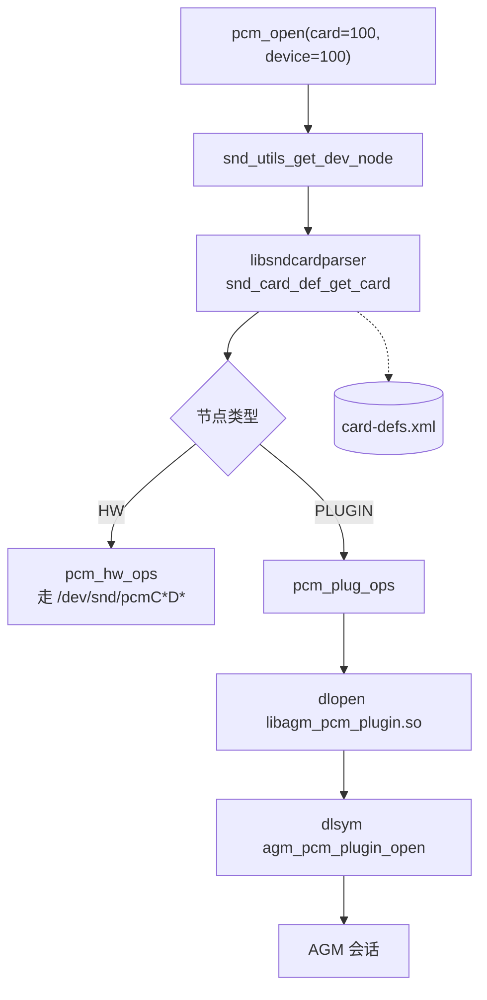

几个容易踩的点：

- **进不进插件，取决于 `card-defs.xml` 里节点的类型，而不是 card 号。** `card=100` 只是约定俗成的虚拟卡号。
- mixer 的加载顺序是“先试硬件 mixer，失败再试 plugin mixer”；虚拟卡上硬件 mixer 失败是正常的。
- **mixer 节点的 ID 固定为 1**（`<mixer><id>1</id>`），与 PCM 的 100/101 无关。
- 插件的符号名由 `.so` 名字推导（`PCM_PLUGIN_OPEN_FN` 宏），不是硬编码函数名。

### 5.3 虚拟 Mixer 控件模型

AGM mixer 插件在打开时会做三件事：

1. `amp_get_be_info()`：向 AGM 枚举 AIF/后端，建立“后端名字 ↔ AIF ID”映射；
2. `amp_get_pcm_info()`：从 `card-defs.xml` 取 PCM 名与 ID；
3. `amp_form_be_ctls()` / `amp_form_pcm_ctls()`：注册控件，并把 `private_value`/`private_data` 绑好。

创建的控件分三类：

| 控件 | 形态 | 绑定的身份 | 典型用途 |
| --- | --- | --- | --- |
| `<backend> rate ch fmt` | INTEGER 数组 | AIF ID | 设置 BE 的采样率/声道/格式/数据格式 |
| `<backend> metadata` | TLV BYTES | AIF ID | 给 Device 子图（可选含 Device-PP）下发 GKV/CKV |
| `<backend> setParam` | TLV BYTES | AIF ID | 给 Device 侧模块下发参数 |
| `PCM<n> control` | ENUM | 内部 PCM 数组索引 | **选择后续 metadata/setParam 的作用域**：`Zero` 表示 Stream 段，`<backend>` 表示 Stream-Device 段 |
| `PCM<n> metadata` | TLV BYTES | session ID | 下发 Stream/Stream-PP 或 PSPD/Device-PP 的 GKV/CKV |
| `PCM<n> connect` / `disconnect` | ENUM | session ID | 连接/断开 FE 与 BE |
| `PCM<n> setParam` / `getTaggedInfo` | TLV BYTES | session ID | 模块参数下发 / 取 TKV 对应的模块标签信息 |

> 关键理解：**`PCM<n> control` 本身不触发任何 AGM 调用，它只是“切换后续写操作的目标”**。同一组 `metadata`/`setParam` 控件在不同 `control` 取值下，落到不同的子图组。这也解释了为什么官方推荐的操作顺序总是“先 control，再 metadata/setParam”。

### 5.4 用 tinymix/agmplay 验证链路

官方材料给出了一组“绕过 HAL、直接命令行验证”的方法，思路是：

1. 用 `tinymix` 打开 codec 内部通路（WSA/Spkr/DMIC 等）；
2. 用 `agmplay/agmcompressplay/agmcap` 指定 FE/BE 与格式，直接跑一次用例；
3. 用 AGM 日志 / GPR sniffer 看 GKV、graph_open、graph_start 是否按预期发生。

这类命令是**验证工具链是否通**的最快手段，也是定位“是 HAL 的问题还是 AGM 以下的问题”的分水岭。

---

## 6. Audio Graph Manager

### 6.1 定位

AGM 是**用户态常驻服务**，独立于具体客户端进程（init 脚本拉起），因此可以服务多个 TinyALSA 客户端。它的核心价值是：把“ALSA 控件语义”翻译成“图生命周期操作”。

AGM 做四件事：

1. 维护 **Session 池**；
2. 创建/管理 **Graph 对象**与 **Device 对象**；
3. 管理与执行 **FE→BE 连接**；
4. 调 **GSL** 完成图 open/prepare/start/stop/close、set/get config、buffer 收发、事件接收。

### 6.2 对象模型

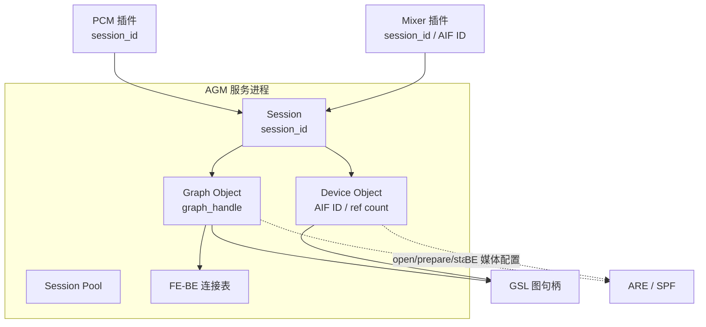

| 对象 | 代表什么 | 创建时机 | 主要职责 | 生命周期 |
| --- | --- | --- | --- | --- |
| Session | 一次播放或录音会话 | 首次调用会话相关控件/API | 给插件提供 API；创建并驱动 Graph/Device；管理状态迁移 | 与 PCM 句柄同寿，`session_close` 释放 |
| Graph | SPF 里的一张图 | 会话内需要建图时 | 调 GSL open/manage/close 图；配置 Stream 侧模块（共享内存 EP、解码器、PCM 转换） | 随会话，或随设备切换重建 |
| Device | 一个 ALSA 设备/AIF（一条 BE DAI link） | 首次连接该 BE | 枚举 AIF；状态迁移；**用引用计数管理 BE**；设定 BE 媒体格式 | 引用计数归零后释放 |

### 6.3 AIF 与后端

- **AIF（Audio Interface）** 是 AGM 视角下的“后端端点”，一个 AIF 对应一条物理 DAI link（I2S、SLIMbus、Codec DMA、TDM、Display Port…）。
- AIF 列表来自 AGM 对声卡的枚举（读 `/proc/asound/pcm` 一类信息），**不是** `card-defs.xml` 里写出来的；`card-defs.xml` 只描述虚拟 PCM/mixer 节点。
- BE 的“引用计数”是并发的基础：多个 FE 连到同一 BE 时，只在第一个 FE 连接时真正配置 BE，最后一个 FE 断开时释放。

### 6.4 FE-BE 连接

连接动作在 ALSA 侧表现为一条 ENUM 控件（`PCM<n> connect`），在 AGM 内部表现为：

1. 找到 FE 对应的 session 与 graph；
2. 找到 BE 对应的 device；
3. 把 FE 的 Stream 子图与 BE 的 PSPD/Device-PP/Device 子图拼成完整 GKV；
4. 调 GSL 触发图 open（或增量 open 新子图）；
5. 打开/配置对应的内核 PCM 设备，把外设（codec、DMA）也拉起来。

> 这就是“**为什么必须先配 metadata 再 connect**”：connect 的瞬间 AGM 就要拿完整 GKV 去查 ACDB，缺键就查不到图。

---

## 7. AudioReach Graph Services

### 7.1 定位

ARGS 是“图服务”的集合，是**客户端（AGM/PAL/直接调 GSL 的应用）与 ARE 之间的全部软件**。公网文档明确它包含四个跨平台组件：**GSL、AML、GPR、ATS**，再加 OSAL 与平台包装。

### 7.2 GSL 结构

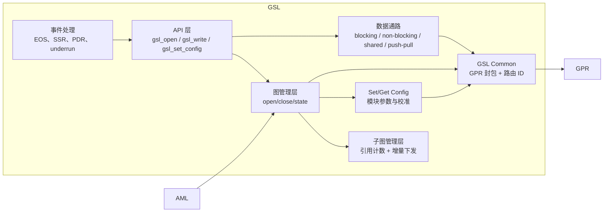

要点：

- **子图管理层做引用计数**：多个用例共享同一个 Device 子图时，只有当最后一个使用者释放时才真正关闭。这是“并发不炸”的关键。
- **增量下发**：新用例与已运行用例有公共子图时，只下发差量子图（delta subgraph），避免重复建图。
- **数据通路有四种模式**：blocking（拷进内部缓冲）、non-blocking（能拷多少拷多少）、shared memory（GSL 分配并共享）、push-pull。上层选哪种，直接影响延迟与拷贝次数。
- **GSL Common 负责路由**：按 routing ID 改写 GPR 包头里的目的 domain，把命令送到正确的 ARE 实例（多核场景）。

### 7.3 AML

AML（ACDB Management Library）是 ACDB 的唯一访问入口：

- 设备上通常有 **基线 ACDB 文件**（压缩二进制，出厂校准）+ **delta 文件**（运行期由 GSL/ARC 写入的增量）；
- AML 提供 get/set API，按 **GKV/CKV/TKV** 返回：
  - 图定义（子图、模块、模块间连接、容器划分）；
  - 校准数据块（按模块 + 参数 ID + CKV 索引）；
  - TKV 命中的模块标签信息。
- AML 可被 **GSL** 调用（常规路径），也可被 **PAL** 直接调用（例如取 codec 校准）。

### 7.4 ACDB 的组织方式

可以把 ACDB 理解成三层索引：

| 层 | 键 | 值 |
| --- | --- | --- |
| 用例层 | GKV（StreamRx、DeviceRx、Instance、DevicePP_Rx…） | 子图集合 + 子图间连接 + 每个子图的容器/模块/连接 |
| 校准层 | (模块 ID, 参数 ID) + CKV（采样率、位宽、音量档…） | 校准二进制块 |
| 标签层 | TKV（模块标签 + 键） | 模块实例定位信息 + 参数索引（供运行时 setParam/getTaggedInfo 用） |

### 7.5 ATS 与在线调优

ATS 是 ARC 连到设备后的“网关”，内部拆成四个子服务：

| 子服务 | 全称 | 作用 |
| --- | --- | --- |
| OCS | Online Calibration Service | 让 ARC 直接操作 AML（在线校准、写回 ACDB 条目） |
| RTC | Real Time Calibration | 通过 GSL 的 RTC API 对运行中模块 get/set |
| MCS | Media Controller Service | 在设备上起停用例（远程播放/录音） |
| FTS | File Transfer Service | 传文件（ACDB、日志、固件） |

连接方式有三种：QPST/DIAG over USB、TCP/IP over USB、TCP/IP over Wi-Fi。后两种让“远程调音”成为可能（这是相对旧 QACT 的重要增强）。

---

## 8. 键向量体系：GKV / CKV / TKV

### 8.1 GKV：用例的唯一标识

GKV（Graph Key Vector）是一组键值对，唯一确定“一张图”。它不描述拓扑细节，只描述“选哪个子图组合”。

最常见的四个键：

| 键 | 含义 | 典型值 |
| --- | --- | --- |
| `StreamRx` / `StreamTx` | 流类型（播放/录音的具体形态） | `PCM_LL_PLAYBACK`、`DEEP_BUFFER_PLAYBACK`、`COMPRESSED_OFFLOAD_PLAYBACK`、`PCM_ULL_PLAYBACK`、`PCM_RECORD` |
| `DeviceRx` / `DeviceTx` | 逻辑设备 | `Speaker`、`Wired Headphone`、`Bluetooth A2DP`、`Handset Mic` |
| `Instance` | 同类型流的实例号 | `Instance_1`、`Instance_2` |
| `DevicePP_Rx` | 设备级后处理集 | `DevicePP_Rx_AUDIO_MBDRC`、`None` |

示例（低延迟播放）：

```text
GKV = [StreamRx: PCM_LL_PLAYBACK] [DeviceRx: Speaker] [Instance: Instance_1] [DevicePP_Rx: Audio_MBDRC]
```

**重要约束**：

- **改键值不会自动改拓扑**。GKV 是“查表的钥匙”，ACDB 里必须有与这把钥匙对应的图；否则就是“有键无图”。
- 每个子图有自己的 **SGKV**（Subgraph GKV），它是完整 GKV 的一个子集。系统设计者可以灵活地把 GKV 的键分配到不同子图，用少量键组合出复杂图。
- PAL 负责在运行期“填键”：新开流时选下一个可用 Instance，选设备时填 DeviceRx，选 PP 时填 DevicePP_Rx。

### 8.2 CKV：校准的选择器

CKV（Calibration Key Vector）决定“同一张图用哪套参数”。典型键：采样率、位宽、声道数、音量档、编解码器类型。

- CKV 是**模块级**的：每个模块可以声明“我依赖哪些键”，也可以声明“哪些参数与键无关”。
- 多个 CKV 组合到同一模块时，条目数是**笛卡尔积**（4 个采样率 × 6 个音量档 = 24 条），所以要谨慎设计键的粒度。
- 音量为典型例子：`Volume Level_3` 会改变 Volume Control 模块所有声道的增益。

### 8.3 TKV：运行时的“寻址标签”

TKV（Tag Key Vector，也叫 Module Tag）解决“**代码不硬编码模块实例**”的问题：

- 图设计时给模块打标签（如 `pspd_mfc`、`echo_cancellation`），标签下挂若干键（采样率、位宽、声道、ON/OFF）；
- 运行时软件只认“标签 + 键”，通过 `getTaggedInfo` 问 ACDB 要“这个标签对应的模块 ID/实例 ID/参数 ID”，再下发 `setParam`；
- 这样换算法、换模块实现，上层代码不用改。

MFC 的例子：`pspd_mfc` 标签下挂 `Sampling Rate`、`Bit Width`、`Channels` 三个键，播放时根据目标设备格式选一组值，就能把 44.1 kHz 流转成 48 kHz。

### 8.4 三类键的分工

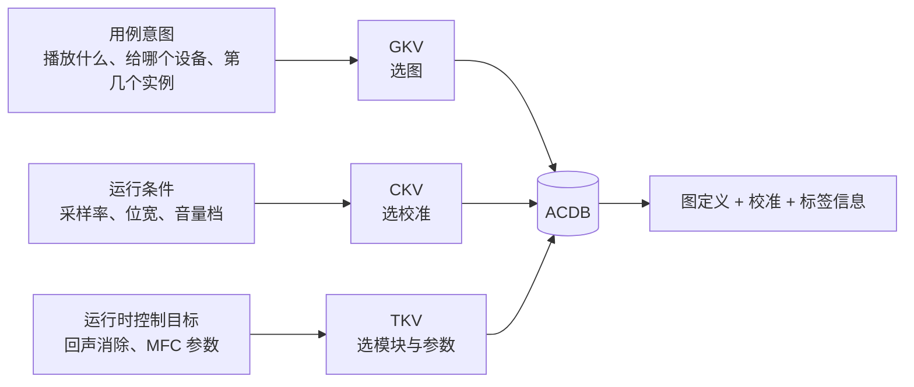

### 8.5 从控件到 AGM 的三条数据形态

这一节是**实现层面最容易踩坑的地方**，官方材料与公网文档在这里能互相印证：

| 形态 | ALSA 侧 | 内容 | 转换成 |
| --- | --- | --- | --- |
| INTEGER | `mixer_ctl_set_value` | 4 元组：rate、channels、`SNDRV_PCM_FORMAT_*`、`AGM_DATA_FORMAT_*` | BE 媒体配置（第三项是**格式枚举**，不是位宽数字） |
| ENUM | `mixer_ctl_set_enum_by_string` | 字符串（`Zero`、后端名） | 控件内部索引 → session 或 AIF |
| TLV BYTES | `mixer_ctl_set_array` | 变长字节流：GKV + CKV + 属性 | `agm_session_set_metadata` / `agm_session_aif_set_metadata` / `agm_aif_set_metadata` |

metadata 载荷的逻辑结构（公网文档公开的就是这个结构）：

```text
struct agm_key_value { uint32_t key; uint32_t value; };
struct agm_key_vector_gsl { size_t num_kvs; struct agm_key_value *kv; };
struct sg_prop { uint32_t prop_id; uint32_t num_values; uint32_t *values; };
struct agm_meta_data_gsl {
    struct agm_key_vector_gsl gkv;   /* 图键向量，决定查哪套图 */
    struct agm_key_vector_gsl ckv;   /* 校准键向量，决定查哪套校准 */
    struct sg_prop sg_props;         /* 子图属性，目前主要用于设备切换辅助 */
};
```

三条注意事项：

1. **`count` 单位不同**：INTEGER 控件的 count 是“元素个数”，BYTES 控件的 count 是“字节数”。
2. **TLV 生命周期**：TinyALSA 在返回前会释放临时 TLV 缓冲，AGM 若要延后使用必须自己拷贝一份。
3. **作用域由 `PCM<n> control` 决定**：`Zero` → Stream/Stream-PP；`<backend>` → Stream-Device（PSPD）/Device-PP；`<backend> metadata` → Device（可选 Device-PP）。这就是公网文档里“FE 与 BE 各自一个 metadata 控件、三种分组”的由来。

### 8.6 metadata 分组对照

| 分组 | 管哪些子图 | 走哪个控件 | 常见 KV |
| --- | --- | --- | --- |
| Stream | Stream、Stream-PP | `PCM<n> metadata`（control=Zero） | `StreamRx`、`Instance`；CKV：`Volume` |
| Device | Device（可选含 Device-PP） | `<backend> metadata` | `DeviceRx`；CKV：`SamplingRate`、`BitWidth`、`Gain` |
| Stream-Device | PSPD、Device-PP | `PCM<n> metadata`（control=`<backend>`） | `StreamRx` + `DevicePP_Rx` |
| 属性 | 子图属性 | 随 metadata 的 `sg_props` | 子图属性 ID（如标记 Stream/Device/StreamDevice） |

---

## 9. GPR：跨域消息路由

### 9.1 为什么需要 GPR

GSL 在 AP 上，ARE 可能在 ADSP（甚至另一个 VM）上。两者之间需要一个**与传输无关**的消息层：换 SoC、换 IPC（GLink/SMD/共享内存/虚拟化通道）时，上层代码不变。GPR 就是这个层。

### 9.2 分层

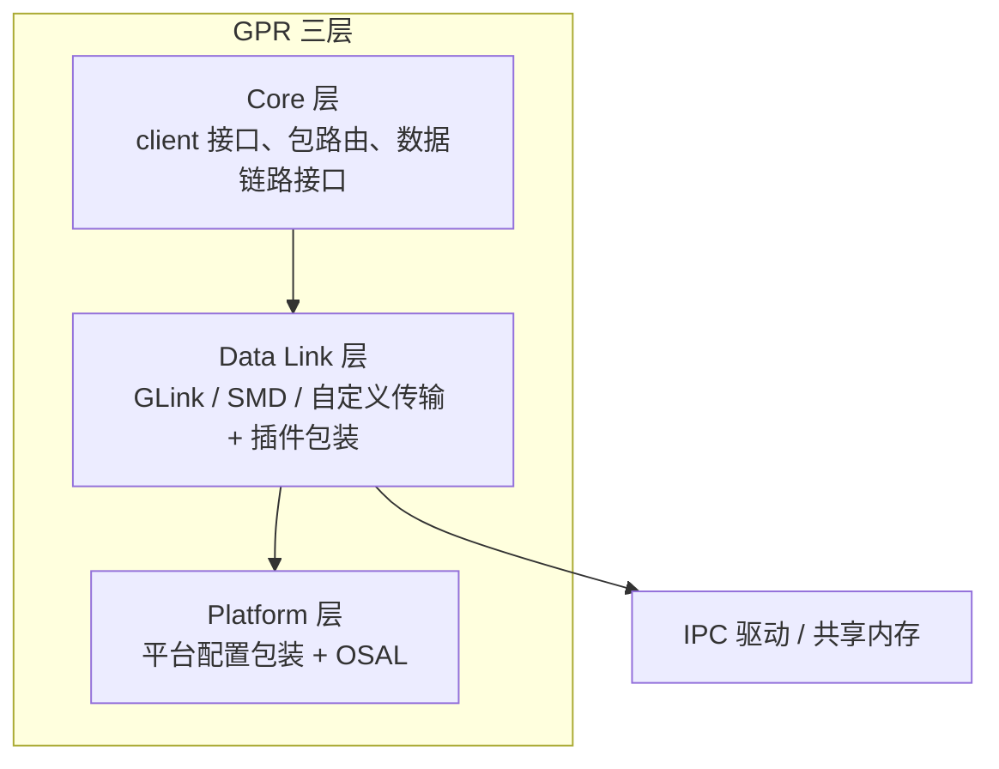

### 9.3 包格式

GPR 包 = **固定头 + 变长 payload**，头字段（公网文档公开）：

| 字段 | 位宽 | 作用 |
| --- | --- | --- |
| `header`（version / header_size / packet_size） | 4 / 4 / 24 bit | 版本、头长（32-bit 字数）、整包字节数 |
| `dst_domain_id` | 8 bit | 目的域 |
| `src_domain_id` | 8 bit | 源域 |
| `client_data` | 8 bit（4 bit 可用） | 客户端私有 |
| `reserved` | 8 bit | 置 0 |
| `src_port` | 32 bit | 源 service ID（域内唯一） |
| `dst_port` | 32 bit | 目的 service ID 或模块实例 ID |
| `token` | 32 bit | 事务 ID，用于异步命令/响应对应 |
| `opcode` | 32 bit | GUID：Owner + Type + Bits（命令/响应/事件/数据） |
| `payload` | 变长 | 参数 |

约定：**4 字节对齐、小端**；未识别消息直接报错，由发送方释放并做错误恢复。

### 9.4 域与地址

| 域 ID | 含义 |
| --- | --- |
| 0 | 无效 |
| 1 | Modem DSP |
| 2 | Audio DSP（ADSP） |
| 3 | Applications（AP） |
| 4 | Sensors DSP |
| 5 | Compute DSP |

寻址 = `domain_id + service_id`（32-bit port）。服务必须先 `gpr_cmd_register()` 注册回调才能收发；回调在 ISR 上下文执行，**禁止阻塞**，耗时操作要挪到线程上下文。

### 9.5 本地与远程路由

- **本地路由**：源域 = 目的域，GPR 直接查表调回调，不经过 IPC。
- **远程路由**：源域 ≠ 目的域，GPR 通过数据链路层发送，对端 GPR 收到后再本地分发。
- **in-band vs out-of-band**：
  - in-band：payload 直接跟在头后，适合小消息（通常 < 512 B）；
  - out-of-band：头里只放共享内存地址，适合大块（校准、图定义、数据缓冲），避免多次拷贝。

### 9.6 异步模型

GPR 是**异步命令-响应 + 事件**模型：

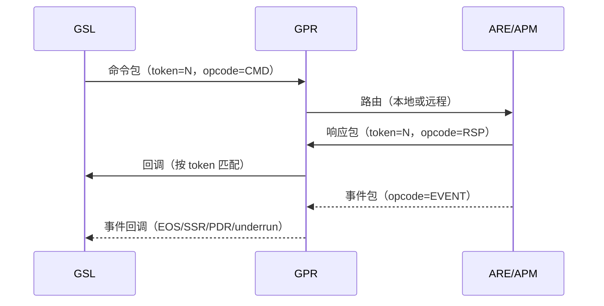

排障时最有用的是 **GPR sniffer**（`GPR Packet Sniff Tool`）：抓包看 opcode、token、目的 port，就能判断命令到底发没发出去、对端回没回。

---

## 10. AudioReach Engine 与 SPF

### 10.1 定位

ARE 是 DSP 侧（也可在 AP 侧）的**音频执行引擎**，采用客户端-服务器模型：

- **Server（ARE）**：提供“把图跑起来”的能力，管理容器、模块、资源；
- **Client（GSL）**：把上层的用例意图翻译成 ARE 命令；
- **POSAL/OSAL**：屏蔽处理器与 OS 差异，让同一套代码跑在 Hexagon/RTOS、ARM/Linux 上。

### 10.2 功能块

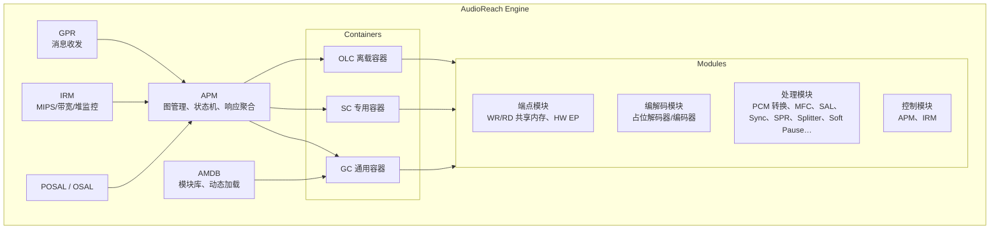

| 功能块 | 作用 |
| --- | --- |
| **APM** | 收 GPR 图管理命令（OPEN/PREPARE/START/STOP/SUSPEND/FLUSH/CLOSE），拆到容器，聚合各容器 ACK 后回 GSL；管模块实例；跨容器协调（如 rate matching）；做端到端图排序与遍历 |
| **Container** | 一个软件线程；决定调度方式、帧长、堆/栈；GC/SC/OLC 三类 |
| **Module** | 最小的可寻址功能；有 MID（功能）与 MIID（实例）；CAPI 封装 |
| **AMDB** | 模块数据库：内置/自定义、静态/动态；注册、下载、引用计数 |
| **IRM** | 资源监控：MIPS、带宽、堆；供 ARC 显示 |
| **POSAL** | 电源管理、MIPS/带宽投票、延迟投票、堆与共享内存、cache 操作、线程/信号量/中断/定时器、日志 |

### 10.3 容器

容器是 AudioReach 区别于传统“模块链”的关键抽象。**一个容器 = 一个软件线程**，容器内的模块按容器调度策略依次执行。

| 容器类型 | 适用模块 | 特点 |
| --- | --- | --- |
| **GC**（Generic Container） | 硬件端点、信号触发模块、共享内存端点、编解码器、打包/解包、转换器、简单 PP、分数重采样/速率匹配 | 通用、支持低功耗岛、纯信号驱动拓扑；多数模块都支持 |
| **SC**（Specialized Container） | 纯 PP 链（sync、SAL、splitter、EC、滤波器、音效） | 移动场景下 PP 链的功耗优化、特殊同步（如通话 smart sync） |
| **OLC**（Off-load Container） | 需要离载到另一个处理域的模块 | 与主容器互操作，传递元数据、EOS、媒体格式、状态 |

调度与帧长经验值：

- 端点（codec DMA sink）常跑 **1 ms** 帧；
- Device-PP 常跑 **5 ms**；
- 解码器常按 **1024 样本**（48 kHz 下约 21.33 ms）；
- 低功耗配置下，多数容器 5 ms，端点容器 1 ms；
- 容器越多 → 并行度越高（Hexagon 多硬件线程），但栈/实例/双缓冲内存和延迟也越大。

容器的阈值聚合规则（GC）：

- 容器内只有一个带阈值模块 → 用它的阈值；
- 多个 → 取 LCM；
- 都没有 → 按子图性能模式：低功耗 5 ms、低延迟 1 ms；
- 原始压缩格式 → 按字节阈值；容器帧长由容器内 PCM 格式决定。

### 10.4 模块与 CAPI

- **模块 = 功能单元**。CAPI（Common Audio Processing Interface）是框架与模块之间的标准接口，负责：初始化、媒体格式设置、参数 get/set、数据处理、状态迁移、事件上报。
- **端口**：数据端口（单向、点对点、可多端口）与控制端口（双向、点对点）。端口同一时刻只连一条链路，**不支持隐式混音/分流**——混音要用 SAL，分流要用 Splitter/SPR。
- **链接**：数据链接（与样本同步）、控制链接（模块间稳态通信，如漂移信息、暂停意图）。
- **图约束**：ARE 只支持**有向无环图**（不允许反馈环）；需要“反馈”时用 Splitter + EC 等模块在拓扑上绕开。

模块与链接的组合规则：

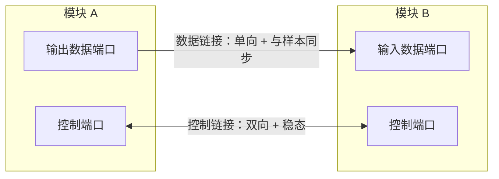

### 10.5 模块清单（按角色）

| 角色 | 模块 | 说明 |
| --- | --- | --- |
| 数据入口 | WR SH Mem EP | 包交换模式下的共享内存写端点；带时间戳与标志；返回 buffer done |
| 数据入口 | SH Mem Pull Mode EP | 非包模式，环形缓冲 + position buffer + watermark；无时间戳/无 metadata；仅 PCM，适合 ULL |
| 数据出口 | RD SH Mem EP | 录音方向的共享内存读端点（包模式） |
| 数据出口 | SH Mem Push Mode EP | 录音方向非包模式（环形缓冲），GC/SC 均支持 |
| 解码 | Placeholder Decoder | 占位解码器；通过“real module ID”参数切换到真实解码器，保持图模板统一 |
| 编码 | Placeholder Encoder | 同上，录音方向 |
| 格式转换 | PCM Converter | 交织/解交织、位宽、声道混合、Q 格式、大小端；**不做重采样**；放在解码器之后 |
| 格式转换 | MFC | 声道混合、采样率转换、位宽转换；只配输出格式，输入靠传播 |
| 分流 | Splitter | 简单分流（1→N），常用于回声参考路径 |
| 分流 | SPR（Splitter Renderer） | 信号触发；多设备同步分流；带 rate-adaptive timer 与渲染决策（AV sync）；上报 underrun |
| 混音 | SAL（Simple Accumulator and Limiter） | 多流累加 + 限幅 + 位宽调整；输入需同格式且已同步 |
| 同步 | Generic Sync | 多输入按到达时间/大小对齐；SC 内使用；SAL 之前 |
| 同步 | Priority Sync | ECNS 前后：主（mic）优先、辅（参考）补零；SC 内使用 |
| 同步 | Multiport Sample Slip | 多时钟域漂移校正；1:1 映射；控制端口传漂移信息 |
| 暂停 | Soft Pause | 斜坡淡入淡出（线性/指数/对数）、下游延迟、延迟爬升、阈值 |
| 无缝 | Gapless | 双流模式提前 EOS，配合解码器去掉首尾静音 |
| 端点 | HW EP Sink/Source | I2S、SLIMbus、Codec DMA、TDM、Display Port、USB 等；信号触发；提供时钟漂移信息；上报 EOS |
| 调试 | Data Logging | 在图内任意位置打点，导出 PCM/压缩数据到 QXDM |
| 控制 | APM / IRM | 不出现在用例图里 |

### 10.6 状态机

子图/图的生命周期（公网文档与官方材料一致）：

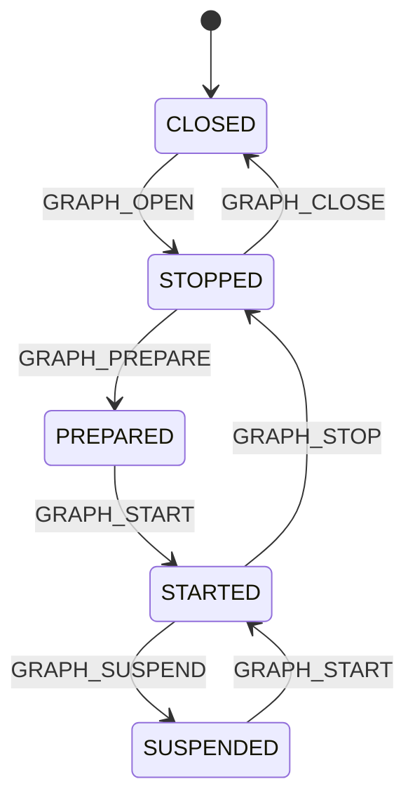

| 状态 | 含义 | 资源 | 数据 |
| --- | --- | --- | --- |
| CLOSED | 逻辑上不存在 | 无 | 无 |
| STOPPED | 已 open，未运行 | 平台资源未投票 | 缓冲可被丢弃 |
| PREPARED | 已传播媒体格式、应用了依赖输入格式的校准 | 未投票 MIPS/带宽 | 可排队但不处理 |
| STARTED | 正常处理 | 已投票 MIPS/带宽；触发使能 | 正常收发 |
| SUSPENDED | 挂起但保留状态 | 资源已释放 | 缓冲与算法状态保留 |

---

## 11. 音频图模型

### 11.1 层次关系

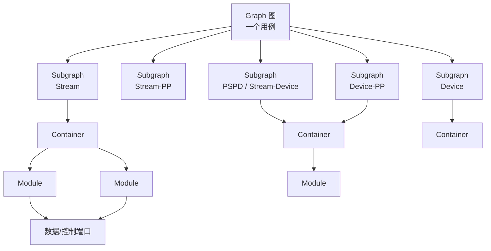

- **Graph**：端到端一条数据通路，可能包含多条并联支路（多设备）。
- **Subgraph**：可独立管理与替换的模块集合；子图属性（性能模式、用例场景 ID）由 GKV/metadata 决定。
- **Container**：执行单元，可跨子图（一个容器内可以有多段子图），子图边界与容器边界不要求重合。
- **Module**：执行实体，有唯一 MIID。

### 11.2 五类子图

| 子图 | 位置 | 典型内容 | 方向 |
| --- | --- | --- | --- |
| **Stream** | 最靠近 HLOS | 共享内存端点、占位解码器/编码器、PCM 转换、数据日志 | Rx：入口；Tx：出口 |
| **Stream-PP** | Stream 之后/之前 | 流级音效、EQ、音量、MFC（流侧） | Rx：Stream → PP；Tx：PP → Stream |
| **PSPD / Stream-Device** | 流与设备之间 | MFC（流到设备格式）、声道混合 | 双向 |
| **Device-PP** | 设备前 | MBDRC、IIR、设备级音效、Sync、SAL | 双向 |
| **Device** | 最靠近硬件 | HW EP 端点、Splitter | Rx：出口；Tx：入口 |

播放（Rx）顺序：`Stream → Stream-PP → PSPD → Device-PP → Device`；
录音（Tx）顺序：`Device → Device-PP → PSPD → Stream-PP → Stream`。

> 不是每个图都必须有全部五段。多数产品只对“每个 Stream 类型”和“每个 Device”各定义一次子图，用不同 PP 子图实现不同校准。

### 11.3 典型播放子图细节

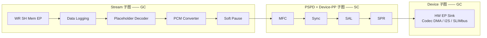

| 模块 | 为什么放这里 | 关键配置 |
| --- | --- | --- |
| WR SH Mem EP | 客户端数据的落脚点 | 缓冲地址/数量、媒体格式、时间戳有效性 |
| Data Logging | 每段都可打点，排障友好 | 打点 ID、通道、方向 |
| Placeholder Decoder | 保持图模板统一 | 先 enable，再 real module ID，最后媒体格式 |
| PCM Converter | 把解码器输出统一成后续处理要的布局 | 只配输出格式 |
| Soft Pause | 暂停/恢复的斜坡 | 斜坡时长/步长/曲线、下游延迟 |
| MFC | 流格式 → 设备格式 | 输出采样率/位宽/声道 |
| Sync + SAL | 多流混音前对齐 + 限幅 | 输入格式一致、同步模块在前 |
| SPR | 多设备分流 + 渲染定时 + AV sync | 渲染模式、延迟、hold buffer |
| HW EP Sink | 真正出声 | 媒体格式、接口配置、功耗模式、DMA |

### 11.4 典型录音子图细节

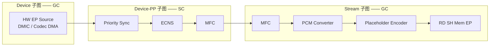

录音方向的要点：

- **PCM Converter 在编码器之前**；
- **ECNS 之前必须有 Priority Sync**（主 mic 优先，参考路径补零）；
- Device-PP 的 MFC 把格式调到 ECNS 要的样子，Stream-PP 的 MFC 再调到客户端要的样子；
- Placeholder Encoder 让同一张图适配不同编码器。

### 11.5 GKV 与元数据在三种场景下的设计

**① MSSD：多流 → 单设备**

```text
GKV1 = [StreamRX1][StreamRX1 PP][StreamRX1DeviceRX][DeviceRX PP][DeviceRX]
GKV2 = [StreamRX2][StreamRX2 PP][StreamRX2DeviceRX][DeviceRX PP][DeviceRX]
```

- 每个流有自己的 Stream 子图与 metadata；
- Device 与 Device-PP 共享，引用计数管理；
- 混音点在 Device-PP 的 SAL。

**② SSMD：单流 → 多设备**

```text
GKV1 = [StreamRX][StreamRX PP][StreamRXDeviceRX1][DeviceRX1 PP][DeviceRX1]
GKV2 = [StreamRX][StreamRX PP][StreamRXDeviceRX2][DeviceRX2 PP][DeviceRX2]
```

- Stream 子图末尾加 Splitter/SPR，把同一路数据分到多个设备腿；
- 每个设备腿独立 PSDP/Device-PP/Device，可独立启停。

**③ 设备切换**

- 只 STOP/CLOSE 设备腿（PSPD、Device-PP、Device），FE 与其缓冲保持；
- 新设备腿 OPEN/CONFIGURE/START，重新下发 HW EP 的媒体格式与接口配置；
- 期间下游不消费，WR buffer 暂不返回；SPR 收到 peer STOP、关掉定时器。

官方材料把这套动作总结为设备子图的 `STOP → CLOSE → OPEN → CONFIGURE → START`，与公网文档的“拆设备腿、保流腿”一致。

---

## 12. 端到端流程

### 12.1 系统启动

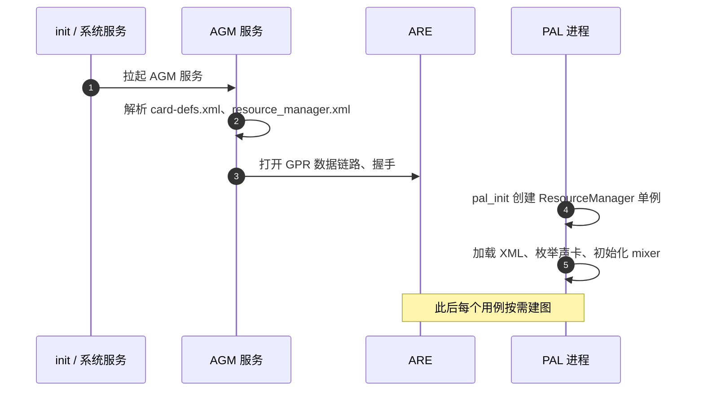

### 12.2 播放：从 HAL 到出声

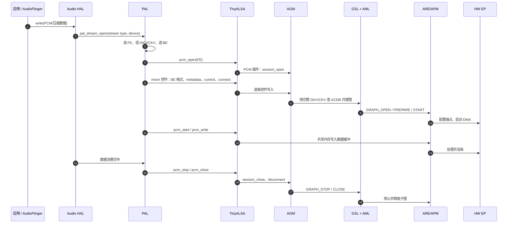

### 12.3 控件下发顺序（最小可用集）

公网文档与官方材料给出的顺序可以合并为下面这条“**先 BE 后 FE、先 metadata 后 setParam、最后 connect、再开流**”的黄金顺序：

| 步 | 动作 | 目的 |
| --- | --- | --- |
| 1 | `<backend> rate ch fmt` | 设定 BE 媒体格式（4 元组，第三项是格式枚举） |
| 2 | `<backend> metadata` | Device 子图（可选 Device-PP）的 GKV/CKV |
| 3 | `PCM<n> control` = `Zero` | 把作用域切到 Stream |
| 4 | `PCM<n> metadata` | Stream / Stream-PP 的 GKV/CKV |
| 5 | `PCM<n> control` = `<backend>` | 把作用域切到 Stream-Device |
| 6 | `PCM<n> metadata` | PSPD / Device-PP 的 GKV/CKV |
| 7 | `PCM<n> getTaggedInfo`（可选） | 取 TKV 对应的模块标签信息 |
| 8 | `PCM<n> setParam`（按需，配合 control 切作用域） | 下发模块参数 |
| 9 | `PCM<n> connect` = `<backend>` | FE-BE 连接，触发完整图建立 |
| 10 | `pcm_open` → `pcm_prepare` → `pcm_start` → `pcm_write` | 开流与送数据 |
| 11 | `pcm_stop` → `pcm_close` → `PCM<n> disconnect` | 收尾 |

> 反过来写（先 connect 再 metadata）会出现“connect 时 GKV 不全 → 查不到图/建图失败”，这是最常见的集成问题之一。

### 12.4 录音流程

与播放同构，差异在：

- FE 是 capture 节点（如 `PCM101` 或 compress capture）；
- 控件顺序仍是 BE 格式/元数据 → FE 元数据 → connect；
- 数据方向反过来：DSP 写共享内存，HAL 读；
- 录音图里 ECNS 前必须有 Priority Sync；若同时有播放（回声参考），参考路径由 Splitter 分出。

### 12.5 停止与异常

- 正常停止：`STOP → CLOSE`，模块算法状态复位、内部缓冲清空、资源退订。
- 长暂停：优先 `SUSPEND` 而不是 `STOP`，保留数据与算法状态、只释放硬件资源；恢复用 `START`。
- 异常：SSR（子系统重启）/PDR（处理域重启）由 GPR 事件上报，GSL 决定是本地消费还是回调给上层；上层需要重建图。

---

## 13. 数据通路与实时行为

### 13.1 缓冲与所有权

| 模式 | 谁分配 | 谁拷贝 | 适用 |
| --- | --- | --- | --- |
| 包交换（WR/RD SH Mem EP） | 客户端分配并 map，模块按 buffer 描述符读/写 | 零拷贝（共享内存），但每包有 IPC 往返 | 常规播放/录音，需要时间戳与 EOS |
| Pull 模式（播放） | 客户端分配环形缓冲 + position buffer | 零拷贝，无 IPC 往返 | 超低延迟 PCM 播放 |
| Push 模式（录音） | 客户端分配环形缓冲 | 零拷贝，无 IPC 往返 | 超低延迟 PCM 录音 |
| GSL blocking / non-blocking | GSL 内部缓冲 | 有拷贝 | 简单客户端，不关心延迟 |
| GSL shared memory | GSL 分配并与客户端共享 | 零拷贝 | 高性能客户端 |

### 13.2 包交换生命周期（WR SH Mem EP）

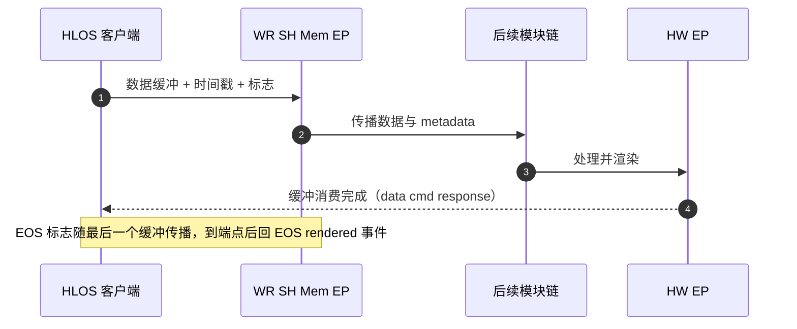

- 数据缓冲里带**时间戳与标志**（时间戳有效、最后缓冲、帧结束等）；
- **metadata 与数据同路传播**（视觉上像两条线，实现上是一条数据链路上的附属信息）；
- **EOS 语义**：客户端在最后一个缓冲打 EOS 标记，标记走完整条拓扑，到 HW EP 后回 “EOS rendered”；收到 ACK 后再发 `GRAPH_STOP`。

### 13.3 帧长、阈值与延迟

| 因素 | 影响 | 调节手段 |
| --- | --- | --- |
| 容器帧长 | 越小延迟越低、MIPS 越高 | 子图性能模式（低延迟 1 ms / 低功耗 5 ms）、容器划分 |
| 缓冲数量 | 抗抖动能力 vs 延迟 | 客户端缓冲数、SPR hold buffer |
| 容器数量 | 并行度 vs 内存/延迟 | 合并无意义的容器、按 PP 链单独成 SC |
| 模块数量 | 每个模块都有固定开销（即使 disable） | 删无用模块、减少不必要的格式转换 |
| 重采样位置 | 多次格式转换叠加误差与开销 | 调换模块顺序，减少转换次数 |
| 信号触发 vs 定时触发 | 信号触发通常更省 MIPS | 用 GC 承载信号触发链路 |

### 13.4 漂移与 AV 同步

- **时钟漂移**：HW EP 通过控制链接把时钟漂移信息告诉上游的 drift corrector / SPR / Sample Slip；SPR 的定时器按端点速率自适应（rate-adapted timer）。
- **AV 同步**：SPR 支持三种起始渲染策略——立即、延迟 N、绝对时间；运行期可切“默认（硬件中断驱动）”或“按绝对时间戳渲染”。会话时间通过 `get cfg` 向 SPR 查询，供播放器画进度条。
- **AV sync 配置必须在 START 前完成**，运行期不能打开；未启用时 session time 返回 0。

### 13.5 暂停、seek 与 flush

- 暂停用 **Soft Pause** 模块做斜坡，避免“啪”声；斜坡参数（时长、步长、曲线、下游延迟、延迟爬升、阈值）可配。
- **PAUSE-RESUME 与 STOP-START 解耦**：子图处于 STOP 时收到 RESUME 不会自己开始，必须等 START 且数据可用。
- seek 用 **FLUSH**：清掉拓扑里旧数据、复位会话时间、把缓冲还给客户端。等价于 STOP-START，但更轻。
- 注意：**暂停斜坡没走完就 FLUSH 会有咔哒声**，应等 pause complete 事件再 flush。

---

## 14. 控制语义与状态机

### 14.1 命令与语义

| 命令 | 触发方 | 语义 | 典型副作用 |
| --- | --- | --- | --- |
| `GRAPH_OPEN` | AGM/GSL | 创建容器与模块实例、建立连接 | 分配实例内存、下载动态模块 |
| `GRAPH_PREPARE` | AGM/GSL | 传播媒体格式、应用依赖格式的校准 | 模块按输入格式选校准 |
| `GRAPH_START` | AGM/GSL | 开始数据流、投票资源 | 使能触发、DMA、定时器 |
| `GRAPH_STOP` | AGM/GSL | 停止数据流、复位算法状态 | 清缓冲、退订资源 |
| `GRAPH_SUSPEND` | AGM/GSL | 挂起、保留状态与缓冲 | 只退订硬件资源 |
| `GRAPH_FLUSH` | AGM/GSL | 清数据、复位会话时间 | 归还缓冲，用于 seek |
| `GRAPH_CLOSE` | AGM/GSL | 释放一切 | 卸载动态模块（引用计数归零时） |
| `SET_CONFIG` | GSL | 下发模块参数/校准 | 模块内部状态变化 |
| `GET_CONFIG` | GSL | 读模块状态（如 SPR 会话时间） | 无副作用 |

### 14.2 播放会话的时序（简化）

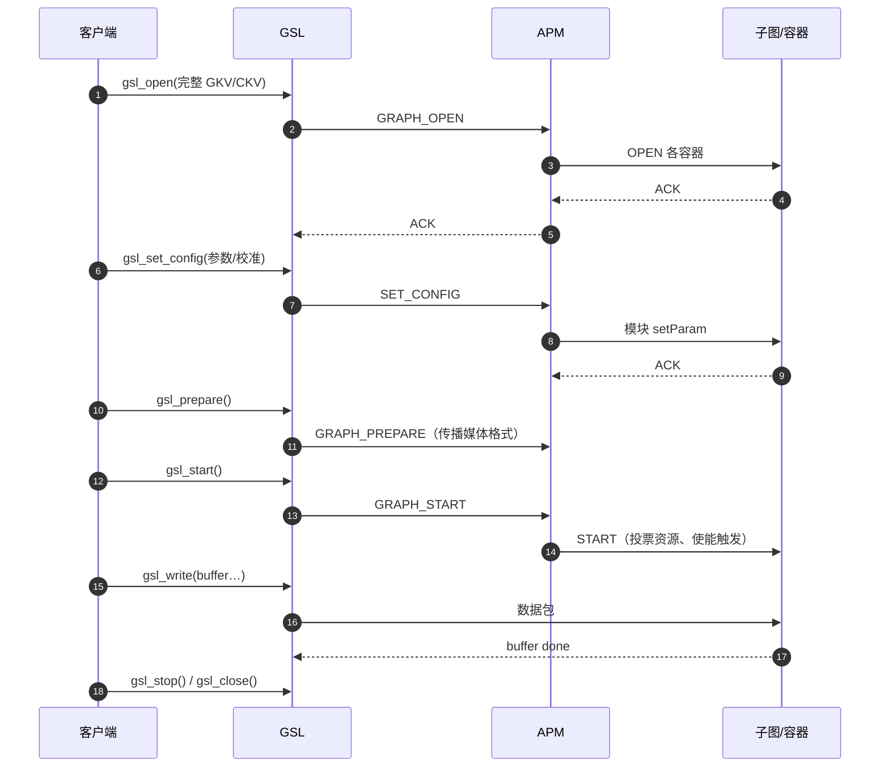

---

## 15. 并发、混音与设备切换

### 15.1 多流共享设备（MSSD）

- 各流独立 FE 与 Stream 子图；
- 共享 Device 子图与 Device-PP；
- 混音点：Device-PP 里的 **SAL**，之前必须有 **Sync** 对齐；
- AGM 用 **BE 引用计数**保证“最后一个使用者才关设备”；
- 各流的媒体格式可以不同，靠各流自己的 MFC 转成设备格式。

### 15.2 单流多设备（SSMD）

- Stream 末尾 **Splitter Renderer** 分流；
- 每个设备腿独立 PSPD/Device-PP/Device；
- SPR 用 rate-adapted timer 统一各输出口的渲染节奏，主输出口的漂移信息通过控制链接回传；
- 输出口可以不同步启动（先开一个，后开另一个），SPR 负责处理。

### 15.3 设备切换

```mermaid
sequenceDiagram
    autonumber
    participant HAL as HAL/PAL
    participant AGM as AGM
    participant GSL as GSL
    participant DSP as ARE
    HAL->>AGM: 设备变更（如拔出耳机）
    AGM->>GSL: 停止设备腿子图
    GSL->>DSP: STOP/CLOSE（Device、Device-PP、PSPD）
    Note over DSP: Stream 腿与其缓冲保留，SPR 关定时器
    AGM->>GSL: 新设备腿 OPEN
    GSL->>DSP: OPEN / 配置 HW EP 格式与接口 / START
    Note over DSP: 新设备腿接管输出
```

关键约束：

- 设备腿重建后，**HW EP 的媒体格式与接口配置必须重新下发**（新子图是新实例）；
- 切换期间下游不消费，WR 缓冲暂不返回给客户端（正常现象，不要误判为卡死）；
- 用 SPR 的渲染决策与 hold buffer 可以让切换更平滑。

### 15.4 录音方向的并发

- 播放 + 录音同时存在时，录音的 EC 需要**回声参考**：从播放链 Splitter 分一路到 EC；
- **Priority Sync** 保证 mic 与参考两路的帧对齐；参考路缺失时补零（便于排障）；
- **Multiport Sample Slip** 处理多时钟域（如蓝牙与本地 codec 不同源）的漂移，让多个端口在同一时间点做 slip/stuff，减少 artifacts，提升 VUI 检测率。

### 15.5 常见并发问题定位

| 现象 | 可能原因 | 检查点 |
| --- | --- | --- |
| 第二路流开不起来 | FE 已被占用 / BE 引用计数不匹配 | `card-defs.xml` 的 FE 数量、AGM 的 session 池、`allocateFrontEndIds` 日志 |
| 两路流互相打断 | 共享了同一个 FE / 设备切换误关 FE | connect/disconnect 顺序、AGM Device 引用计数 |
| 混音后爆音 | 未同步就 SAL / 格式不一致 | Sync 是否在 SAL 前、各流 MFC 输出格式是否一致 |
| 切设备后无声 | 新 HW EP 未配格式 | 设备腿是否重新下发媒体格式与接口配置 |
| 录音有回声 | 参考路径缺失或未对齐 | Splitter 是否分了参考、Priority Sync 是否在 EC 前 |

---

## 16. 跨平台适配

### 16.1 Android / Linux（HLOS）形态

```mermaid
flowchart TB
    subgraph USER["用户态"]
        AF["AudioFlinger / 应用"]
        HAL["Audio HAL / STHAL"]
        PAL["PAL"]
        TAL["TinyALSA / TinyCompress 插件"]
        AGM["AGM"]
        ARGS["GSL + AML + ATS"]
        ACDB[("ACDB 文件")]
    end
    subgraph KERNEL["内核态"]
        ASOC["ASoC / ALSA 驱动"]
        GPRD["GPR IPC 驱动"]
    end
    subgraph DSP["ADSP"]
        SPF["ARE / SPF"]
        DYN["动态模块库"]
    end
    AF --> HAL --> PAL --> TAL --> AGM --> ARGS
    ARGS --> ACDB
    ARGS --> GPRD --> SPF
    SPF --> DYN
    SPF --> ASOC
```

- **Linux 有两种形态**：插件架构（功能全，走 AGM/GSL）与 ALSA/ASoC 驱动架构（内核里用 ASoC topology 描述图，适合习惯内核 ALSA 的开发者）。
- 上游内核里 AudioReach 的 ALSA 驱动位于 `sound/soc/qcom/qdsp6`，可配合 ASoC topology 使用。
- 开源侧有 Yocto 的 `meta-audioreach` 层，参考板包括 RB3 Gen2、Raspberry Pi 4。

### 16.2 QNX / INTEGRITY（Green Hills）

官方 80-VN500-101 专门讲了这条线。与 Linux 的差异主要在“谁来做 IPC 与设备访问”：

| 维度 | Linux/Android | QNX/INTEGRITY |
| --- | --- | --- |
| 进程间通信 | GPR over GLink/SMD | GPR over CSD2（client/server 库） |
| 设备访问 | ALSA/ASoC + `/dev/snd` | `diagio-audio` / `DEVA` 驱动接口 |
| 应用框架 | AudioFlinger + Audio HAL | QNX native apps + OEM 应用（CSD2 client） |
| 调优通道 | ATS over TCP/IP、DIAG | 同一套 ATS/QTS |
| 虚拟化 | 单 VM | Hypervisor 下 PVM/GVM 分离 |

共同点：**GSL、AML、ARE 完全复用**，只是 OSAL 与平台包装不同。这正是“跨平台复用”原则的落地。

### 16.3 Hypervisor / 多 VM

官方材料给出的方案是 **GSL 前后端拆分**：

- 业务 VM（GVM）里跑应用与 PAL，通过 **MM HAB**（共享内存通道）把控制命令送到物理 VM（PVM）；
- PVM 里跑 GSL 后端 + AGM，直接访问 GPR/IPC 与 DSP；
- ACDB 文件同时存在于 PVM 与 GVM；调优仍走 QACT/ATS。

这样做的原因：DSP 与音频外设通常由 PVM 拥有，GVM 不能直接碰；把 GSL 拆成 FE/BE 后，GVM 侧保持 ALSA/PAL 语义不变。

> 广义上这也对应公网文档里的 **Master/Satellite** 多实例模型：GSL 按 routing ID 把不同 use case 路由到不同 ARE 实例；多核 offload 时，Master 通过 OLC 把部分模块放到 Satellite 上执行。

---

## 17. 调优与开发工作流

### 17.1 从设计到上机的闭环

```mermaid
flowchart LR
    A["模块头文件<br/>CAPI + 参数注解"] -->|"h2xml"| B["模块 XML<br/>能力/参数/校准接口"]
    B -->|"导入"| C["ARC 图设计画布"]
    C -->|"画图 + 配键"| D["ACDB<br/>图定义 + 校准"]
    D -->|"打包下发"| E["设备上的 ACDB"]
    E --> F["运行期 AML 查询"]
    F --> G["ARE 执行"]
    G -->|"RTC / IRM / Data Logging"| H["在线调优与监控"]
    H -->|"保存"| D
```

### 17.2 数据驱动三件套

| 工具 | 输入 | 输出 | 作用 |
| --- | --- | --- | --- |
| **h2xml** | 带注解的 C 头文件 | XML（模块能力、参数、校准接口） | 让模块“自描述”，无需手写 ACDB 条目 |
| **ARC/QACT** | XML + 现有 ACDB | 图定义 + 校准 + 键配置 | 图形化画图、配键、调参、在线监控 |
| **ACDB Migration Utility** | Elite 用例 + 模块/参数映射表 | AudioReach 用例 | 迁移旧校准，减少重调工作量 |

### 17.3 常用排障手段

| 手段 | 能回答的问题 | 入口 |
| --- | --- | --- |
| 动态日志 | 某个模块/文件的详细日志 | 改 `audio_dynamic_log.xml` 后推回 `/vendor/etc/` |
| AGM 命令行 | 是 HAL 的问题还是 AGM 以下的问题 | `agmplay` / `agmcompressplay` / `agmcap` |
| GPR sniffer | 命令发没发出去、对端回没回 | GPR 抓包工具 |
| SPF log parser | 容器 ID 映射、图管理命令是否执行 | 解析 DSP 日志 |
| Data Logging 模块 | 声音在哪一段变坏（变 mute/变噪） | 图内打点，导出 PCM/压缩到 QXDM |
| IRM + ARC Online | MIPS/内存/带宽实际消耗 | ARC 在线模式 |

### 17.4 典型故障模式

| 现象 | 第一嫌疑 | 第二嫌疑 | 验证方法 |
| --- | --- | --- | --- |
| 完全无声 | GKV 不全导致建图失败 | BE 媒体格式没下发 | 看 `graph_open` 是否收到全部模块与 tag，看 BE 格式控件 |
| 有声但很快断 | underrun（上游供数不足） | SPR 定时器/端点未启动 | 看 SPR/HW EP 的 underrun 打印、客户端缓冲数 |
| 有噪声 | 周期性 underrun | 媒体格式不匹配 | 对比模块输入/输出格式打印，必要时加 PCM Converter/MFC |
| 切换设备后无声 | 新 HW EP 未配格式 | 设备腿未 START | 看设备腿是否重新 OPEN/CONFIGURE/START |
| 录音有回声/断续 | 参考路径缺失 | Priority Sync 未生效 | 看 Splitter 分路、EC 输入端口数据 |

---

## 18. 演进与版本脉络

| 时间 | 事件 | 意义 |
| --- | --- | --- |
| 2011 | SPF 前身在 Hexagon DSP 上引入 | 模块化 DSP 音频的起点 |
| 2020 前后 | AudioReach 架构推出，替代 Elite | 图化、数据驱动、跨平台 |
| 2021-02 / 2021-06 | `80-VN500-26` AA / AB | 播放/录音用例的架构与流程基线 |
| 2021-04 / 2022-08 | `80-VN500-101` AA / AB | 面向 Green Hills（QNX/INTEGRITY）与虚拟化的架构导入 |
| 2022 起 | CAPI v2 → v3 迁移、QACT 8.x（ARC） | 模块接口统一、工具链现代化 |
| 2023 起 | 开源（GitHub AudioReach，BSD-3-Clause）、上游内核驱动、`meta-audioreach` | 从闭源交付走向开放协作 |
| 2024 | 公网文档体系成型（Design/API/Dev/ARC/Platform Reference） | 本文主要依据 |

演进的三条主线：

1. **从“按用例写代码”到“按数据画图”**：GKV/CKV/TKV + ACDB + ARC。
2. **从“单 DSP 固定链”到“多核可编排”**：容器、OLC、Master/Satellite。
3. **从“设备端黑盒调音”到“在线可视化调优”**：RTC、IRM、Data Logging、远程连接。

---

## 19. 附录

### A.1 术语表

| 缩写 | 全称 | 中文 |
| --- | --- | --- |
| ACDB | Audio Calibration Database | 音频校准数据库 |
| AGM | Audio Graph Manager | 音频图管理器 |
| AIF | Audio Interface | 音频接口（后端端点） |
| AMDB | Audio Module Database | 音频模块数据库 |
| AML | ACDB Management Library | ACDB 管理库 |
| APM | Audio Processing Manager | 音频处理管理器 |
| ARC | AudioReach Creator | 音频图设计与调优工具 |
| ARE | AudioReach Engine | AudioReach 引擎 |
| ARGS | AudioReach Graph Services | 图服务集合 |
| ATS | Audio Tuning Service | 调优服务 |
| BE / FE | Back-End / Front-End | 后端 / 前端 |
| CAPI | Common Audio Processing Interface | 通用音频处理接口 |
| CKV | Calibration Key Vector | 校准键向量 |
| DPCM | Dynamic PCM | 动态 PCM（ALSA） |
| GC / SC / OLC | Generic / Specialized / Off-load Container | 通用 / 专用 / 离载容器 |
| GKV | Graph Key Vector | 图键向量 |
| GPR | Generic Packet Router | 通用包路由器 |
| GSL | Graph Service Library | 图服务库 |
| HLOS | High-Level Operating System | 高级操作系统 |
| HW EP | Hardware End Point | 硬件端点 |
| IRM | Integrated Resource Monitor | 集成资源监控 |
| MIID / MID | Module Instance ID / Module ID | 模块实例 ID / 模块 ID |
| MFC | Media Format Converter | 媒体格式转换器 |
| PAL | Platform Adaptation Layer | 平台适配层 |
| POSAL / OSAL | Platform & OS Abstraction Layer | 平台与 OS 抽象层 |
| PSPD | Per-Stream Per-Device | 每流每设备 |
| RTC | Real Time Calibration | 实时校准 |
| SAL | Simple Accumulator and Limiter | 简单累加与限幅 |
| SGKV | Subgraph Key Vector | 子图键向量 |
| SPF | Signal Processing Framework | 信号处理框架 |
| SPR | Splitter Renderer | 分流渲染器 |
| SSMD / MSSD | Single/Multiple Stream, Single/Multiple Device | 单/多流、单/多设备 |
| TKV | Tag Key Vector | 标签键向量 |
| ULL | Ultra Low Latency | 超低延迟 |

### A.2 参考资料

**公开资料（本文主要依据）**

1. AudioReach 项目总览：<https://audioreach.github.io/sdk_overview.html>
2. 架构总览：<https://audioreach.github.io/design/arch_overview.html>
3. 概念与术语（GKV/CKV/TKV、H2XML）：<https://audioreach.github.io/design/design_concept.html>
4. AudioReach Engine（容器、模块、APM、校准模式）：<https://audioreach.github.io/design/arspf_design.html>
5. AudioReach Graph Services（GSL/AML/GPR/ATS/OSAL）：<https://audioreach.github.io/design/args_design.html>
6. Generic Packet Router（包头、域、路由、异步模型）：<https://audioreach.github.io/design/gpr_design.html>
7. Linux 插件架构（虚拟声卡、GKV 分组、MSSD/SSMD、设备切换、ALSA 建立顺序）：<https://audioreach.github.io/design/linux_plug-in_arch.html>
8. Linux ASoC 架构：<https://audioreach.github.io/design/linux_asoc_arch.html>
9. Linux 适配总览：<https://audioreach.github.io/design/lx_design.html>
10. 开源仓库：<https://github.com/AudioReach>（audioreach-pal、audioreach-graphservices、audioreach-graphmgr、audioreach-conf、meta-audioreach 等）
