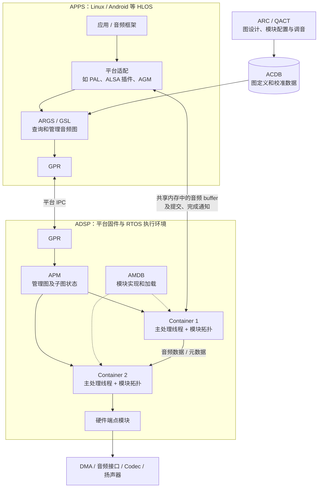
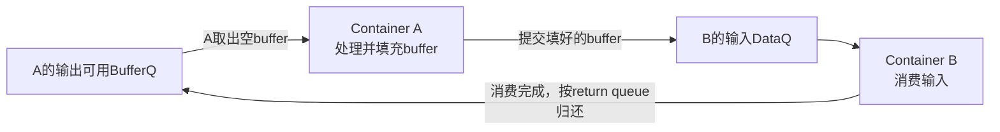
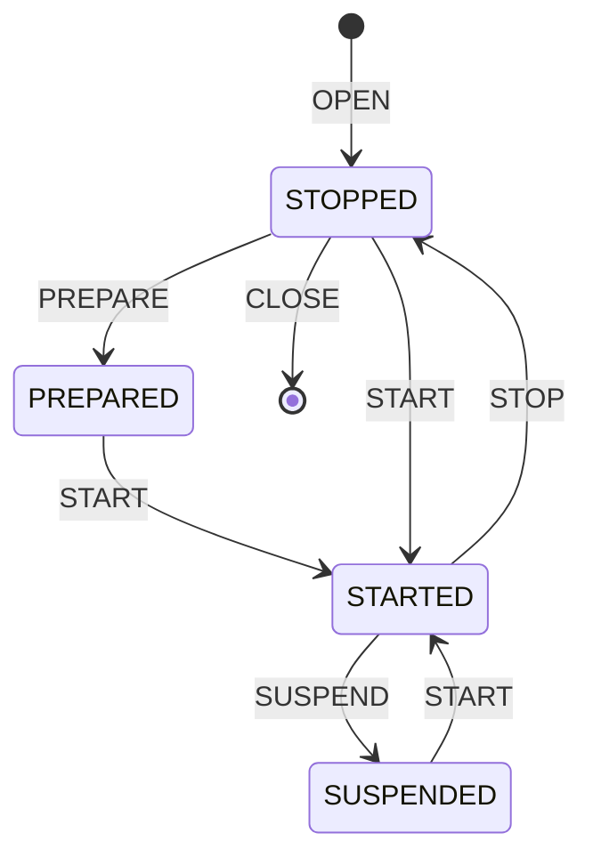

整理日期：2026-10-25。

本文结合本地 AudioReach 官方仓库源码、仓库内官方文档，以及在线官方说明，集中解释 DSP 侧处理框架。APPS 侧 PAL、AGM 的细节可衔接 [AudioReach 架构全景](/myblog/post/audioreach-architecture/) 和 [agmplay 播放控制链](/myblog/post/agmplay-playback-control-chain/)。

源码基线：`audioreach-engine` 提交 `faa820567ad17b6c4168de390f184bb352fd6784`；文档仓库提交 `8127b514e70630b2f8c592024feb853f750092db`。完整组件快照见 [sources.json](/myblog/downloads/audioreach/source-snapshots-2026-10-26.json)。它们是独立源码快照，本文做静态分析，未做目标板运行验证。文中的示意拓扑和计算例子用于解释机制，实际产品图以 ACDB、ARC 和运行时信息为准。

## 1. 先建立四个概念

| 名称 | 含义 | 在系统中的位置 |
| --- | --- | --- |
| ADSP | Audio DSP，音频处理器/音频处理子系统；协议里也有对应的 processor domain | 提供执行音频软件的硬件和固件环境 |
| ARE | AudioReach Engine，AudioReach 的处理引擎 | 包含 SPF 和集成的处理模块 |
| SPF | Signal Processing Framework，信号处理框架 | 管理图、模块执行、调度、buffer、格式、元数据及资源 |
| Container | 承载一组模块的执行实体 | 参考 GC、SC 的主要数据处理在各自线程中运行 |

可以用下面的关系理解：

```text
ADSP 硬件与固件执行环境
└── AudioReach Engine（ARE）
    ├── SPF 框架服务：APM、AMDB、IRM、容器和公共工具等
    └── 音频模块：解码、增益、EQ、混音、重采样、端点等
```

ADSP 与 SPF 分别回答“在哪个处理域执行”和“怎样组织音频处理”。ARE 可以部署到 ADSP，也可以部署到其他处理域：本地公开代码定义了 ADSP、APPS、SDSP、CDSP 等 domain；官方 Raspberry Pi 方案直接在 APPS 用户空间运行 ARE。NXP i.MX8M Plus 方案则把 ARE 放在运行 Zephyr 的 HiFi ADSP 上。

因此，不能把 SPF 的实现条件写成“必须是高通 ADSP”。高通产品上的 DSP 镜像、驱动、低功耗支持和私有算法，仍然需要相应平台的交付与配置。

依据：[图属性及 domain 定义](https://github.com/AudioReach/audioreach-engine/blob/faa820567ad17b6c4168de390f184bb352fd6784/fwk/api/apm/apm_graph_properties.h)、[官方架构说明](https://audioreach.github.io/design/arch_overview.html)、[Raspberry Pi 官方说明](https://audioreach.github.io/platform/raspberry_pi4.html)、[NXP 官方说明](https://audioreach.github.io/platform/nxp.html)。

## 2. APPS 和 ADSP 分别做什么

下面采用常见的“APPS 管理用例，ADSP 执行图”部署方式。



该图是职责示意。用户态 AGM/ARGS 路径与 Linux 内核 ASoC 的 AudioReach 路径是不同接入方案，具体产品应按实际架构追踪。

APPS 侧通常负责选择用例、选择设备、查 ACDB、配置格式、下发参数、提交或接收音频 buffer，以及响应应用的启停和设备切换。ADSP 侧负责把图定义实例化，调度各组模块处理音频，并和端点、共享内存、定时或硬件触发源对接。

端点也是图中的模块。播放源头可以是共享内存端点，末端可以是硬件 sink；录音则可从硬件 source 流向共享内存端点。算法模块和数据出入口因而能被同一套图机制描述。

SPF 是 DSP 音频软件中的一层。一个可运行的产品固件还涉及启动、OS、内存、IPC、设备驱动、电源管理和模块集成等平台条件。Engine README 中的 `libspf.so` 是 SPF 构建产物之一；得到它与得到一份完整可启动 ADSP 固件是不同的交付结果。RB3 Gen2 官方文档也单独说明了 ADSP 固件源码的访问和集成条件。

依据：[Engine README](https://github.com/AudioReach/audioreach-engine/blob/faa820567ad17b6c4168de390f184bb352fd6784/README.md)、[本地架构文档](https://github.com/AudioReach/audioreach-doc/blob/8127b514e70630b2f8c592024feb853f750092db/source/design/arch_overview.rst)、[RB3 Gen2 官方说明](https://audioreach.github.io/platform/rb3_gen2.html)。

## 3. SPF 内部的主要组成

| 组件 | 主要责任 | 阅读时需要区分的内容 |
| --- | --- | --- |
| APM：Audio Processing Manager | 解析建图请求，维护图数据库，创建容器，组织图管理命令，汇总响应 | 管理和协调；稳态算法处理主要在容器线程里进行 |
| Container | 承载拓扑，处理触发、队列、buffer、格式传播和资源需求 | 是模块执行环境，有实例、线程及状态 |
| Topology | 容器内部模块、端口和连接的运行表示，以及处理遍历 | 决定模块处理顺序和数据怎样传递 |
| CAPI module | 封装具体处理功能，提供处理、参数、属性与事件接口 | 既可以是算法，也可以是端点等功能 |
| AMDB：Audio Module Database | 按 module ID 查实现入口，管理静态/动态模块及引用 | 模块实现数据库 |
| IRM：Integrated Resource Monitor | 收集处理器、容器、模块等资源指标，供工具监控 | 具体指标依平台实现 |
| POSAL | 封装线程、队列、channel、信号、内存、cache、定时器和电源管理等 | 平台能力取决于实际后端 |
| GPR：Generic Packet Router | 路由命令、响应、事件和数据相关消息 | 是消息协议/路由层，底层传输依平台 |

ACDB 和 AMDB 容易混淆：**ACDB 保存“用什么图、用什么参数”；AMDB 解决“这个 module ID 对应哪份可执行实现”。**

初始化路径可以从 [spf_main.c](https://github.com/AudioReach/audioreach-engine/blob/faa820567ad17b6c4168de390f184bb352fd6784/fwk/spf/utils/cmn/src/spf_main.c) 看起：

```text
spf_framework_pre_init()
  → 初始化公共内存池等
  → amdb_init()
  → irm_init()（受编译条件控制）
  → dls_init()

spf_framework_post_init()
  → apm_create()
  → 可选线程池等
  → watchdog 服务初始化
```

`apm_create()` 放在后阶段，源码注释说明 APM 会对客户端查询报告 SPF up 状态。Zephyr 示例 [app/src/main.c](https://github.com/AudioReach/audioreach-engine/blob/faa820567ad17b6c4168de390f184bb352fd6784/app/src/main.c) 还展示了 POSAL、GPR、SPF 的初始化调用。实际高通产品入口由其固件集成决定。

## 4. Graph、Subgraph、Container、Module 的关系

### 4.1 各自解决什么问题

| 对象 | 用途 | 典型属性 |
| --- | --- | --- |
| Graph | 表示完成一个端到端用例的连接关系 | source 到 sink 的模块及子图组合 |
| Subgraph | 把需要一起控制生命周期的模块归成一组 | SG ID、性能模式、方向、scenario |
| Container | 把需要一起执行、调度的模块归成一组 | 类型、实例 ID、处理域、heap、stack、线程配置 |
| Module | 表示具体功能及其运行实例 | MID、MIID、端口、参数、CAPI 状态 |
| Link / Port | 描述模块之间的数据或控制交互 | 源/目的 MIID、port ID、连接属性 |

**Subgraph 是控制维度，Container 是执行维度。**

通用图模型允许一个 subgraph 的模块分布在多个 container；一个 container 也能承载来自多个 subgraph 的模块。某些特定容器会施加更严格的限制，例如本快照 PTC 要求恰好一个 subgraph。

### 4.2 源码如何表达这种交叉关系

[apm_module_api.h](https://github.com/AudioReach/audioreach-engine/blob/faa820567ad17b6c4168de390f184bb352fd6784/fwk/api/apm/apm_module_api.h) 的建图接口用下面的信息描述一批模块：

```c
struct apm_modules_list_t {
    uint32_t sub_graph_id;
    uint32_t container_id;
    uint32_t num_modules;
};

struct apm_module_cfg_t {
    uint32_t module_id;
    uint32_t instance_id;
};
```

也就是：先确定一个 `(sub_graph_id, container_id)` 组合，再列出属于这个组合的模块实例。`module_id` 是模块实现/类型的标识，`instance_id` 是这次创建出的模块对象的标识；同一 MID 可以实例化为多个 MIID。

### 4.3 一个示意分组

```text
数据路径：   共享内存源 → PCM转换 → Gain → EQ → 硬件Sink
子图归属：  |------ SG_Stream ------| |--- SG_Device ---|
容器归属：  |--- Container A ---| |---- Container B -----|
```

这里 SG_Stream 横跨 A、B；B 同时包含 SG_Stream 的 Gain 和 SG_Device 的 EQ、Sink。图管理时按 SG 操作，数据处理时按容器中的实际拓扑执行。

这个例子只说明映射关系。是否把 stream 与 device 放进同一容器，要再考虑设备切换、线程周期和目标容器限制。

在车载场景中，媒体流需要连续播放，而输出可能从一个 zone/设备切到另一个设备。把流处理与设备处理划成可独立管理的子图，有助于让设备部分替换和流生命周期分别管理；是否能无缝切换还取决于实际连接、buffer 和状态切换设计。

依据：[模块建图 API](https://github.com/AudioReach/audioreach-engine/blob/faa820567ad17b6c4168de390f184bb352fd6784/fwk/api/apm/apm_module_api.h)、[子图 API](https://github.com/AudioReach/audioreach-engine/blob/faa820567ad17b6c4168de390f184bb352fd6784/fwk/api/apm/apm_sub_graph_api.h)、[本地官方概念文档](https://github.com/AudioReach/audioreach-doc/blob/8127b514e70630b2f8c592024feb853f750092db/source/design/design_concept.rst)。

### 4.4 Data link 与 Control link

Data link 是有方向的点对点连接，一条链路可携带多声道音频以及与采样位置相关的metadata。声道数与端口数不同：一个双声道输入常常是一个input port，而不是两个input port。

Control link 用于模块之间交换控制信息或intent，例如跨模块协同；它是双向控制连接，可以跨容器。模块间控制连接、客户端配置模块参数、音频数据连接分别有自己的接口和生命周期。

普通数据端口不会自动隐式混音或分流；需要用具有相应多端口语义的混音、splitter等模块表达这些行为。连接配置应同时核对MIID和port ID。

## 5. Container 内部到底有什么

以 Generic Container 为例，可以把其实现分成几层：

```text
gen_cntr_t
├── Container utilities（CU）：公共容器状态、线程、channel、命令等
├── Graph utilities（GU）：subgraph、module、port、link 等对象
├── Generic topology：媒体格式、阈值、模块处理、元数据等
├── CAPI 实例：每个模块自己的状态和函数表
├── 外部输入/输出端口：连接其他容器或客户端
└── 电源、优先级、heap、stack、性能统计等运行信息
```

### 5.1 它提供的是执行环境

Container 通常承担：

1. 创建、配置和销毁内部模块与端口。
2. 根据 graph 定义建立拓扑和处理顺序。
3. 收到触发后调用模块的 CAPI `process()`。
4. 协调输入消费、输出产出、buffer 归还和背压。
5. 传播 media format、timestamp、EOS 等信息。
6. 处理 APM、客户端及其他容器的控制消息。
7. 汇总算法的计算量和带宽需求，管理线程与平台资源请求。

算法本身主要由 CAPI 模块实现，容器负责让这些模块能以合适的顺序和节奏合作。

### 5.2 主线程在等什么

[cu_island.c](https://github.com/AudioReach/audioreach-engine/blob/faa820567ad17b6c4168de390f184bb352fd6784/fwk/spf/containers/cmn/container_utils/core/src/cu_island.c) 中的 `cu_workloop()` 按 `curr_chan_mask` 等待 channel，获取就绪 bit，再通过 `qftable[bit_index]` 调用对应 handler。可概括为：

```text
等待命令队列 / 数据队列 / 可用buffer / 硬件或timer信号
    ↓
找到就绪事件的handler
    ↓
处理命令，或检查数据处理条件
    ↓
遍历拓扑，调用相应模块process()
    ↓
发送输出、归还输入、处理事件和资源更新
    ↓
继续等待
```

这是基于就绪事件的工作循环。即使多个模块在同一 container 中，也不表示它们在该线程中同时执行；通常是按拓扑顺序被调用。不同 container 的线程则可以被 OS 调度器并发调度，是否获得硬件并行执行机会取决于处理器资源和调度。

官方 CAPI 文档也要求模块默认遵循容器线程上下文。模块若自行使用后台线程，要处理同步和事件回调约束。源码另有可选异步命令处理与线程池，因而“每个容器一个主要数据处理线程”适合描述参考执行模型，不宜扩展成“整个系统严格只有这些线程”。

### 5.3 Stack、heap 分别装什么

同一容器中的模块调用共享这个线程的 stack。各模块仍有自己的实例状态、算法历史和可能的动态内存。

[gen_cntr_utils.c](https://github.com/AudioReach/audioreach-engine/blob/faa820567ad17b6c4168de390f184bb352fd6784/fwk/spf/containers/gen_cntr/core/src/gen_cntr_utils.c) 的 `gen_cntr_get_thread_stack_size()` 结合 CAPI stack 需求、容器配置和框架处理开销得到线程栈需求。它还避免把已分配栈缩小。模块变化导致需要更大栈时，公共逻辑允许重新启动处理线程并交接剩余工作。

因此，合并容器有时能节省线程栈，但不能据此推断算法状态内存也会消失。

依据：[gen_cntr.c](https://github.com/AudioReach/audioreach-engine/blob/faa820567ad17b6c4168de390f184bb352fd6784/fwk/spf/containers/gen_cntr/core/src/gen_cntr.c)、[cu.c](https://github.com/AudioReach/audioreach-engine/blob/faa820567ad17b6c4168de390f184bb352fd6784/fwk/spf/containers/cmn/container_utils/core/src/cu.c)、[CAPI 官方开发说明](https://audioreach.github.io/dev/capi_mod_dev.html)。

## 6. Container 类型及当前源码的实现情况

### 6.1 类型总表

类型 ID 来自 [apm_graph_properties.h](https://github.com/AudioReach/audioreach-engine/blob/faa820567ad17b6c4168de390f184bb352fd6784/fwk/api/apm/apm_graph_properties.h)。

| 类型 | 全称/定位 | Type ID | 主要用途 |
| --- | --- | --- | --- |
| GC | Generic Container | `0x0B001001` | 通用处理，支持多种端点、编解码与处理模块 |
| SC | Specialized Container | `0x0B001000` | 面向 PP、同步和特定语音处理的优化容器 |
| OLC | Off-load Container | `0x0B001002` | 协调把一部分图卸载到其他处理域 |
| PTC | Pass Thru Container | `0x0B00100D` | 在受限拓扑和触发条件下减少处理与buffer管理开销 |
| WC | Wear Container | `0x0B001003` | 源码中独立的一组容器实现，需要对应构建集成 |

### 6.2 GC：通用功能最多的阅读入口

GC 对应 `gen_cntr/` 和 `gen_topo/`。它处理共享内存端点、硬件/信号触发端点、编码器、解码器以及多种普通处理模块。

其通用性体现在：数据触发和信号触发、格式变化、阈值聚合、输入输出不等量、元数据及外部端口管理都需要框架参与。GC 的稳态处理还会按拓扑性质走优化路径。

官方设计文档允许 GC 承载一些重采样、rate matching、同步和 EC 场景，同时说明了组合限制。因此，不能按“有 EC 就一定不能用 GC”分类；要检查具体模块所需扩展及组合条件。

关键入口：`gen_cntr_create()`、`gen_cntr_graph_open()`、`gen_cntr_data_process_frames()`、`gen_topo_topo_process()`。

### 6.3 SC：面向处理链与同步的优化

SC 对应 `spl_cntr/` 和 `spl_topo/`。官方参考设计将其用于 pre/post-processing，包括多输入同步、EC、连续 rate matching/分数采样率转换和语音专用同步需求。

SC 会对简单 SISO 处理链、禁用模块、同步/混音模块及可旁路情形做优化。按官方参考设计，SC 不承载硬件/共享内存端点和编解码等 GC 负责的功能，且没有 GC 的 LPI 支持。

SC 的模块 threshold 兼容规则也更严格：多个固定 threshold 需要满足整倍数关系；后文给出例子。

当前仓库的 `CONFIG_SPL_CNTR` 控制真实实现与 stub 的选择；`CONFIG_SPECIAL_TOPOLOGY` 对专用拓扑进行配置。Kconfig 的缺省值与具体 defconfig 的取值需要分别检查；本快照 `arch/linux/configs/defconfig` 显式启用了 SC、SC 扩展和专用拓扑。

### 6.4 OLC：分布式处理的协调者

例如本地 master 图需要把某段算法放到另一 DSP，OLC 负责本地与 satellite 之间的图管理和数据协调。它要传递格式、元数据、EOS、启停等语义，不能只把一段 PCM 发过去就结束。

master/satellite 参考架构通过增加跨域连接和共享内存端点完成 offload，带来潜在 IPC 和额外 buffering 开销。是否划算要同时评估目标核资源、功耗和端到端时延。

**本快照的 OLC CMake core 构建选用 `stub_src/olc.c`。** 仓库具有实际实现目录，并不代表该 CMake 产物已启用完整 offload 能力。

### 6.5 PTC：限制更多，执行路径更直接

PTC 的创建入口复用 `gen_cntr_create()`，但使用不同的容器及 topology vtable。在本快照真实实现中，`pt_cntr_validate_topo_at_open()` 要求：

- 恰好一个 subgraph。
- 不接受 voice-call scenario。
- `num_parallel_paths` 不超过 1。
- 至少有一个 signal-triggered module。
- 不接受 sync module。

后续校验还会检查模块处理循环、阈值、数据管理扩展和相邻端口格式布局等条件。部分内部 buffering 情况会发出警告。PTC 通过这些约束简化处理和 buffer 分配，因此它仍然会调用模块算法，名称中的 Pass Thru 不能理解成整条图绕过算法。

其可用性有明显的构建差异：

- CMake 的 `pass_thru_cntr/build/CMakeLists.txt` 当前选用 stub，`is_pass_thru_container_supported()` 返回 `FALSE`，创建 PTC 会失败。
- `gen_cntr/build/Android.mk` 的源文件列表包含真实 PTC 源文件。

第二点只说明该 makefile 的源码选择，不能据此声称某个具体 Android BSP 已启用并验证了 PTC。

### 6.6 WC：区分存在的源码与默认构建路径

`wear_cntr/` 有自己的创建表和执行实现。通用 [cu.c](https://github.com/AudioReach/audioreach-engine/blob/faa820567ad17b6c4168de390f184bb352fd6784/fwk/spf/containers/cmn/container_utils/core/src/cu.c) 的创建表列出 SC、GC、OLC、PTC；WC 没有作为该表的另一项加入。当前容器顶层 CMake 也没有将 `wear_cntr` 添加为子目录。

所以目前能确认“有 WC 类型 ID 及独立源码”，其具体产品用途、完整能力和集成路径需要进一步对照平台工程，不能仅从 Wear 名称推导行为。

### 6.7 本快照的构建核对表

| 项目 | 静态检查结果 | 可以得出的结论 |
| --- | --- | --- |
| 通用创建表 | SC / GC / OLC / PTC | 类型进入创建分派表仍需可用实现 |
| SC core CMake | 根据 `CONFIG_SPL_CNTR` 选择真实实现或 stub | 必须检查配置 |
| OLC core CMake | 选择 stub | 该路径未集成真实 OLC core |
| PTC CMake | 选择 stub | 该路径不支持创建 PTC |
| PTC Android.mk | 列出真实实现 | 与 CMake 路径不同，需看实际产品集成 |
| WC | 独立创建表；未进入当前顶层 CMake | 不能视为当前通用路径默认可选 |

证据：[CU 创建表](https://github.com/AudioReach/audioreach-engine/blob/faa820567ad17b6c4168de390f184bb352fd6784/fwk/spf/containers/cmn/container_utils/core/src/cu.c)、[容器顶层 CMake](https://github.com/AudioReach/audioreach-engine/blob/faa820567ad17b6c4168de390f184bb352fd6784/fwk/spf/containers/build/CMakeLists.txt)、[SC Kconfig](https://github.com/AudioReach/audioreach-engine/blob/faa820567ad17b6c4168de390f184bb352fd6784/fwk/spf/containers/Kconfig)、[SC core CMake](https://github.com/AudioReach/audioreach-engine/blob/faa820567ad17b6c4168de390f184bb352fd6784/fwk/spf/containers/spl_cntr/core/build/CMakeLists.txt)、[OLC core CMake](https://github.com/AudioReach/audioreach-engine/blob/faa820567ad17b6c4168de390f184bb352fd6784/fwk/spf/containers/olc/core/build/CMakeLists.txt)、[PTC CMake](https://github.com/AudioReach/audioreach-engine/blob/faa820567ad17b6c4168de390f184bb352fd6784/fwk/spf/containers/gen_cntr/ext/pass_thru_cntr/build/CMakeLists.txt)、[PTC 校验](https://github.com/AudioReach/audioreach-engine/blob/faa820567ad17b6c4168de390f184bb352fd6784/fwk/spf/containers/gen_cntr/ext/pass_thru_cntr/src/pt_cmd_handler.c)、[Android.mk](https://github.com/AudioReach/audioreach-engine/blob/faa820567ad17b6c4168de390f184bb352fd6784/fwk/spf/containers/gen_cntr/build/Android.mk)、[WC 创建表](https://github.com/AudioReach/audioreach-engine/blob/faa820567ad17b6c4168de390f184bb352fd6784/fwk/spf/containers/wear_cntr/src/wear_cntr.c)。

## 7. Container 的属性配置

[apm_container_api.h](https://github.com/AudioReach/audioreach-engine/blob/faa820567ad17b6c4168de390f184bb352fd6784/fwk/api/apm/apm_container_api.h) 定义了容器创建配置。常用属性如下。

| 属性 | 作用 | 关注点 |
| --- | --- | --- |
| Container type | 决定创建哪个容器实现 | 类型支持和模块支持需同时满足 |
| Container instance ID | 标识这次创建的容器对象 | 用于图归属、查找及日志关联 |
| Processing domain | 指定执行域 | 跨域时要有对应通信与 offload 支持 |
| Parent container | 描述相应父容器关系 | 常见于 offload 配置，需要结合对应接口语义 |
| Stack size | 配置线程栈需求 | 框架还会结合模块与自身开销计算 |
| Heap ID / peer heap ID | 选择自己和跨容器交互相关内存区域 | 一般 heap 与 LPI heap 的条件不同 |
| Thread priority | 配置线程优先级 | 特殊 ignore 值与平台自动计算需区分 |
| Scheduling policy | 配置线程调度策略 | 由 POSAL 和 OS 后端解释 |
| Core affinity | 配置核亲和性 mask | processor domain 和 OS 核亲和性是不同层次 |
| Frame size | 配置处理帧长 | API描述用于PCM/PCM packetized格式；有模块threshold时需按其约束确定，OLC不使用该属性 |

Subgraph 性能模式定义在另一个头文件中，包含 low power 和 low latency。它能参与容器帧长等决策，但与容器类型、模块 threshold、线程优先级分别是不同配置项。

## 8. 调度：谁来触发一轮处理

### 8.1 Data-triggered：按输入/输出就绪情况处理

对简单线性链，缺省条件可理解为“输入数据可用，并且有可写的输出 buffer”。下游没有归还可用 buffer 时，上游会受到背压。

多输入、多输出、内部 buffering 模块的条件更复杂。例如有些模块可能暂时只需要继续收输入，有些可以先输出内部缓存。框架的 trigger policy 扩展允许模块表达不同端口就绪关系，不能一概写成“所有输入输出永远同时就绪”。

### 8.2 Signal-triggered：按硬件或定时信号处理

硬件 DMA 中断或 timer 可以通过 signal 唤醒容器。此时处理节奏与外部时钟相关，例如需要按周期向硬件端点供数。

信号按时到达并不等于输入一定足够。稳态运行仍要处理数据不足、端口状态、buffer、格式和各模块的消费产出约束。

GC 相关源码包括：

- [gen_cntr_st_handler_island.c](https://github.com/AudioReach/audioreach-engine/blob/faa820567ad17b6c4168de390f184bb352fd6784/fwk/spf/containers/gen_cntr/core/src/gen_cntr_st_handler_island.c)：信号触发入口。
- [gen_cntr_trigger_policy_island.c](https://github.com/AudioReach/audioreach-engine/blob/faa820567ad17b6c4168de390f184bb352fd6784/fwk/spf/containers/gen_cntr/core/src/gen_cntr_trigger_policy_island.c)：触发条件与策略。
- [gen_cntr_data_handler_island.c](https://github.com/AudioReach/audioreach-engine/blob/faa820567ad17b6c4168de390f184bb352fd6784/fwk/spf/containers/gen_cntr/core/src/gen_cntr_data_handler_island.c)：帧处理和 topology 调用。

官方设计页中“单容器仅一个 signal-triggered module”的说明要按容器与版本理解。当前 PTC 代码会遍历 STM 列表，并仅给最后一个 STM 配置触发 signal；因此不宜把旧设计页的单 STM 描述当成所有实现的永久限制。

### 8.3 模块最终在哪里执行

常见 GC 路径可跟到：

```text
容器事件handler
  → gen_cntr_data_process_frames()
  → gen_cntr_data_process_one_frame()
  → gen_topo_topo_process()
  → 模块 capi_ptr->vtbl_ptr->process(...)
```

这条路径是阅读导航；实际存在 pure signal topology 等优化分支。真正的 CAPI 调用可在 [gen_topo_data_process_island.c](https://github.com/AudioReach/audioreach-engine/blob/faa820567ad17b6c4168de390f184bb352fd6784/fwk/spf/containers/cmn/topologies/gen_topo/core/src/gen_topo_data_process_island.c) 中找到。

## 9. Buffer 如何在容器之间流动

对普通相邻容器，外部输入端口有 DataQ，外部输出端口管理可用 buffer 的队列。可用下图理解所有权循环：



一次简化循环如下：

1. 上游取得可用输出 buffer，并对内部模块进行处理。
2. 将填好的输出作为数据消息交给下游输入队列。
3. 下游处理并消费这块输入。
4. 消费完后通过消息中的归还路径返回给上游。
5. 上游重新使用它。

队列上传递的是消息和 buffer 描述等信息；这一过程不等于每次都复制整块 PCM。是否需要拷贝，取决于端点方式、buffer 兼容性、内外部布局、in-place 能力及是否跨域。

容器内部相邻模块则由 topology 管理数据视图与buffer，通常无需为每对模块建立一个线程间队列。容器边界、子图边界、模块边界分别带来的开销应分开分析。

ICB（Inter-container Buffering）会综合两边的帧长、实时性质等条件管理容器间 buffering，必要时还有预填充等逻辑。更多 container 通常意味着更多线程状态、队列和buffer需求，但具体增加多少时延必须看实际buffer配置与消费节奏。

依据：[peer container 输入/输出实现](https://github.com/AudioReach/audioreach-engine/tree/faa820567ad17b6c4168de390f184bb352fd6784/fwk/spf/containers/gen_cntr/ext/peer_cntr/src)、[ICB 实现](https://github.com/AudioReach/audioreach-engine/tree/faa820567ad17b6c4168de390f184bb352fd6784/fwk/spf/containers/cmn/icb/src)、[预填充实现](https://github.com/AudioReach/audioreach-engine/blob/faa820567ad17b6c4168de390f184bb352fd6784/fwk/spf/containers/cmn/container_utils/core/src/cu_prebuffer.c)。

## 10. Frame size、Threshold 和时延

### 10.1 几种尺寸需要分别看

| 名称 | 解释 |
| --- | --- |
| 模块 port threshold | 模块对输入/输出处理数据量的要求，常以字节等形式表达 |
| Container frame size | 容器组织一轮或一组处理的数据时间尺度 |
| 客户端 buffer / ALSA period | APPS 提交数据或驱动工作的缓冲粒度 |
| 硬件 DMA period | 实际硬件端点的传输或中断节奏 |
| 算法 delay | 算法自身的历史、lookahead、滤波或编解码延迟 |

这几项可以不同。模块可能一次处理多个循环，容器也可能把一块上游buffer拆成多轮消费。不能从某一项直接推出整个播放链的时延。

### 10.2 PCM 计算示例

以 48 kHz、双声道、每样本实际占 16 bit 存储为例：

```text
1 ms：每通道48个sample，双声道共192 byte
5 ms：每通道240个sample，双声道共960 byte
10 ms：每通道480个sample，双声道共1920 byte

字节数 = 采样率 × 时间秒数 × 通道数 × 每样本存储字节数
```

24-bit 有效数据若装在 32-bit word 中，上式应按 4 byte 计算；还需结合 interleaved/deinterleaved 布局解释每个 CAPI buffer 的长度。

### 10.3 GC 的聚合思路

对未显式配置容器帧长的常见情况：有一个固定 threshold 时优先采用它；多个 threshold 可通过 LCM 聚合；没有模块 threshold 时，性能模式参与决定缺省帧长，参考值为 low power 5 ms、low latency 1 ms。

例如：

| 条件 | 参考结果 |
| --- | --- |
| 模块 threshold 为 1 ms，SG 选择 low power | 容器使用 1 ms |
| 模块 threshold 分别为 2 ms 和 5 ms | 聚合为 10 ms |
| 无模块 threshold，SG low power | 缺省 5 ms |

源码还会读取显式配置的容器帧长，以及处理PCM/压缩格式、采样率变化和拓扑相关逻辑。可从 [gen_cntr_buf_util.c](https://github.com/AudioReach/audioreach-engine/blob/faa820567ad17b6c4168de390f184bb352fd6784/fwk/spf/containers/gen_cntr/core/src/gen_cntr_buf_util.c) 搜索 `conf_frame_len`、`lcm` 和 `threshold`，不能把上述例子当作对任意格式均成立的简单公式。

### 10.4 SC 的聚合思路

SC 要求多个模块 threshold 具有整倍数关系；同时会结合目标帧长选择合适的整倍数。

| 条件 | 参考结果 |
| --- | --- |
| 目标5 ms，模块要求2 ms | 选择6 ms |
| 目标5 ms，模块分别要求1 ms和3 ms | 选择6 ms |
| 模块分别要求2 ms和3 ms | 不满足整倍数约束，拒绝这种组合 |

因此，“2 与 3 的 LCM 是 6”不能用来推断 SC 一定接受该图。源码的 [spl_cntr_buf_util.c](https://github.com/AudioReach/audioreach-engine/blob/faa820567ad17b6c4168de390f184bb352fd6784/fwk/spf/containers/spl_cntr/core/src/spl_cntr_buf_util.c) 明确有 threshold multiple 检查；语音等 scenario 还存在专门规则。

### 10.5 Container 数量与时延的取舍

拆开容器可以适配不同处理周期、隔离不同触发源并改善负载分布；代价是更多栈、对象、队列、buffer 和调度开销。

合并容器可以减少部分边界开销，但可能让高开销算法进入更紧的处理周期，也可能破坏模块支持或同步条件。

工程上可按以下组成检查时延：

```text
端到端时延的来源
  = 客户端排队
  + 算法内部延迟
  + 模块/容器间buffer驻留
  + 调度等待与执行
  + 跨域传输相关延迟
  + 硬件与Codec链路延迟
```

这是排查分类，不是严格可直接相加的测量公式；部分执行阶段重叠，实际应按时间戳和 path delay 等手段测量。

## 11. 图与子图的生命周期

[apm_api.h](https://github.com/AudioReach/audioreach-engine/blob/faa820567ad17b6c4168de390f184bb352fd6784/fwk/api/apm/apm_api.h) 定义了图管理命令。这里的状态以子图为管理粒度。

| 操作 | 主要含义 |
| --- | --- |
| OPEN | 创建图所需对象、容器、模块和连接；正常打开后处于 stopped |
| PREPARE | 在格式已知时传播格式，并进行依赖格式的准备 |
| START | 使子图进入运行，按需要启用触发和申请资源 |
| STOP | 停止处理，复位算法状态、清理内部数据，并释放相应性能请求 |
| SUSPEND | 暂停运行并降低资源请求，保留算法状态和内部数据 |
| FLUSH | 按命令规则丢弃排队或缓存数据，处理相应复位 |
| CLOSE | 删除指定子图相关对象，并在合适时机销毁不再使用的容器 |

常见过程可以画为：



图只展示常见路径。API 允许的调用范围和实现细节应以头文件为准；START 的说明明确允许从 OPEN、PREPARE、STOP、SUSPEND 之后调用，PREPARE 并非所有场景中都必须由客户端单独调用。

STOP 和 SUSPEND 的差异会影响恢复后的算法连续性和旧数据处理；应用层 pause API 与某个 APM opcode 的映射则取决于上层策略，不能机械等同。

同一容器中若还有其他活跃子图，停止一个子图不会自动等价于删除整个容器。模块端口的有效状态还受到自身和 peer 状态传播的影响。

依据：[本地官方状态说明](https://github.com/AudioReach/audioreach-doc/blob/8127b514e70630b2f8c592024feb853f750092db/source/design/arspf_design.rst)、[GC 状态处理](https://github.com/AudioReach/audioreach-engine/blob/faa820567ad17b6c4168de390f184bb352fd6784/fwk/spf/containers/gen_cntr/core/src/gen_cntr_cmd_handler.c)。

## 12. APPS 下发 GRAPH_OPEN 后发生什么

### 12.1 建图请求包含哪些内容

`APM_CMD_GRAPH_OPEN` payload 包含若干配置块，主要描述：

- subgraph 列表及属性。
- container 列表及属性。
- 每个 `(subgraph, container)` 组合下的模块列表。
- 模块属性，例如端口信息。
- 模块数据连接。
- 模块控制连接。
- 相应模块配置数据。

这些结构可在 [apm_api.h](https://github.com/AudioReach/audioreach-engine/blob/faa820567ad17b6c4168de390f184bb352fd6784/fwk/api/apm/apm_api.h)、[apm_module_api.h](https://github.com/AudioReach/audioreach-engine/blob/faa820567ad17b6c4168de390f184bb352fd6784/fwk/api/apm/apm_module_api.h) 和 [apm_container_api.h](https://github.com/AudioReach/audioreach-engine/blob/faa820567ad17b6c4168de390f184bb352fd6784/fwk/api/apm/apm_container_api.h) 对照。

### 12.2 源码阅读链

```text
GSL构造并发送建图命令
  → GPR到达目标domain的APM
  → apm_gpr_call_back_f()
      包装为SPF_MSG_CMD_GPR，送入APM队列
  → APM线程处理命令
  → apm_parse_cmd_payload()
      解析SG、container、modules、links等
  → apm_parse_container_list()
      对需要新建的container调用cntr_cmn_create()
  → 根据type分派
      GC / PTC → gen_cntr_create()
      SC       → spl_cntr_create()
      OLC      → olc_create()
  → APM command sequencer组织后续容器命令
  → 容器处理SPF_MSG_CMD_GRAPH_OPEN
  → gen_cntr_graph_open()（以GC为例）
      创建图对象、端口和模块，配置连接及参数
  → 容器响应，APM汇总后给客户端返回
```

这是跨队列、跨线程的阅读顺序，其中存在异步回调、阶段切换和可选分支。不要把它理解成 APPS 通过普通 C 调用栈直接调用 DSP 的 `process()`。

源码中 APM 在解析容器配置阶段就会创建所需容器；container 的 OPEN 处理继续建立其内部模块拓扑。增量建图还可能复用既有容器。

关键文件：

| 文件 | 关注函数 |
| --- | --- |
| [apm_gpr_if.c](https://github.com/AudioReach/audioreach-engine/blob/faa820567ad17b6c4168de390f184bb352fd6784/fwk/spf/apm/core/src/apm_gpr_if.c) | `apm_gpr_call_back_f()` |
| [apm.c](https://github.com/AudioReach/audioreach-engine/blob/faa820567ad17b6c4168de390f184bb352fd6784/fwk/spf/apm/core/src/apm.c) | `apm_create()`、`apm_work_loop()` |
| [apm_gpr_cmd_handler.c](https://github.com/AudioReach/audioreach-engine/blob/faa820567ad17b6c4168de390f184bb352fd6784/fwk/spf/apm/core/src/apm_gpr_cmd_handler.c) | GPR命令处理 |
| [apm_gpr_cmd_parser.c](https://github.com/AudioReach/audioreach-engine/blob/faa820567ad17b6c4168de390f184bb352fd6784/fwk/spf/apm/core/src/apm_gpr_cmd_parser.c) | `apm_parse_cmd_payload()`、`apm_parse_container_list()` |
| [apm_cmd_sequencer.c](https://github.com/AudioReach/audioreach-engine/blob/faa820567ad17b6c4168de390f184bb352fd6784/fwk/spf/apm/core/src/apm_cmd_sequencer.c) | `apm_cmd_graph_open_sequencer()` |
| [cu.c](https://github.com/AudioReach/audioreach-engine/blob/faa820567ad17b6c4168de390f184bb352fd6784/fwk/spf/containers/cmn/container_utils/core/src/cu.c) | `cntr_cmn_create()`、`cu_check_launch_thread()` |
| [gen_cntr.c](https://github.com/AudioReach/audioreach-engine/blob/faa820567ad17b6c4168de390f184bb352fd6784/fwk/spf/containers/gen_cntr/core/src/gen_cntr.c) | `gen_cntr_create()` |
| [gen_cntr_cmd_handler.c](https://github.com/AudioReach/audioreach-engine/blob/faa820567ad17b6c4168de390f184bb352fd6784/fwk/spf/containers/gen_cntr/core/src/gen_cntr_cmd_handler.c) | `gen_cntr_graph_open()`、各状态操作 |

## 13. CAPI、AMDB 与模块参数

### 13.1 CAPI 把算法接到框架上

[capi.h](https://github.com/AudioReach/audioreach-engine/blob/faa820567ad17b6c4168de390f184bb352fd6784/fwk/spf/interfaces/module/capi/capi.h) 定义模块函数表，主要包括：

| 接口 | 作用 |
| --- | --- |
| `get_static_properties()` | 创建前查询实例内存、stack、扩展等要求 |
| `init()` | 初始化模块实例 |
| `process()` | 消费输入、产生输出，维护处理状态 |
| `set_param()` / `get_param()` | 配置或查询参数 |
| `set_properties()` / `get_properties()` | 设置和查询属性，例如媒体格式 |
| `end()` | 释放模块内部资源 |

其中 `get_static_properties` 与 `init` 是 AMDB 提供的模块入口，运行时函数表由实例持有。

模块还通过事件向框架报告媒体格式、threshold、计算量、带宽、算法 delay 等变化。容器接收后可能更新buffer、处理循环、优先级或资源请求。

### 13.2 模块实例是怎样创建的

可沿以下文件阅读：

```text
graph_utils.c
  gu_prepare_for_module_loading()
  gu_handle_module_loading()
    → amdb_request_module_handles()

gen_topo_capi.c
  → 查询CAPI静态属性
  → 分配模块实例内存
  → 查询stack、in-place、buffering、扩展等能力
  → amdb_capi_init_f()
```

AMDB 可以管理静态模块和动态模块。动态模块可按启动或用例边界等策略加载；共享代码的加载/卸载与每个 MIID 自己的算法状态生命周期需要分别看，引用管理会防止仍被使用的实现过早卸载。

### 13.3 参数怎样到达目标模块

建图和图状态命令一般面向 APM；参数数据中通过 MIID、parameter ID 等信息确定对象，容器最终将相应配置交给模块。框架还支持向已注册地址的实例发送相应命令。具体路径受命令类型及客户端实现影响。

APPS 侧 GKV/CKV/TKV 用于选图、选校准、定位和配置能力；进入 DSP 协议后，处理的是具体的图对象、模块实例和参数payload。

因此排查“音量参数已下发但没有变化”，需要继续核对 MIID 是否属于当前路径、parameter ID 是否正确、payload 是否匹配模块 ABI，以及模块是否在实际处理的数据链上。

依据：[AMDB](https://github.com/AudioReach/audioreach-engine/tree/faa820567ad17b6c4168de390f184bb352fd6784/fwk/spf/amdb)、[graph_utils.c](https://github.com/AudioReach/audioreach-engine/blob/faa820567ad17b6c4168de390f184bb352fd6784/fwk/spf/containers/cmn/graph_utils/src/graph_utils.c)、[gen_topo_capi.c](https://github.com/AudioReach/audioreach-engine/blob/faa820567ad17b6c4168de390f184bb352fd6784/fwk/spf/containers/cmn/topologies/gen_topo/core/src/gen_topo_capi.c)。

## 14. 共享内存端点、数据命令和 EOS

### 14.1 Write / Read 从客户端视角命名

| 端点 | 客户端动作 | 在处理图中的位置 |
| --- | --- | --- |
| Write Shared Memory Endpoint | APPS写入音频buffer，提交给ARE | 常见于播放图的source |
| Read Shared Memory Endpoint | APPS提交接收buffer，ARE填充后供其读取 | 常见于录音图的sink |

“write endpoint”中的模块会读取客户端提供的数据，这与“客户端向ARE写”的命名是一致的。

### 14.2 音频 buffer 与消息各承担什么

[wr_sh_mem_ep_api.h](https://github.com/AudioReach/audioreach-engine/blob/faa820567ad17b6c4168de390f184bb352fd6784/fwk/api/modules/wr_sh_mem_ep_api.h) 的数据命令包含地址低/高位、mapping handle、长度、timestamp、flags 及metadata相关信息。共享内存需先通过相应映射接口建立有效关系，并满足平台 cache/对齐规则。

典型情况下，音频样本在双方映射的buffer中，数据命令携带其描述和控制信息。GPR 能承载数据相关命令及事件，因此“PCM bulk data 在共享内存”与“GPR 参与数据通路”可以同时成立。

NXP 官方方案明确区分 GPR over RPMsg 的控制消息和映射共享内存中的音频数据。其公开示例目前是模拟播放，尚无将音频输出到真实硬件的端点；这个平台说明不能当成所有高通 BSP 的底层传输实现。

### 14.3 Buffer done、EOS、实际播放完成

Write endpoint 消费完客户端buffer后返回 buffer done，主要用于说明该buffer可以按协议回收或复用。

数据可能还在下游算法、其他容器、DMA 或硬件中。EOS 则携带流结束语义，要沿图传播，并按端点/渲染语义处理尾部数据。确认播放尾音结束应关注相应 EOS rendered / drain 语义，不能仅使用输入buffer done推断。

Metadata 还可能包含采样位置相关信息。重采样、缓存、变帧长模块要按扩展契约传播或变换这些信息；只检查PCM数值不足以验证图行为。

### 14.4 校准数据还有不同生命周期

普通配置可以由模块复制到内部状态；persistent配置可能要求客户端保持共享内存有效；global/shared persistent数据还可以由多个模块引用。大模型或大系数表的内存归属、可写性和释放时机要按具体命令及模块契约处理，不能在收到普通响应后统一释放。

依据：[Write endpoint API](https://github.com/AudioReach/audioreach-engine/blob/faa820567ad17b6c4168de390f184bb352fd6784/fwk/api/modules/wr_sh_mem_ep_api.h)、[Read endpoint API](https://github.com/AudioReach/audioreach-engine/blob/faa820567ad17b6c4168de390f184bb352fd6784/fwk/api/modules/rd_sh_mem_ep_api.h)、[APM配置与映射API](https://github.com/AudioReach/audioreach-engine/blob/faa820567ad17b6c4168de390f184bb352fd6784/fwk/api/apm/apm_api.h)、[NXP官方说明](https://audioreach.github.io/platform/nxp.html)。

## 15. 多容器、多核、多实例分别意味着什么

| 情况 | 说明 | 是否自动形成跨域offload |
| --- | --- | --- |
| 同一domain多个container | 多个执行线程和处理阶段 | 否 |
| 同一处理器多个硬件线程/核调度container | 利用本地并行资源 | 否 |
| 多个domain分别运行独立ARE | 不同用例由不同实例处理 | 不一定 |
| 一张用例图跨domain拆分 | master/satellite协调分布式处理 | 需要相应offload能力 |

APM domain ID 是协议与运行环境的标识，不能直接等同于某个 Linux CPU 编号，也不能只凭类型定义推断某款芯片一定具备对应硬件。

官方参考架构中：独立用例可以按 routing 信息选择不同 ARE 实例；一个用例拆到多个处理域时，由 master 与 satellite 组织。该设计采用 master 为中心的星形结构，satellite 之间不直接互通，以降低同步与恢复复杂度。

ADSP重启也超出某个subgraph的普通STOP/START范围。APPS侧有subsystem状态变化与SSR处理；恢复需要结合平台重新建立有效通信、内存映射及图对象，不能把重启前的handle天然视为仍然有效。

依据：[本地官方多核说明](https://github.com/AudioReach/audioreach-doc/blob/8127b514e70630b2f8c592024feb853f750092db/source/design/arspf_design.rst)、[domain定义](https://github.com/AudioReach/audioreach-engine/blob/faa820567ad17b6c4168de390f184bb352fd6784/fwk/api/apm/apm_graph_properties.h)、[GSL源码](https://github.com/AudioReach/audioreach-graphservices/tree/ad9168e474c8c101ba20d1fdeb6e656b66f2feb0/gsl/src)。

## 16. 怎样设计一张合理的图

下面是根据上述机制推导的设计步骤，适用于评估媒体、导航、语音等并发路径；它不是某款车载平台的固定拓扑。

1. **先标生命周期。** 哪部分属于某条stream，哪部分属于可共享设备，哪些需要单独切换或关闭，据此定义subgraph。
2. **标明格式和时钟关系。** 列出各段采样率、通道、数据布局、实时属性与硬件时钟来源。
3. **标明每个模块要求。** 检查CAPI扩展、容器支持、threshold、内部buffering、算法delay和同步要求。
4. **再划container。** 对不同帧周期、触发源、执行预算进行分组，兼顾负载和边界开销。
5. **检查汇合点。** 多流进入混音前要处理各路格式、时间和数据可用性。EC参考路与近端采集也需要核对同步。
6. **测量并调整。** 用IRM/工具和数据日志核对计算量、buffer驻留、丢帧和路径时延，再决定合并或拆开容器。

示意场景：媒体、导航两路先各自做stream处理，再进入共享设备侧的同步、混音、处理及端点。Stream SG可以分开管理，共享Device SG可以持续存在。容器分法应由周期、模块兼容性和负载确定，不能仅按“媒体一容器、导航一容器、设备一容器”的名字决定。

资源评估至少看四项：

| 指标 | 容器划分的影响 |
| --- | --- |
| 时延 | 边界buffer、frame size、调度和跨域传输可能增加驻留 |
| 计算开销 | 更小帧通常增加唤醒与框架开销；重模块可能需要单独预算 |
| 内存 | 线程stack、容器对象、队列、模块状态和buffer分别占用内存 |
| 功耗 | 唤醒频率、时钟/带宽请求、LPI条件和本地并行均会影响结果 |

功耗控制依赖POSAL后端。当前Linux版 `posal_power_mgr_request()` 等函数存在返回成功的空实现，因此不能据此宣称在Linux运行时已完成真实的DSP式时钟投票或低功耗控制。

依据：[gen_cntr_pm.c](https://github.com/AudioReach/audioreach-engine/blob/faa820567ad17b6c4168de390f184bb352fd6784/fwk/spf/containers/gen_cntr/core/src/gen_cntr_pm.c)、[Linux power manager后端](https://github.com/AudioReach/audioreach-engine/blob/faa820567ad17b6c4168de390f184bb352fd6784/fwk/platform/posal/src/linux/posal_power_mgr.c)、[POSAL接口](https://github.com/AudioReach/audioreach-engine/tree/faa820567ad17b6c4168de390f184bb352fd6784/fwk/platform/posal/inc)。

## 17. 排查问题时按哪条线看

| 现象 | 优先核对 | 可用源码入口 |
| --- | --- | --- |
| GRAPH_OPEN失败 | 类型实现是否启用、MID是否可加载、图/端口是否合法、内存及栈需求 | APM parser、CU创建表、AMDB、GU |
| START成功但无声 | 数据是否到WR端点，格式是否传播，端口是否started，输出buffer/信号是否就绪 | GC命令、触发和数据handler |
| 周期性underrun/爆音 | 实际调度预算、输入不足、时钟漂移、threshold组合、跨容器buffer量 | trigger policy、buffer util、ICB、模块日志 |
| 参数返回成功但无效果 | MIID/parameter/payload是否匹配，模块是否位于当前数据路径，是否被旁路 | set/get配置、CAPI参数处理 |
| 停止后仍有尾音 | 下游buffer、算法历史、DMA和EOS/drain语义 | 元数据、EOS、端点处理 |
| 内存或计算开销偏高 | 容器/模块数量、stack、frame size、禁用模块、重复buffer和并发图 | IRM、容器prof及buffer管理 |
| SSR后失效 | domain状态、通信、mapping和图对象恢复情况 | APPS侧GSL/平台恢复逻辑 |

一个有效的记录至少包含：domain、SG ID、container type/ID、MID/MIID、两端port ID、格式、frame/threshold、当前状态及失败命令。只记录“DSP无声”很难定位到具体层次。

## 18. 阅读顺序与需要保留的版本边界

### 18.1 建议按四条线阅读

**概念与协议：** `apm_graph_properties.h` → `apm_container_api.h` → `apm_sub_graph_api.h` → `apm_module_api.h` → `apm_api.h`。

**建图：** `apm_gpr_if.c` → `apm_gpr_cmd_handler.c` → `apm_gpr_cmd_parser.c` → `cu.c` → `gen_cntr.c` → `gen_cntr_cmd_handler.c` → `graph_utils.c` / `gen_topo_capi.c`。

**稳态数据：** `cu_island.c` → `gen_cntr_st_handler_island.c` / `gen_cntr_trigger_policy_island.c` → `gen_cntr_data_handler_island.c` → `gen_topo_data_process_island.c` → 具体模块的CAPI `process()`。

**参数：** APPS的GSL配置构造 → APM/容器配置命令 → topology参数分派 → 目标模块CAPI `set_param()`。音量例子可看 已有完整专题（本地补充文档，暂未发布）。

### 18.2 不能过度概括的结论

| 容易过度概括的说法 | 本次源码和文档支持的结论 |
| --- | --- |
| SPF就是ADSP固件 | SPF是处理框架，产品固件还有平台和OS等集成 |
| 一个subgraph对应一个container | 通用模型是交叉映射，特定容器可有额外限制 |
| 一个module对应一个线程 | 多个模块通常在容器主线程中执行 |
| 多个container就是多DSP | 可以全部处于同一domain，只是多个执行线程 |
| 头文件有类型ID就能使用 | 要核对创建表、真实实现、stub和构建配置 |
| GPR只与控制面有关 | 它也路由数据相关命令、事件和响应；大块数据可位于共享内存 |
| buffer done就是已经播完 | 表示对应输入buffer消费完成，还需区分下游与渲染结束 |
| 所有图都只能是DAG | 官方设计页写DAG；本快照APM有cyclic-link检测与记录代码，应按层次和版本继续核实 |
| 有cyclic-link代码就支持任意算法反馈 | 代码存在只证明相关管理机制，任意反馈图是否可运行还取决于容器、模块、延迟和触发条件 |
| POSAL有投票API就会改变时钟 | 要检查平台后端是否真正实现该行为 |

环路差异可见 [apm_graph_utils.c](https://github.com/AudioReach/audioreach-engine/blob/faa820567ad17b6c4168de390f184bb352fd6784/fwk/spf/apm/ext/graph_utils/src/apm_graph_utils.c) 中的 `apm_cont_cache_curr_cyclic_data_link()` 和容器图排序逻辑。本文中的基本数据流示例均采用无反馈拓扑。

## 19. 官方资料入口

在线资料用于核对官方概念与平台说明；具体实现结论以本文标明的本地提交为准。

- [AudioReach Engine官方设计](https://audioreach.github.io/design/arspf_design.html)：容器、APM、AMDB、状态、分布式处理和图设计。
- [AudioReach架构总览](https://audioreach.github.io/design/arch_overview.html)：APPS、图服务和ARE的关系。
- [概念与术语](https://audioreach.github.io/design/design_concept.html)：Graph、Subgraph、Container、键向量。
- [CAPI模块开发](https://audioreach.github.io/dev/capi_mod_dev.html)：模块接口、端口、触发、格式、元数据和线程约束。
- [官方Engine仓库](https://github.com/AudioReach/audioreach-engine)：框架和模块实现。
- [Raspberry Pi 4](https://audioreach.github.io/platform/raspberry_pi4.html)：APPS运行ARE的公开例子。
- [NXP i.MX8M Plus](https://audioreach.github.io/platform/nxp.html)：HiFi ADSP、Zephyr、RPMsg和共享内存的公开例子。
- [RB3 Gen2](https://audioreach.github.io/platform/rb3_gen2.html)：高通平台集成、ADSP固件和自定义模块说明。
